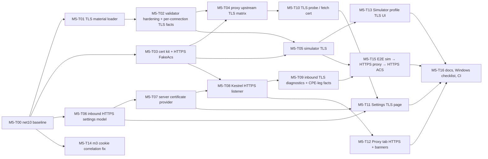

# M5 — HTTPS listener and upstream TLS modes: task breakdown

| Field | Value |
|---|---|
| Document | `docs/M5_TASKS.md` |
| Author | PlannerBot (for CoderBot → ReviewerBot / TesterBot) |
| Date | 2026-10-28 |
| Baseline | `main` @ `a769aae` ("docs: defer fix/ci-followups review nits") |
| Target framework | **net10.0** (Q1 resolved by Fariborz: move to .NET 10). Assumes CoderBot's `chore/net10` migration is merged first. |
| Scope | Inbound HTTPS listener (CPE → proxy), the four upstream TLS validation modes (proxy and simulator) verified end to end, TLS facts in the UI, the TLS settings UI, and the deferred items listed in §5. |
| Out of scope | Auth/cookie items from PLAN's old M5 (see §5 and decision D1), upstream client certificates (D5), negotiated upstream protocol/cipher capture (D6). |

> **Numbering note.** In `docs/PLAN.md` (§5, milestone table) **M5 = "Auth and cookies"** and **M6 = "HTTPS/TLS options"**.
> The inbound HTTPS listener is the stretch task **T10.7** (FR-P-17). This milestone, per Fariborz/DevOrchestrator, is PLAN's
> **M6 plus T10.7 pulled forward**. Task IDs below use the prefix `M5-` so they cannot be confused with PLAN's `T5.x`/`T6.x`.
> Requirement IDs (FR-*/NFR-*) are unchanged from PLAN.md §2.

Every file, class, and method named "current" below exists at `a769aae`. New types are marked **(new)**.

---

## 0. What a769aae already has (grounding)

| Area | Current state at a769aae | Gap for M5 |
|---|---|---|
| Upstream TLS validation | `src/AcsTool.Core/Net/Tls.cs`: `TlsValidationMode {Strict, IgnoreErrors, PinnedThumbprint, CustomCa}`, `TlsOptions`, `TlsInfo`, `TlsValidatorFactory.Create(...)`, `BuildWithCustomRoot(...)`, `LoadCertificate(path)`, `NormalizePin(...)`. All four modes are implemented. | Only `Strict` is exercised (`IMPLEMENTATION_NOTES.md` "Proxy (M2)"). There is no HTTPS integration test at all. `LoadCertificate` reads only the **first** PEM certificate and uses the obsolete `new X509Certificate2(byte[])` under `#pragma warning disable SYSLIB0057` (net10: use `X509CertificateLoader`). There is no server-auth EKU check in `BuildWithCustomRoot`. Pins are not validated (an empty or malformed pin list silently rejects every connection). |
| Handler creation | `src/AcsTool.Core/Net/UpstreamHandlerFactory.cs`: `UpstreamHandlerFactory.Create(...)` sets `SslOptions` with `CertificateRevocationCheckMode = X509RevocationMode.NoCheck` for **every** mode. `UpstreamHandlerOptions.PreloadedCustomCa` is a single `X509Certificate2`. | `TlsOptions.Protocols` is passed through, but `TlsOptions.ClientCertPfxPath`/`ClientCertPasswordProtected` are **never used**. Revocation for Strict contradicts PLAN §3.5.5/R10 (see §7). |
| CA preload (review m12) | `CpeSessionTracker.PrepareTls()` / `ReleaseTls()` load the CA once per `ProxyServer.StartAsync`. A missing file → `ProxyStartException` (tested: `ProxyServerTests` line ~95). `CreateLocked(...)` passes `PreloadedCustomCa = _customCa`. | Runtime CustomCa success/failure is untested. The simulator does **not** preload: `HttpCwmpTransport`'s constructor → `UpstreamHandlerFactory.Create` → `TlsValidatorFactory.Create` reads the CA file per transport and never disposes it. A missing file throws from `SimulatedCpe` start. |
| TLS error detail | `ErrorClassifier.Classify(..., lastTlsPolicyErrors)` maps `SecureConnectionError`/`AuthenticationException` → `Tls`. The detail comes from `ProxySession.LastTlsPolicyErrors` (proxy, via `UpstreamForwarder.ForwardAsync` → `UpstreamSender.SendAsync(..., () => session.LastTlsPolicyErrors)`) and from `HttpCwmpTransport._lastTlsErrors` (simulator). | **Stale-detail bug:** these fields are never reset per connection. A handshake that fails *before* certificate validation (protocol mismatch, plain-HTTP server on an https URL) shows the policy errors of an earlier connection. |
| TLS facts in sessions | Proxy: `CreateLocked`'s `onTls` callback → `_sink.UpdateSession(id, s => s with { Tls = tls })`. `SessionDetailViewModel.TlsText` displays it. | Simulator sessions never record `TlsInfo` (only `_lastTlsErrors`). There is no inbound (CPE-leg) TLS info at all. |
| Inbound listener | `ProxyServer.Build(IPAddress)`: `WebApplication.CreateSlimBuilder`, a single `k.Listen(ip, _settings.Port)` (plain HTTP). `ProxyRequestHandler` already builds `IncomingRequest(..., ctx.Request.IsHttps)`, and `HeaderRewriter.RewriteSetCookie(..., downstreamHttps, upstreamHttps, ...)` already honors it. | No HTTPS listener, no settings for it, no certificate loading. `ProxyViewModel.DisplayUrls(bindAddress, port)` hard-codes `http://`. `ProxyServer.BoundPort` assumes a single listener. |
| Settings | `AppSettings.cs`: `ProxySettings(..., TlsOptions? Tls = null, ...)`. JSON via `AcsToolJsonContext` (string enums). `SettingsAndUtilTests` round-trips a PinnedThumbprint pin. | No `InboundHttps` settings. `SettingsViewModel.Build()` copies `_base.Proxy` and never edits `Tls`. The Settings window has **no TLS page**. The Proxy tab has only the mode combo (`ProxyView.xaml` line 17 → `ProxyViewModel.TlsModes`/`TlsMode`), so choosing PinnedThumbprint/CustomCa in the UI cannot be completed without hand-editing `settings.json`. |
| Simulator TLS UI | `CpeProfile.Tls` (`TlsOptions`), defaulted by `DefaultProfiles` to `TlsOptions.Default`. `ProfileValidator` checks only the URL scheme. | No TLS fields in `CpeProfileEditorViewModel` or `SimulatorView.xaml`. Nothing validates TLS settings. |
| Test infrastructure | `tests/AcsTool.Testing/FakeAcs.cs`: `FakeAcs.StartAsync` → `k.Listen(IPAddress.Loopback, 0)` (HTTP only). `FakeAcs.Url()` hard-codes `http://`. `ProxyHarness.Url()` hard-codes `http://`. `ProxyHarness.CpeClient()` has no TLS options. | No certificate kit, no HTTPS FakeAcs, no HTTPS harness. |

### 0.1 Spike results (Linux, .NET 10.0.14, done in `/tmp/m5spike`, outside the repo)

These were verified before writing the tasks, so CoderBot doesn't need to rediscover them:

1. `WebApplication.CreateSlimBuilder` + `ListenOptions.UseHttps(cert)` works **without** `UseKestrelHttpsConfiguration()` (no config-based endpoints are used).
2. Client errors through `SocketsHttpHandler`:
   - Untrusted CA → `HttpRequestError.SecureConnectionError` + inner `AuthenticationException` ("rejected by the provided RemoteCertificateValidationCallback"), with policy errors `RemoteCertificateChainErrors` and chain status `PartialChain` (OpenSSL) / `UntrustedRoot` for self-signed.
   - TLS 1.3-only client vs a TLS 1.2-only server, and an https URL pointed at a plain-HTTP server, both → `SecureConnectionError` with **no** validation callback call (hence the stale-detail bug above).
3. CustomCa via `X509ChainTrustMode.CustomRootTrust`: good leaf → OK; wrong name → rejected through `RemoteCertificateNameMismatch`; expired leaf → chain `NotTimeValid` → rejected.
4. `CertificateRequest.Create(issuer, notBefore, ...)` throws if `notBefore` < the issuer's NotBefore. The test CA must be backdated further than any "expired" or "not yet valid" leaf.
5. **Inbound handshake failures can be detected**: put a connection middleware *before* `UseHttps` (outer) and one *after* it (inner). Only the inner one runs when the handshake succeeds, and it can read `ITlsHandshakeFeature` (Protocol, `NegotiatedCipherSuite`, `HostName`) while the connection is alive. Reading `ITlsHandshakeFeature` in the outer `finally` throws `ObjectDisposedException` (the `SslStream` is gone), so the inner middleware must store the facts in `ConnectionContext.Items`.

---

## 1. Ordered task breakdown

Sizes: **S** ≤ half a day, **M** ≈ 1 day, **L** ≈ 2–3 days. Every task ends with `./build.sh` green on Linux (net10, `CI=true`, 0 warnings).
Commit messages carry the task ID (`M5-T03: test certificate kit`). Work on a branch `feat/m5-tls` cut from `main` **after** the net10 merge.

### Dependency graph



Suggested order: T00 → T01 → T03 → T02 → T04 → T05 → T06 → T07 → T08 → T09 → T14 → T10 → T11 → T12 → T13 → T15 → T16.
T14 is independent and can be slotted anywhere after T00.

### Task table

| ID | Title | Size | Depends on | Requirements |
|---|---|---|---|---|
| M5-T00 | net10 baseline check and TLS API cleanup | S | net10 merge | NFR-01, NFR-12 |
| M5-T01 | TLS material loader (CA bundles, pins) and prepared-TLS object | M | T00 | FR-P-15, FR-S-14, NFR-07, NFR-08 |
| M5-T02 | Validator hardening and per-connection TLS facts | M | T01 | FR-P-08, FR-P-15, FR-P-16 |
| M5-T03 | Test certificate kit and HTTPS FakeAcs | M | T00 | NFR-09 (test infra for FR-P-15/16/17) |
| M5-T04 | Proxy upstream TLS matrix (integration) | M | T02, T03 | FR-P-08, FR-P-15, FR-P-16 |
| M5-T05 | Simulator TLS: preload, validation, TlsInfo on sessions | M | T02, T03 | FR-S-14, FR-P-16, NFR-07 |
| M5-T06 | Inbound HTTPS settings model | S | T00 | FR-P-17, NFR-11 |
| M5-T07 | Server certificate provider (PFX, cert store, generated self-signed) | L | T06 | FR-P-17, NFR-02, NFR-08 |
| M5-T08 | Kestrel HTTPS listener in `ProxyServer` | M | T03, T07 | FR-P-01, FR-P-17, FR-U-08 |
| M5-T09 | Inbound TLS diagnostics and CPE-leg TLS facts | M | T08 | FR-P-16, FR-P-17, FR-C-09 |
| M5-T10 | TLS probe ("Fetch server certificate") | S | T04 | FR-P-15, FR-P-16 |
| M5-T11 | Settings window TLS page | L | T06, T07, T10 | FR-U-07, FR-P-15, FR-P-17, NFR-08 |
| M5-T12 | Proxy tab: HTTPS URLs, TLS banners, pre-start validation | S | T08 | FR-P-01, FR-U-08 |
| M5-T13 | Simulator profile TLS UI | M | T05 | FR-S-14, FR-S-01 |
| M5-T14 | Review m3: cookie-pair correlation fix | S | T00 | FR-P-06, FR-P-13, FR-P-14 |
| M5-T15 | End-to-end HTTPS scenarios | M | T05, T09 | FR-P-15, FR-P-17, FR-S-14 |
| M5-T16 | Docs, Windows manual checklist, CI wiring | S | T11–T15 | NFR-01, NFR-13 |

Total: 17 tasks, about 13–15 working days for one implementer.

---

### M5-T00 — net10 baseline check and TLS API cleanup (S)

- **Description:** After `chore/net10` is merged, confirm the baseline is green, then remove net8-era workarounds in TLS code:
  - `TlsValidatorFactory.LoadCertificate`: replace `#pragma warning disable SYSLIB0057` + `new X509Certificate2(data)` with
    `X509CertificateLoader.LoadCertificate(data)` (DER) and `X509CertificateLoader.LoadPkcs12(...)` where a PFX is intended. (Loading a CA from a PFX is no longer accepted silently; see T01.)
  - In the validation callback, `new X509Certificate2(certificate)` becomes `certificate as X509Certificate2 ?? X509CertificateLoader.LoadCertificate(certificate.GetRawCertData())`, and the copy is disposed only when it is a copy.
  - Bump `Microsoft.AspNetCore.TestHost` / `Microsoft.Extensions.TimeProvider.Testing` to 10.x only if the migration didn't.
- **Files:** `src/AcsTool.Core/Net/Tls.cs`, `Directory.Packages.props` (if needed).
- **Acceptance:** no `SYSLIB0057` pragma left in `src/` (`git grep SYSLIB0057 -- src` is empty). Build has 0 warnings under `CI=true` with `AcsToolTfm=net10.0`. All existing tests pass (counts at least equal to the a769aae CI numbers: Core 308, Proxy 97, Simulator 65, Presentation 54).

### M5-T01 — TLS material loader and prepared-TLS object (M)

- **Description:** Centralize "load and validate TLS inputs once" for the proxy and the simulator (generalizes review m12).
  - **(new)** `src/AcsTool.Core/Net/TlsMaterial.cs`:
    ```csharp
    public sealed class PreparedTls : IDisposable {           // owns loaded certs
        public TlsOptions Options { get; }
        public X509Certificate2Collection CustomTrust { get; }   // empty unless CustomCa
        public IReadOnlySet<string> Pins { get; }                // normalized, validated
        public X509Certificate2Collection? ClientCertificates { get; }  // null in M5 (D5)
    }
    public static class TlsMaterialLoader {
        public static PreparedTls Prepare(TlsOptions options);   // throws TlsConfigurationException (new, user-facing message)
    }
    ```
  - CA file formats: PEM with **one or more** certificates (`X509Certificate2Collection.ImportFromPemFile`), DER (`X509CertificateLoader.LoadCertificateFromFile`). A PFX with a private key is rejected with "use the CA's public certificate (.cer/.pem)". The file must contain at least one certificate with `BasicConstraints.CertificateAuthority = true`, or else a single self-signed certificate (a self-signed ACS leaf used as its own anchor is allowed, with a warning in the log).
  - Pins: each entry goes through `TlsValidatorFactory.NormalizePin` and must be 64 hex characters (SHA-256). Otherwise → `TlsConfigurationException("Pin #2 is not a SHA-256 fingerprint (64 hex chars)")`. PinnedThumbprint with zero valid pins → exception.
  - Change `UpstreamHandlerOptions.PreloadedCustomCa` (single cert) to `PreparedTls? Prepared`. `UpstreamHandlerFactory.Create` and `TlsValidatorFactory.Create` take `PreparedTls`. The old file-reading fallback inside `TlsValidatorFactory.Create` (lines 35–39) is **removed**, so no file I/O can happen per handler.
  - `CpeSessionTracker.PrepareTls()` / `ReleaseTls()` keep their names but hold a `PreparedTls` (`_customCa` field → `_preparedTls`). `ProxyServer.StartAsync` maps `TlsConfigurationException` → `ProxyStartException` (same banner path as today).
- **Files:** `src/AcsTool.Core/Net/Tls.cs`, **(new)** `src/AcsTool.Core/Net/TlsMaterial.cs`, `src/AcsTool.Core/Net/UpstreamHandlerFactory.cs`, `src/AcsTool.Proxy/CpeSessionTracker.cs`, `src/AcsTool.Proxy/ProxyServer.cs`, `tests/AcsTool.Core.Tests/NetTests.cs` (or **(new)** `TlsMaterialTests.cs`), `tests/AcsTool.Proxy.Tests/ProxyServerTests.cs`.
- **Acceptance:**
  - Unit tests: a PEM bundle with root + intermediate loads 2 certs; DER loads; PFX with a key → rejected; garbage → `TlsConfigurationException` mentioning the path; leaf-only non-CA, non-self-signed → rejected; pins `"AA:BB…"` (64 hex) normalized; 63-char pin → rejected; PinnedThumbprint with `[]` → rejected; Strict/IgnoreErrors ignore the CA path and pins.
  - `ProxyServer.StartAsync` with an invalid pin fails with `ProxyStartException` and state `Faulted`, and the proxy can be restarted after the setting is fixed (mirrors `Start_CustomCaFileMissing_…`).
  - `PreparedTls.Dispose` disposes every loaded certificate (test via a disposal-tracking wrapper or by checking `Handle == IntPtr.Zero` after dispose).

### M5-T02 — Validator hardening and per-connection TLS facts (M)

- **Description:**
  1. **Stale detail fix.** Move "last TLS facts" from `ProxySession.LastTlsPolicyErrors` and `HttpCwmpTransport._lastTlsErrors` into `PhaseTracker`: add `TlsInfo? LastTls { get; }` and `MarkTlsInfo(TlsInfo)`. `PhaseTracker.BeginConnect()` (called by `ConnectCallbackFactory` for every new connection) clears it. The validation callback calls `tracker.MarkTlsInfo(info)` (and `MarkTlsDone()` when accepted, as today). `UpstreamSender.SendAsync` drops the `lastTlsPolicyErrors` parameter and passes `tracker.LastTls` to `ErrorClassifier.Classify`. Remove `ProxySession.LastTlsPolicyErrors` and the lambda in `UpstreamForwarder.ForwardAsync`.
  2. **Handshake failure without certificate.** In `ErrorClassifier.Classify`, when the kind is `Tls` and `tracker.LastTls is null`, set `TlsDetail = "handshake failed before certificate validation (protocol/cipher mismatch or the server is not speaking TLS)"`. When `LastTls` exists but was accepted, the failure is post-validation: use detail `"handshake failed after certificate accepted"`.
  3. **CustomCa EKU and policy.** In `TlsValidatorFactory.BuildWithCustomRoot`, add `ChainPolicy.ApplicationPolicy.Add(new Oid("1.3.6.1.5.5.7.3.1"))` (server auth), keep `RevocationMode = NoCheck`, use `PreparedTls.CustomTrust` (all certs) as `CustomTrustStore`, and record `chain.ChainStatus` from the custom chain (not the platform chain) in `TlsInfo.ChainStatus`, so CustomCa failures say `NotTimeValid`/`UntrustedRoot`/`NotValidForUsage` instead of the platform's `PartialChain`.
  4. **Revocation option (decision D4).** Add `bool CheckRevocation = false` to `TlsOptions`. `UpstreamHandlerFactory.Create` sets `CertificateRevocationCheckMode = Mode == Strict && CheckRevocation ? X509RevocationMode.Online : NoCheck`. Update the comment at line 47 to match.
  5. **Accepted-by-override flag** stays as is (`ok && errors != None`). Add a `TlsInfo.Mode` (TlsValidationMode) field so the UI can say "accepted by pin" / "accepted by custom CA" / "validation disabled".
- **Files:** `src/AcsTool.Core/Net/PhaseTracker.cs`, `Tls.cs`, `ErrorClassifier.cs`, `UpstreamSender.cs`, `UpstreamHandlerFactory.cs`, `src/AcsTool.Proxy/ProxySession.cs`, `UpstreamForwarder.cs`, `CpeSessionTracker.cs` (the `onTls` lambda in `CreateLocked`), `src/AcsTool.Simulator/Transport/HttpCwmpTransport.cs`, `tests/AcsTool.Core.Tests/NetTests.cs`.
- **Acceptance:**
  - Unit: `PhaseTracker.BeginConnect` clears `LastTls`. `Classify(SecureConnectionError, tracker with no LastTls)` → detail "handshake failed before certificate validation…". `Classify(..., tracker with rejected LastTls)` → `TlsDetail` = that info's `PolicyErrors` (+ chain status).
  - Unit: the CustomCa callback with a leaf lacking server-auth EKU → rejected, chain status contains `NotValidForUsage`.
  - `git grep LastTlsPolicyErrors -- src` and `git grep _lastTlsErrors -- src` are empty.
  - Integration coverage arrives in T04/T05.

### M5-T03 — Test certificate kit and HTTPS FakeAcs (M)

- **Description:**
  - **(new)** `tests/AcsTool.Testing/TestCertificates.cs`: generated once per test run (lazy static, thread-safe) with `CertificateRequest`, RSA 2048, SHA-256:
    - `RootCa` (CN=AcsTool Test Root, NotBefore = now − 400 d, NotAfter = now + 2 y, CA:true, KeyCertSign).
    - `IntermediateCa` (signed by root).
    - `Leaf` (CN=localhost; SAN DNS `localhost`, IP `127.0.0.1`, IP `::1`; EKU serverAuth; signed by the intermediate).
    - `LeafSignedByRoot`, `WrongNameLeaf` (SAN `other.test` only), `ExpiredLeaf` (now − 30 d … now − 1 d), `NotYetValidLeaf`, `SelfSignedLeaf`, `NoServerAuthEkuLeaf` (EKU clientAuth only), and `ClientCert` (for future D5 use, unused in M5).
    - **Every certificate with a private key goes through a PKCS#12 round trip** (`X509CertificateLoader.LoadPkcs12(cert.Export(Pfx, pwd), pwd)`). The spike showed ephemeral keys work on Linux, but SChannel (Windows runner) can't use an ephemeral `CertificateRequest` key as a server credential.
    - Helpers: `WritePem(dir, params certs)`, `WriteDer`, `WritePfx(dir, cert, password)`, `Sha256Pin(cert)`, and `ServerChain(leaf, intermediates)` → `SslStreamCertificateContext.Create(leaf, additionalCertificates, offline: true)` so the server sends the intermediate.
  - `FakeAcsOptions`: add `X509Certificate2? ServerCertificate`, `X509Certificate2Collection? ServerChain`, `SslProtocols ServerProtocols = None`, `bool HangDuringTls` (accepts TCP and never answers the ClientHello; implemented as a raw `TcpListener` mode).
  - `FakeAcs.StartAsync`: when a certificate is set, `k.Listen(IPAddress.Loopback, 0, lo => { lo.Protocols = HttpProtocols.Http1; lo.UseHttps(new HttpsConnectionAdapterOptions { ServerCertificateChain/ServerCertificate…, SslProtocols = … }); })`.
    `FakeAcs.Url()` uses `BaseUri.Scheme` instead of the hard-coded `http://`, and adds `UrlFor(string host, string path = "/acs")` (e.g. `localhost` vs `127.0.0.1` for name-mismatch cases).
  - `ProxyHarness.Url()` uses the scheme of the bound URL. `ProxyHarness.CpeClient(...)` gets an optional `RemoteCertificateValidationCallback`/trust root so tests can act as an HTTPS CPE.
- **Files:** **(new)** `tests/AcsTool.Testing/TestCertificates.cs`, `tests/AcsTool.Testing/FakeAcs.cs`, `tests/AcsTool.Proxy.Tests/ProxyHarness.cs`, **(new)** `tests/AcsTool.Proxy.Tests/TestCertificatesTests.cs`.
- **Acceptance:**
  - Self-tests: every kit certificate has the expected validity, SAN, EKU, issuer, and `HasPrivateKey`.
  - `FakeAcs` over HTTPS answers a plain `HttpClient` that trusts the root via `CustomTrustStore`.
  - `HangDuringTls` makes a client time out in the TLS phase.
  - Kit generation takes < 2 s and happens once per test assembly.
  - Passes on Linux and on the Windows CI runner (the PFX round trip is in place).

### M5-T04 — Proxy upstream TLS matrix (M)

- **Description:** Integration tests (CPE `HttpClient` over HTTP → `ProxyServer` → HTTPS `FakeAcs`) for every mode, plus any fixes they reveal. **(new)** `tests/AcsTool.Proxy.Tests/UpstreamTlsTests.cs`, `[Trait("Category","Tls")]`.
- **Files:** **(new)** `tests/AcsTool.Proxy.Tests/UpstreamTlsTests.cs`, fixes in `src/AcsTool.Core/Net/*` / `src/AcsTool.Proxy/*` as needed.
- **Acceptance:** see the matrix in §3.1 (cases P-01…P-20). Every case asserts:
  - the CPE status (200 for accepted; 502 for TLS failures, or 504 for a TLS-phase timeout);
  - the session `Outcome` (`Completed` / `UpstreamError`);
  - `Exchange.Error.Kind` / `Phase` / `TlsDetail`;
  - `SessionSnapshot.Tls` (subject, issuer, SHA-256, `PolicyErrors`, `AcceptedByOverride`, `Mode`).

### M5-T05 — Simulator TLS: preload, validation, TlsInfo on sessions (M)

- **Description:**
  - `HttpCwmpTransportFactory.Create(profile, secrets)` calls `TlsMaterialLoader.Prepare(profile.Tls)` **once per CPE** (D: per profile instance; fleets come in M8), passes `Prepared` to `UpstreamHandlerOptions`, and `HttpCwmpTransport.DisposeAsync` disposes it. A `TlsConfigurationException` surfaces as a `SimulatedCpe` `Error` state with the message (no crash, no unobserved task exception).
  - `ProfileValidator`: when `AcsUrl` is https and `Tls.Mode` is CustomCa, the CA path must exist. When PinnedThumbprint, the pins must be valid (reuse T01's pin validation). When `AcsUrl` is http and the mode is non-Strict, warn "TLS settings are ignored for http:// URLs" (warning, not an error).
  - TlsInfo on simulator sessions: `ICwmpTransport` gains `TlsInfo? LastTls { get; }` (from the transport's `PhaseTracker`). In `CwmpClientSession.RunAsync`, after each exchange whose request went to https, when `LastTls` changed: `_ctx.Sink.UpdateSession(_sid, s => s with { Tls = tls })`.
  - Simulator connect timeout: `HttpCwmpTransport` hard-codes `Math.Min(10, …RequestTimeoutSeconds)` for the connect timeout. Keep it, but document it in the profile editor tooltip (no new setting).
- **Files:** `src/AcsTool.Simulator/Transport/HttpCwmpTransport.cs`, `src/AcsTool.Simulator/Profiles/ProfileValidator.cs`, `src/AcsTool.Simulator/Session/CwmpClientSession.cs`, `src/AcsTool.Simulator/Engine/SimulatedCpe.cs`, `tests/AcsTool.Simulator.Tests/TransportAndEngineTests.cs` (+ **(new)** `SimulatorTlsTests.cs`), `tests/AcsTool.Simulator.Tests/ProfileTests.cs`.
- **Acceptance:** see §3.2 (cases S-01…S-08). A CA file is read once per CPE start, not per session (test: delete the file after start; the next "Send Inform now" still succeeds). A missing CA file → `CpeStateKind.Error` with the message, and the engine stays usable.

### M5-T06 — Inbound HTTPS settings model (S)

- **Description:** **(new)** records in `src/AcsTool.Core/Settings/AppSettings.cs`:
  ```csharp
  public enum ServerCertificateSource { GeneratedSelfSigned, PfxFile, CertificateStore }
  public sealed record InboundHttpsSettings(bool Enabled = false, int Port = 7443,
      ServerCertificateSource Source = ServerCertificateSource.GeneratedSelfSigned,
      string? PfxPath = null, string? PfxPasswordProtected = null,
      StoreLocation StoreLocation = StoreLocation.CurrentUser, string StoreName = "My", string? StoreThumbprint = null,
      SslProtocols Protocols = SslProtocols.None, int HandshakeTimeoutSeconds = 10);
  ```
  `ProxySettings` gains `InboundHttpsSettings? InboundHttps = null`. `AppSettings.Normalize()` does not need to touch it (null = disabled). The HTTP listener (`Port`, default 7547) always stays on, so both run side by side (decision D2). Validation: `Port` ≠ `ProxySettings.Port`; 1–65535.
- **Files:** `src/AcsTool.Core/Settings/AppSettings.cs`, `tests/AcsTool.Core.Tests/SettingsAndUtilTests.cs`.
- **Acceptance:** JSON round trip, including enums as strings and the protected password. An a769aae-era `settings.json` (no `inboundHttps`) loads with HTTPS disabled. `SchemaVersion` stays 1 (additive change).

### M5-T07 — Server certificate provider (L)

- **Description:** **(new)** `src/AcsTool.Proxy/ServerCertificates.cs`:
  ```csharp
  public sealed record ServerCertificateResult(X509Certificate2 Certificate, SslStreamCertificateContext Context,
      IReadOnlyList<string> Warnings);   // owns Certificate; dispose on stop
  public interface IServerCertificateProvider {
      ServerCertificateResult Load(InboundHttpsSettings s);            // throws ProxyStartException (user-facing)
      string GenerateSelfSigned(IReadOnlyList<string> extraSans);      // writes PFX, returns path
      IReadOnlyList<CertificateSummary> ListStore(StoreLocation l, string storeName);   // for the Settings picker (T11)
  }
  public sealed class ServerCertificateProvider(IAppPaths paths, ISecretProtector secrets, TimeProvider time,
      ILogger<ServerCertificateProvider> log) : IServerCertificateProvider
  ```
  - **PfxFile:** `X509CertificateLoader.LoadPkcs12FromFile(path, secrets.Unprotect(PfxPasswordProtected), X509KeyStorageFlags.UserKeySet)` (UserKeySet: no admin, NFR-02). Pick the first cert with a private key. The others become chain extras.
  - **CertificateStore:** `X509Store(StoreName, StoreLocation)` opened `ReadOnly | OpenExistingOnly`, `Find(FindByThumbprint, thumbprint, validOnly: false)`. It must have `HasPrivateKey` **and** the key must be usable: a test signing operation via `GetRSAPrivateKey()/GetECDsaPrivateKey()` turns "no access to the private key" (typical for LocalMachine without admin) into a clear message.
  - **GeneratedSelfSigned:** if `%APPDATA%\AcsTool\certs\proxy-selfsigned.pfx` (`IAppPaths.ConfigDir`/certs) exists and is valid for > 30 days, reuse it. Otherwise generate: RSA 2048, CN=AcsTool Proxy, SAN = `localhost`, the machine name, every local IPv4 (the same enumeration as `ProxyViewModel.DisplayUrls`), and `127.0.0.1`; EKU serverAuth; 2-year validity. The password is random and stored protected in `settings.json` (`PfxPasswordProtected`). A stable cert matters because modems may pin it.
  - Warnings (not errors): expires in < 30 days; no serverAuth EKU; SAN contains no local IP or hostname (modem will see a name mismatch); certificate is self-signed.
  - `SslStreamCertificateContext.Create(cert, additional, offline: true)` so intermediates from the PFX are sent.
  - Export: `ExportPublicCertificate(path)` writes the `.cer` (DER) so the user can upload it to a modem's trust store (UI button in T11).
- **Files:** **(new)** `src/AcsTool.Proxy/ServerCertificates.cs`, `src/AcsTool.Proxy/ServiceCollectionExtensions.cs` (register; `ProxyServerFactory` gets `IServerCertificateProvider`), **(new)** `tests/AcsTool.Proxy.Tests/ServerCertificateTests.cs`.
- **Acceptance:** see §3.3 (cases L-01…L-10). Store tests on Linux use the real `CurrentUser\My` .NET store (`~/.dotnet/corefx/cryptography/x509stores/my`) with a unique subject and **always** remove the cert in `finally`, marked `[Trait("Category","CertStore")]`.

### M5-T08 — Kestrel HTTPS listener in `ProxyServer` (M)

- **Description:**
  - `ProxyServer.Build(IPAddress ip)`: keep `k.Listen(ip, _settings.Port)` for HTTP. When `InboundHttps.Enabled`, add
    `k.Listen(ip, https.Port, lo => { lo.Protocols = HttpProtocols.Http1; /* T09 outer middleware */ lo.UseHttps(new HttpsConnectionAdapterOptions { ServerCertificateChain/Context from T07, SslProtocols = https.Protocols, ClientCertificateMode = ClientCertificateMode.NoCertificate, HandshakeTimeout = … }); /* T09 inner middleware */ })`.
    HTTP/1.1 only (decision D7): CPEs speak HTTP/1.1, and ALPN-negotiated h2 from tools like curl would hide CWMP-relevant framing.
  - `ProxyServer.StartAsync`: load the server certificate before `Build` (inside the existing try, so failures reuse the cleanup path and `ProxyStartException`). Dispose it on stop next to `_tracker.ReleaseTls()`.
  - Bind errors: `MapBindFailure` stays. The `ProxyBindException` must name the port that failed (today it always reports `_settings.Port`). Add `ProxyBindException.Port` = the failing listener's port by binding listeners in order and catching per port, or by inspecting the `IOException` message for the endpoint. Decision: bind HTTP first and HTTPS second, and record which `Listen` threw via the `AddressInUseException` endpoint text.
  - `BoundPort` keeps meaning the HTTP port. Add `BoundHttpsPort` (0 when disabled). `BoundUrls` lists both with their schemes.
  - Logging event 1011 lists both URLs. New event 1015: "HTTPS listener using certificate {Subject} ({Sha256}), expires {NotAfter}" and each warning from T07.
- **Files:** `src/AcsTool.Proxy/ProxyServer.cs`, `src/AcsTool.Proxy/Model.cs` (`ProxyBindException` port), `src/AcsTool.Proxy/ServiceCollectionExtensions.cs` (`ProxyServerFactory.Create` passes the provider), `tests/AcsTool.Proxy.Tests/ProxyServerTests.cs`, **(new)** `tests/AcsTool.Proxy.Tests/InboundHttpsTests.cs`.
- **Acceptance:** cases H-01…H-10 in §3.4. Stop/start 10× with HTTPS enabled without leaks (certificate disposed; `ProxyServer.BoundUrls` empty after stop).

### M5-T09 — Inbound TLS diagnostics and CPE-leg TLS facts (M)

- **Description:** Make "the modem can't even complete TLS with the proxy" visible. Without this, the feed stays empty and that looks like a network problem.
  - Connection middleware pair around `UseHttps` (proven in spike §0.1 item 5):
    - **Inner** (after `UseHttps`): reads `ITlsHandshakeFeature` (`Protocol`, `NegotiatedCipherSuite`, `HostName`) and stores **(new)** `ClientTlsInfo(Protocol, CipherSuite, Sni)` in `ConnectionContext.Items["acstool.tls"]`.
    - **Outer** (before `UseHttps`): peeks the first byte of `ctx.Transport.Input` without consuming it (`ReadAsync` + `AdvanceTo(buffer.Start)`). `0x16` = TLS record; an ASCII letter = plain HTTP sent to the HTTPS port. In `finally`, if `Items` holds no `acstool.tls`, it records a failed handshake.
  - Failed handshakes become a one-shot orphan session via `CpeSessionTracker.CreateOrphan(req, label)` (it already exists; give it a synthetic `IncomingRequest` with `Method = "TLS"`), with label `Inbound TLS handshake failed from {ip}` and notes: `plain HTTP sent to the HTTPS port` / `client closed during handshake (it likely rejected the proxy certificate or has no common protocol/cipher)` / `handshake timed out`. Rate-limit to 1 row per client IP per 10 s (+ a counter note) so a retrying modem doesn't flood the feed.
  - Successful HTTPS requests: `ProxyRequestHandler` reads `ClientTlsInfo` from `ctx.Features.Get<IConnectionItemsFeature>()` and passes it to `SessionStart`. **(new)** `SessionSnapshot.ClientTls` (`ClientTlsInfo?`) in `src/AcsTool.Core/Sessions/SessionModel.cs` and `SessionStart`. The detail pane shows "CPE leg: TLS 1.2, TLS_ECDHE_RSA_WITH_AES_256_GCM_SHA384, SNI acs.lab".
  - `ClientEndpoint` keeps its format. The feed row shows a lock glyph when `ClientTls` is not null (Presentation `SessionItemViewModel` gains `IsClientTls`).
- **Files:** `src/AcsTool.Proxy/ProxyServer.cs`, **(new)** `src/AcsTool.Proxy/InboundTlsMiddleware.cs`, `src/AcsTool.Proxy/ProxyRequestHandler.cs`, `src/AcsTool.Proxy/CpeSessionTracker.cs` (`CreateOrphan` usage, rate limit), `src/AcsTool.Core/Sessions/SessionModel.cs`, `src/AcsTool.Presentation/Detail/SessionDetailViewModel.cs`, `src/AcsTool.Presentation/Feed/SessionItemViewModel.cs`, `src/AcsTool.App/Views/SessionDetailView.xaml`, `SessionFeedView.xaml`, tests in `InboundHttpsTests.cs`, `tests/AcsTool.Presentation.Tests/DetailTests.cs`.
- **Acceptance:** cases H-11…H-16 in §3.4. Presentation test: `TlsText`/a new `ClientTlsText` shows both legs.

### M5-T10 — TLS probe "Fetch server certificate" (S)

- **Description:** **(new)** `src/AcsTool.Core/Net/TlsProbe.cs`: `Task<TlsProbeResult> ProbeAsync(Uri httpsUrl, TimeSpan timeout, CancellationToken ct)`. It opens a TCP connection plus a client `SslStream` with SNI = host and accepts any certificate (it only *reads*). It returns the leaf and chain (subject, issuer, SHA-256, validity, SANs), the negotiated protocol and cipher, and the platform `SslPolicyErrors` and chain status, i.e. what Strict would conclude. The probe classifies failures with `ErrorClassifier` (it reuses `ConnectCallbackFactory`'s DNS/connect logic). Used by T11 ("Pin this certificate", "Use issuer as custom CA" → saves the issuer/root PEM to `ConfigDir/certs/`) and by the Proxy tab as a "Test upstream" action (T12).
- **Files:** **(new)** `src/AcsTool.Core/Net/TlsProbe.cs`, tests in `tests/AcsTool.Core.Tests` (against an HTTPS FakeAcs; Core.Tests already references Testing).
- **Acceptance:** P-21…P-23 in §3.1. Never sends HTTP. The result's SHA-256 equals `TestCertificates.Sha256Pin(Leaf)`. Probing an http-only port → `Tls` error with the "before certificate validation" detail.

### M5-T11 — Settings window TLS page (L)

- **Description:**
  - `SettingsViewModel` (`src/AcsTool.Presentation/Settings/SettingsViewModel.cs`): new properties for upstream TLS:
    - `TlsMode`, `PinsText` (multi-line; normalized on save), `CustomCaPath`, `CheckRevocation`;
    - `AllowTls12`/`AllowTls13` → `SslProtocols` (both on = `None` = OS default).
    
    And for inbound HTTPS:
    - `InboundHttpsEnabled`, `InboundHttpsPort`, `CertificateSource`, `PfxPath`, `PfxPassword` (write-only, protected via `ISecretProtector` on save; same "keep ciphertext unless retyped" rule as review m8/m9), `StoreLocation`, `StoreThumbprint`.

    `Build()` writes `Tls` and `InboundHttps` (today it carries `_base.Proxy.Tls` through untouched). `LoadFrom` reads them. `RestoreDefaults` resets them. Validation uses `[CustomValidation]`: pins via T01's validator; CA path exists when CustomCa; PFX path exists when PfxFile; thumbprint present when CertificateStore; port ≠ HTTP port.
  - Commands: `BrowseCaCommand` / `BrowsePfxCommand` (`IFileDialogService`); `FetchUpstreamCertificateCommand` (T10; shows the result; "Pin it" appends to `PinsText`; "Trust issuer" writes the PEM and sets `CustomCaPath` + mode CustomCa); `GenerateSelfSignedCommand` (T07); `ExportProxyCertificateCommand` (.cer for the modem); `PickStoreCertificateCommand` (lists `IServerCertificateProvider.ListStore`: subject, thumbprint, expiry, has-key; Windows-useful, works on Linux too).
  - `SettingsWindow.xaml`: a new "TLS" tab (ScrollViewer-hosted, per the existing `XamlLayoutTests` rules) with two group boxes, "Upstream ACS (proxy → ACS)" and "CPE side (modem → proxy)". The PFX password uses `PasswordBox` + `PasswordBoxAssistant` (`Attach="True"`). The "IgnoreErrors" option shows the red "validation disabled" hint inline.
- **Files:** `src/AcsTool.Presentation/Settings/SettingsViewModel.cs`, `src/AcsTool.Presentation/Abstractions/Abstractions.cs` (if `IFileDialogService` needs an open-file filter overload), `src/AcsTool.App/Views/SettingsWindow.xaml(.cs)`, `src/AcsTool.App/Services/PlatformServices.cs` (file dialog filters), `tests/AcsTool.Presentation.Tests/ViewModelTests.cs`, `XamlLayoutTests.cs`.
- **Acceptance:** cases U-01…U-08 in §3.5. Windows manual items W-04, W-05.

### M5-T12 — Proxy tab: HTTPS URLs, TLS banners, pre-start validation (S)

- **Description:**
  - `ProxyViewModel.DisplayUrls(bindAddress, port)` becomes `DisplayUrls(bindAddress, httpPort, httpsPort?)`, which returns `http://…:7547` and `https://…:7443` lines per local IP.
  - Before Start: if TlsMode is PinnedThumbprint with no pins, or CustomCa with no path, show an inline validation error ("Configure pins / CA in Settings → TLS"), and disable Start, instead of failing at runtime.
  - Banners: keep `TlsChipKey` for IgnoreErrors. Add a warning banner when the inbound certificate has T07 warnings (e.g. "Proxy certificate has no SAN for 192.168.1.10 — modems validating the name will reject it"). Add "Test upstream" (T10 probe) next to the upstream URL. It shows "TLS OK (Strict)" or the probe error.
  - A HTTPS-enabled indicator (lock + port) in the top bar. The full settings live in the Settings window.
- **Files:** `src/AcsTool.Presentation/Proxy/ProxyViewModel.cs`, `src/AcsTool.App/Views/ProxyView.xaml`, `tests/AcsTool.Presentation.Tests/ViewModelTests.cs`.
- **Acceptance:** U-09…U-12 in §3.5.

### M5-T13 — Simulator profile TLS UI (M)

- **Description:** `CpeProfileEditorViewModel`: `TlsMode`, `PinsText`, `CustomCaPath`, `CheckRevocation`, enabled only when `AcsUrl` is https. They map to `CpeProfile.Tls`. `SimulatorView.xaml`: a compact "TLS" row in the ACS group box (mode combo + "Advanced…" expander with pins/CA/browse). Reuses T01 validation through `ProfileValidator` (T05). The Running CPEs row shows the TLS error short text (`UpstreamError.ShortText`, e.g. `TLS RemoteCertificateNameMismatch`).
- **Files:** `src/AcsTool.Presentation/Simulator/CpeProfileEditorViewModel.cs`, `SimulatorViewModel.cs`, `src/AcsTool.App/Views/SimulatorView.xaml`, `tests/AcsTool.Presentation.Tests/ViewModelTests.cs`, `XamlLayoutTests.cs` (the Simulator MinHeight budget from R-m1/NEW-01 must still hold).
- **Acceptance:** U-13…U-15 in §3.5. The `SimulatorTab_MinimumsFitDefaultWindow_NoNestedScrollbarAtDefaultSize` lint still passes.

### M5-T14 — Review m3: cookie-pair correlation fix (S)

- **Description:** Implements the fix proposed in `docs/REVIEW_M0-M4.md` m3. `CpeSessionTracker._byCookie` becomes `Dictionary<string, HashSet<ProxySession>>`. `ObserveResponse` adds the session to the pair's set. `FindExisting` accepts a cookie match only if the set has **exactly one** active session, **or** exactly one candidate whose `ClientIp` equals `req.RemoteIp`. Otherwise it falls through to the IP fallback and adds the note "ambiguous cookie correlation ignored ({pair})". Unindexing (around line 395, which removes `_byCookie` entries when a session ends) removes only this session from each set.
- **Why in M5:** with HTTPS ACSes behind load balancers (`SERVERID=`, `AWSALB=`), shared affinity cookies become common, and a wrong match forwards one CPE's request over **another session's upstream TLS connection** (D6 broken, TlsInfo misattributed).
- **Files:** `src/AcsTool.Proxy/CpeSessionTracker.cs`, `tests/AcsTool.Proxy.Tests/TrackerTests.cs`.
- **Acceptance:** two CPEs from different IPs that both receive `SERVERID=node1`; CPE A reconnects mid-session (new connection id) → it resolves to A's session (by IP fallback), never B's. A unique cookie still correlates across a reconnect from a *different* IP (e.g. CPE behind a NAT that changes source address). A session end removes only its own entry.

### M5-T15 — End-to-end HTTPS scenarios (M)

- **Description:** Full-stack tests in **(new)** `tests/AcsTool.Simulator.Tests/HttpsEndToEndTests.cs` (Simulator.Tests already references Proxy and Testing):
  - SimulatedCpe (https, CustomCa = the proxy's generated self-signed cert) → ProxyServer (HTTPS inbound, upstream CustomCa = test root) → FakeAcs (HTTPS, leaf + intermediate chain). A full session ends `Completed` in **both** stores' records, with `ClientTls` on the proxy session and `Tls` on both.
  - The same chain with a Digest-protected FakeAcs: the Digest `uri` survives an HTTPS → HTTPS hop (FR-P-11 regression).
  - The same chain with an upstream pin mismatch: the simulator sees 502, its session ends `HttpError`, the proxy session ends `UpstreamError/Tls`, and the detail names the mismatched SHA-256.
- **Files:** **(new)** `tests/AcsTool.Simulator.Tests/HttpsEndToEndTests.cs`.
- **Acceptance:** the 3 scenarios pass on Linux and on the Windows runner. Runtime < 10 s total.

### M5-T16 — Docs, Windows checklist, CI (S)

- **Description:**
  - `docs/IMPLEMENTATION_NOTES.md`: an M5 section (status, deviations, deferred items).
  - `README.md`: an "HTTPS" section: generating or exporting the proxy cert; installing the CA/cert on a modem; pointing `ManagementServer.URL` at `https://<pc>:7443/acs`; choosing an upstream mode; Windows Firewall prompt for the second port.
  - Append the §3.7 manual checklist to the notes.
  - CI: no new job. The `Category=Tls` and `CertStore` tests run on both runners by default (they are not Perf). Add a CI guard step that fails if `ACSTOOL_SKIP_TLS` (the escape hatch in §3.6) is set, mirroring the existing `ACSTOOL_SKIP_NET_TIMEOUT` guard in `.github/workflows/ci.yml`, `build.sh`, and `build.ps1`.
- **Files:** `docs/IMPLEMENTATION_NOTES.md`, `README.md`, `.github/workflows/ci.yml`, `build.sh`, `build.ps1`.
- **Acceptance:** the docs are reviewed by ReviewerBot. Both CI jobs are green. Coverage of `src/AcsTool.Core/Net` and `src/AcsTool.Proxy` is ≥ 85% lines (Core/Proxy overall stay ≥ 80%, per NFR-09).

---

## 2. Acceptance criteria

Per-task criteria are listed under each task in §1. The case IDs (P-, S-, L-, H-, U-) are specified in §3.

### 2.1 Milestone exit criteria (all must hold)

1. **Build:** `./build.sh` on the Linux box and `./build.ps1 -NoCoverage` on the Windows CI runner are green with `AcsToolTfm=net10.0`, `CI=true`, and **0 warnings**. `--smoke-exit` still exits 0.
2. **Upstream TLS matrix:** all §3.1 cases (P-01…P-23) pass on **both** Linux (OpenSSL) and Windows (SChannel) CI runners. The only allowed platform skips are the ones listed in §3.6 with a reason.
3. **Simulator TLS:** §3.2 (S-01…S-08) passes. No per-session file I/O for TLS material.
4. **Inbound HTTPS:** §3.3 and §3.4 (L-01…L-10, H-01…H-16) pass. A CPE can reach the proxy over HTTPS with each certificate source. Failed inbound handshakes appear in the feed.
5. **E2E:** the 3 T15 scenarios pass on both runners.
6. **UI:** §3.5 VM tests (U-01…U-15) pass. Every TLS setting in `TlsOptions` and `InboundHttpsSettings` is editable in the UI except `ClientCertPfxPath`/`ClientCertPasswordProtected` (D5). No setting requires hand-editing `settings.json`.
7. **Robustness:** no TLS misconfiguration crashes the process or leaves the proxy in `Starting`. Every one ends in `ProxyStartException` + banner + `Faulted` (restartable) or a CPE `Error` state.
8. **Secrets:** the PFX password is stored only as `ISecretProtector` output and never appears in logs, exports, or `ToString()` of settings records (test: serialize settings and grep for the plaintext).
9. **Regression:** all pre-M5 tests still pass. Test counts only go up.
10. **Coverage:** `Core/Net`, `Proxy` ≥ 85% line coverage. Core/Proxy/Simulator/Presentation overall ≥ 80% (NFR-09).
11. **Manual Windows checklist (§3.7)** is executed by Fariborz (or on a Windows host) and the results are recorded in `IMPLEMENTATION_NOTES.md`. As with M4's T4.6, the milestone can be merged with the checklist marked "pending" if Fariborz agrees (decision D9). Items W-01…W-03 (cert store, real modem) are the ones that matter most.
12. **Docs:** `IMPLEMENTATION_NOTES.md` M5 section and `README.md` HTTPS section are written. PLAN.md's milestone table renumbering is noted (D1).

---

## 3. Test plan

### General rules (TesterBot)

- All automated tests run on Linux under `dotnet test` and on the Windows runner. Loopback only (`127.0.0.1`/`localhost`, ephemeral ports). No external hosts, no internet.
- Certificates come from `TestCertificates` (T03), generated in-process at test start, round-tripped through PKCS#12, and never committed to the repo. Files written for path-based tests go to a per-test temp dir (`TempAppPaths` / `Path.GetTempPath()` + GUID), deleted in `Dispose`.
- New test classes carry `[Trait("Category","Tls")]`. Cert-store tests also carry `[Trait("Category","CertStore")]`.
- Time-sensitive cases (expired / not-yet-valid) use certificates with validity windows far from "now" (days, not seconds), so no clock mocking is needed. `TimeProvider` is not consulted by `X509Chain`.
- Each upstream case asserts **four things**: what the CPE got (status), the proxy session outcome, `Exchange.Error` (Kind, Phase, TlsDetail), and `SessionSnapshot.Tls`.

### 3.1 Upstream TLS: proxy → HTTPS FakeAcs (`UpstreamTlsTests`, T04/T10)

Default URL host is `localhost` unless noted. "Root" = `TestCertificates.RootCa`. Server chain = leaf + intermediate unless noted.

| Case | Mode | Server cert / setup | Expected |
|---|---|---|---|
| P-01 | Strict | Leaf (test root not trusted by OS) | 502; `Tls`, phase `Tls`; TlsDetail contains `RemoteCertificateChainErrors`; `Tls.AcceptedByOverride=false` |
| P-02 | Strict | — (positive) | Not automatable without adding the test root to the machine trust store, **which tests must not do**. Covered by W-06 (manual) and by P-03/P-09 through the same callback code path |
| P-03 | IgnoreErrors | ExpiredLeaf | 200; session `Completed`; `Tls.AcceptedByOverride=true`; `PolicyErrors` contains `RemoteCertificateChainErrors` |
| P-04 | IgnoreErrors | WrongNameLeaf via `localhost` | 200; `AcceptedByOverride=true`; PolicyErrors contains `RemoteCertificateNameMismatch` |
| P-05 | IgnoreErrors | SelfSignedLeaf | 200; ChainStatus contains `UntrustedRoot` (both platforms; assert on the flag, not on the status text) |
| P-06 | PinnedThumbprint | Leaf; pin = SHA-256(Leaf) formatted `AA:BB:…` | 200; `Mode=PinnedThumbprint`; AcceptedByOverride=true (chain errors existed) |
| P-07 | PinnedThumbprint | Leaf; pin = SHA-256(WrongNameLeaf) | 502; `Tls`; detail names the presented SHA-256 |
| P-08 | PinnedThumbprint | WrongNameLeaf; pin = its SHA-256 | 200 (pinning ignores name and chain, PLAN §3.5.5) |
| P-09 | CustomCa | Leaf + intermediate; CA file = Root (PEM) | 200; ChainStatus empty for the custom chain |
| P-10 | CustomCa | LeafSignedByRoot; CA file = Root (DER) | 200 |
| P-11 | CustomCa | Leaf **without** the intermediate in the server chain; CA file = Root + Intermediate (PEM bundle) | 200 (bundle loading, T01) |
| P-12 | CustomCa | Leaf without the intermediate; CA file = Root only | 502; `Tls`; ChainStatus contains `PartialChain`. **Platform note:** Windows may fetch AIA (no AIA URL in test certs, so it fails on both) |
| P-13 | CustomCa | WrongNameLeaf | 502; PolicyErrors `RemoteCertificateNameMismatch` |
| P-14 | CustomCa | ExpiredLeaf | 502; ChainStatus `NotTimeValid` |
| P-15 | CustomCa | NotYetValidLeaf | 502; ChainStatus `NotTimeValid` |
| P-16 | CustomCa | NoServerAuthEkuLeaf | 502; ChainStatus `NotValidForUsage` (T02 EKU policy) |
| P-17 | CustomCa | SelfSignedLeaf; CA file = that leaf | 200 (self-signed anchor allowed, T01) |
| P-18 | any | Server TLS 1.2 only; client `Protocols = Tls13` | 502; `Tls`; TlsDetail "handshake failed before certificate validation…"; **not** stale from a previous connection (run P-03 first on the same session handler, then switch FakeAcs) |
| P-19 | any | https URL pointed at a plain-HTTP FakeAcs | 502; `Tls`; "before certificate validation" detail |
| P-20 | any | `HangDuringTls` server; RequestTimeout 2 s | 504; `Timeout`, phase `Tls` |
| P-21 | TlsProbe | Leaf + intermediate | Result SHA-256 = pin of Leaf; chain has 2+ elements; protocol and cipher not empty |
| P-22 | TlsProbe | plain-HTTP port | `Tls` error, "before certificate validation" |
| P-23 | TlsProbe | closed port | `Connect/ConnectionRefused` |

Also: **P-24**, connection reuse. Within one proxy session, a second exchange reuses the upstream TLS connection (`PhaseTracker` shows no new `BeginConnect`, and `Tls` is unchanged). **P-25**, Strict with `CheckRevocation=true` on a cert without CRL/OCSP URLs: on Linux the result is `RevocationStatusUnknown` → rejected. Document the result and assert only that it is a classified `Tls` error and not a hang (< 5 s).

### 3.2 Simulator TLS (`SimulatorTlsTests`, T05)

| Case | Setup | Expected |
|---|---|---|
| S-01 | Profile https, CustomCa = Root, FakeAcs Leaf chain | Session `Completed`; simulator `SessionSnapshot.Tls` set (T05) |
| S-02 | Profile https, Strict, FakeAcs Leaf | `CpeStateKind.Error`, `LastError` short text `TLS RemoteCertificateChainErrors`; session `UpstreamError` |
| S-03 | PinnedThumbprint correct / wrong | Completed / UpstreamError(Tls) |
| S-04 | IgnoreErrors + ExpiredLeaf | Completed; `AcceptedByOverride` |
| S-05 | CustomCa path missing at start | `ProfileValidator` error; if forced past validation, `SimulatedCpe` → Error with the message; the engine still runs other CPEs |
| S-06 | CA file deleted after the CPE started | Next "Send Inform now" still succeeds (loaded once) |
| S-07 | http:// ACS URL with Mode = CustomCa | Validator warning only; session runs over HTTP |
| S-08 | Basic auth + HTTPS FakeAcs | Completed; credentials never sent over a failed TLS connection (FakeAcs records no request in S-02) |

### 3.3 Server certificate provider (`ServerCertificateTests`, T07)

| Case | Setup | Expected |
|---|---|---|
| L-01 | PfxFile with the correct password (protected via `PlainSecretProtector`) | Loads; `HasPrivateKey`; context includes the intermediate from the PFX |
| L-02 | PfxFile, wrong password | `ProxyStartException` "password is wrong or the file is not a PFX" |
| L-03 | PfxFile, path missing | `ProxyStartException` naming the path |
| L-04 | PfxFile containing only a public cert | `ProxyStartException` "no private key" |
| L-05 | CertificateStore `CurrentUser\My`, thumbprint of a test cert added by the test | Loads (Linux .NET store; cleaned up in `finally`) |
| L-06 | CertificateStore, unknown thumbprint | `ProxyStartException` "not found in CurrentUser\My" |
| L-07 | CertificateStore, cert without a private key | `ProxyStartException` "no private key / no access" |
| L-08 | GeneratedSelfSigned, first start | PFX written under `TempAppPaths.ConfigDir/certs`; SAN includes `localhost`, `127.0.0.1`, and the machine name; protected password stored; second call reuses the same thumbprint |
| L-09 | GeneratedSelfSigned, existing cert expiring in < 30 days | Regenerated, with a log warning |
| L-10 | Warnings | ExpiredLeaf → error; NoServerAuthEkuLeaf → warning; cert without a local SAN → warning |

### 3.4 Inbound HTTPS listener (`InboundHttpsTests`, T08/T09)

| Case | Setup | Expected |
|---|---|---|
| H-01 | HTTPS enabled (PFX = Leaf), CPE client trusts Root | Full CWMP session over HTTPS → `Completed`; `IncomingRequest.IsHttps=true` |
| H-02 | HTTP and HTTPS side by side | Both ports accept; sessions on each are independent |
| H-03 | `BoundUrls` | Contains `http://127.0.0.1:{p}` and `https://127.0.0.1:{q}`; `BoundHttpsPort=q` |
| H-04 | HTTPS port already in use | `ProxyBindException(PortInUse)` whose `Port` is the **HTTPS** port; state `Faulted`; restartable |
| H-05 | HTTPS port == HTTP port | Validation error before binding |
| H-06 | Cert load fails (L-02) | `ProxyStartException`; HTTP listener not left bound (no partial start) |
| H-07 | Stop/start ×10 with HTTPS | No leaks; certificate disposed; ports reusable |
| H-08 | HTTP/2 attempt (client `Version20`, `RequestVersionOrHigher`) | Negotiates HTTP/1.1 (Protocols = Http1) |
| H-09 | Downstream HTTPS + upstream HTTPS | `Set-Cookie; Secure` is **kept** (`HeaderRewriter.RewriteSetCookie` with `downstreamHttps=true`); no "Secure stripped" note |
| H-10 | Downstream HTTPS + upstream HTTP | Secure attribute untouched (none present); Digest uri pass-through unchanged |
| H-11 | Client TLS 1.3-only vs server Protocols=Tls12 | Orphan row "Inbound TLS handshake failed" with the "client closed during handshake" note |
| H-12 | Plain HTTP POST to the HTTPS port | Orphan row with the note "plain HTTP sent to the HTTPS port" |
| H-13 | Client connects and sends nothing; HandshakeTimeout 1 s | Orphan row with the note "handshake timed out" |
| H-14 | 20 failing handshakes from one IP in 2 s | ≤ 1 row per 10 s per IP; the counter note shows 20 |
| H-15 | Successful HTTPS session | `SessionSnapshot.ClientTls` has Protocol `Tls12`/`Tls13`, a cipher suite, and SNI `localhost` when the client sends it |
| H-16 | Client rejects the proxy cert (no trust) | Orphan row; the CPE side gets `SecureConnectionError` (confirms that the "modem rejected our cert" path is visible) |

### 3.5 Presentation / UI logic (`ViewModelTests`, `XamlLayoutTests`, T11–T13)

| Case | Expected |
|---|---|
| U-01 | `SettingsViewModel` round trip of every TLS and InboundHttps field through `Build()` → `SaveAsync()` → `LoadFrom()` |
| U-02 | Invalid pin → `HasErrors`, Save returns false; valid pins normalized to lowercase hex on save |
| U-03 | CustomCa without a path / PfxFile without a path / CertificateStore without a thumbprint → errors |
| U-04 | PFX password: typed → saved protected; reopened → empty box, ciphertext kept unless retyped (m8/m9 semantics) |
| U-05 | FetchUpstreamCertificate (fake probe) → "Pin it" appends the pin; "Trust issuer" writes PEM to `ConfigDir/certs` and sets mode CustomCa |
| U-06 | GenerateSelfSigned → `CertificateSource=GeneratedSelfSigned`, the thumbprint is shown, export writes a `.cer` |
| U-07 | RestoreDefaults resets TLS + InboundHttps (HTTPS disabled, Strict) |
| U-08 | `XamlLayoutTests`: the new TLS tab content is a ScrollViewer; the PFX `PasswordBox` has `PasswordBoxAssistant.Attach="True"` |
| U-09 | `ProxyViewModel.DisplayUrls` lists http and https URLs per local IP |
| U-10 | PinnedThumbprint with no pins → Start disabled with a message |
| U-11 | Inbound cert warnings → warning banner; cleared on Stop |
| U-12 | "Test upstream" success/failure text from a fake probe |
| U-13 | Profile editor TLS fields map to `CpeProfile.Tls`; disabled for an http:// ACS URL |
| U-14 | Profile validation errors from T05 surface on the editor |
| U-15 | `SimulatorTab_MinimumsFitDefaultWindow_NoNestedScrollbarAtDefaultSize` still passes |

### 3.6 Platform skips and escape hatches

- Every TLS test must run on both runners. Allowed conditional skips (via `Xunit.SkippableFact`, already a dependency):
  - Any case needing **TLS 1.3 on Windows**, when `SslStream` reports TLS 1.3 unsupported (Windows 10 / Server 2019 SChannel). The current `windows-latest` (Server 2022+) supports it, so this should not trigger in CI.
  - **P-25** revocation behavior differs (asserted loosely by design).
- `ACSTOOL_SKIP_TLS=1` is a local-only escape hatch for a broken OpenSSL setup. CI fails if it is set (T16), like `ACSTOOL_SKIP_NET_TIMEOUT`.
- Cert-store tests (L-05…L-07) must not run in parallel with each other (`[Collection("CertStore")]`) and must clean up.

### 3.7 Manual checks on Windows (not automatable on the Linux box)

| ID | Check | Why it can't be automated here |
|---|---|---|
| W-01 | **Cert store, CurrentUser\My:** import a PFX via `certmgr.msc` (or create one with `New-SelfSignedCertificate -CertStoreLocation Cert:\CurrentUser\My -DnsName <pc>,<ip>`), pick it in Settings → TLS → "Pick from store", start HTTPS. It works **without admin**. | Real Windows store + CNG/CAPI key storage; the Linux store is a .NET emulation. |
| W-02 | **Cert store, LocalMachine\My** with a cert whose private key ACL doesn't grant the user: Start shows "no access to the private key", no crash, no UAC prompt. Then grant access (or run elevated once) and it works. | Machine key ACLs exist only on Windows. |
| W-03 | **Real modem over HTTPS:** set the modem's ACS URL to `https://<pc-ip>:7443/acs`. Test with (a) the generated self-signed cert exported and uploaded to the modem's trust store (if the firmware allows), and (b) a modem that skips validation. Confirm the Inform appears with `ClientTls` (protocol/cipher). With a modem that rejects the cert, confirm the "Inbound TLS handshake failed" row appears. | Needs physical CPE firmware (TLS stacks: often mbedTLS/OpenSSL 1.0.x, TLS 1.0–1.2, limited ciphers). |
| W-04 | **WPF Settings → TLS page:** layout at the default and minimum sizes, browse dialogs (filters `*.pem;*.crt;*.cer;*.der` and `*.pfx;*.p12`), PasswordBox never shows plain text, the "validation disabled" hint is visible, the store picker lists certs with subject/expiry/has-key. | WPF rendering can't run on Linux (`XamlLayoutTests` only lint). |
| W-05 | **Proxy tab and simulator editor:** https URLs listed, the lock indicator, banners, "Test upstream" result text, simulator TLS row and Advanced expander, and the Running CPEs TLS error text. | Rendering. |
| W-06 | **Strict against a real public-CA ACS** (e.g. the production ACS URL): Strict succeeds with the Windows root store. Then point it at a host with a missing intermediate and compare with the Linux result (SChannel may fetch the intermediate via AIA; OpenSSL won't). Record the difference in the notes. | Needs internet and the Windows root store; P-02 can't be automated without polluting the trust store. |
| W-07 | **SChannel vs OpenSSL protocol/cipher behavior:** with Settings → TLS protocols = TLS 1.2 only, and with an old modem (or `openssl s_client -tls1` from WSL against the HTTPS listener), confirm that TLS 1.0/1.1 are refused by OS policy on Windows 11 even if requested, and that the inbound failure row appears. Record the negotiated cipher suites for a real modem. | OS-level SChannel policy (registry) differs from OpenSSL defaults. |
| W-08 | **Windows Firewall:** the first HTTPS start prompts for the second port. Modems on the LAN can reach 7443 after "Private networks" is allowed. | OS prompt. |
| W-09 | **DPAPI:** the PFX password saved, app restarted, HTTPS starts. Copying `settings.json` to another Windows user → the "password can't be decrypted" banner, no crash (m8 semantics). | Real DPAPI. |
| W-10 | **Generated self-signed cert persistence:** the thumbprint is unchanged across restarts. `%APPDATA%\AcsTool\certs\proxy-selfsigned.pfx` exists. The key container is not left orphaned after delete/regenerate (`certutil -user -key` shows no growth after 3 regenerations). | Windows key container behavior (PFX import with `UserKeySet`). |
| W-11 | **Published app** (`publish.ps1`, self-contained): HTTPS works from the published folder (the ASP.NET Core HTTPS bits are included) and `--smoke-exit` passes with HTTPS enabled in settings. | Packaging check. |

Results go into `IMPLEMENTATION_NOTES.md` under "M5 manual checklist", like T4.6.

---

## 4. Risks

| ID | Risk | Likelihood / Impact | Mitigation |
|---|---|---|---|
| R-M5-1 | **SChannel vs OpenSSL differences.** Chain building (Windows fetches missing intermediates via AIA, OpenSSL doesn't), chain-status names, TLS 1.3 availability, legacy protocol policy, and ephemeral-key server certs (SChannel can't use them). Tests green on Linux may fail on the Windows runner, and vice versa. | High / Medium | PKCS#12 round trip in the kit (T03); assertions on `UpstreamErrorKind` + presence of key flags rather than exact strings; both CI runners mandatory (§2.1 #2); W-06/W-07 record the real differences. |
| R-M5-2 | **Old modems can't negotiate TLS with the proxy** (TLS 1.0, RSA-only ciphers, no SNI) on Windows 11, where SChannel disables TLS 1.0/1.1 by OS policy. The app can't override that. | Medium / High (for the user's goal) | Inbound failure rows (T09) make it visible; README documents the OS policy; fallback is the HTTP listener (always on, D2). |
| R-M5-3 | **Modems won't trust the proxy's certificate.** CPE firmware often validates against a built-in CA list or pins the real ACS. A non-transparent proxy needs the modem's ACS URL changed **and** trust in the proxy cert. | High / Medium | Export-.cer flow (T07/T11); support PFX/store certs (e.g. one from the user's lab CA the modems already trust); the inbound failure row tells the user it's a trust problem; the HTTP listener remains. |
| R-M5-4 | **Certificate SAN mismatch with the IP the modem uses** (DHCP changes, multiple NICs). | Medium / Medium | The generated cert includes all local IPv4s at generation time; a warning banner when the current IPs aren't in the SAN (T07/T12); a "Regenerate" button. |
| R-M5-5 | **Merge conflicts with the net10 migration** (same files: `Tls.cs` pragma, `Directory.Packages.props`, analyzers on SDK 10 flagging new code). | Medium / Low | T00 starts only after the `chore/net10` merge; the M5 branch is cut from post-merge `main`. |
| R-M5-6 | **Cert-store tests pollute the build box's user store** (shared Linux box, CoderBot/TesterBot share `~/.dotnet/corefx/...`). | Medium / Low | Unique subject per run, removal in `finally`, `[Collection("CertStore")]`, a sweep at test-collection start that deletes leftovers with the test subject prefix. |
| R-M5-7 | **Handshake-failure detection relies on Kestrel connection-middleware ordering** (spike-verified on .NET 10.0.14) and on `ConnectionContext.Items` semantics. | Low / Medium | Covered by H-11…H-16 on both runners; if Kestrel changes behavior, the tests fail loudly. |
| R-M5-8 | **Revocation semantics confusion.** Strict + NoCheck may surprise a user who expects revocation; Online checks can hang on isolated labs. | Medium / Low | Explicit `CheckRevocation` toggle (D4), off by default, with a tooltip; P-25 guards against hangs. |
| R-M5-9 | **Wrong-session TLS reuse via cookie correlation** (m3) once HTTPS ACSes behind load balancers are used. | Medium / Medium | T14. |
| R-M5-10 | **Secrets on disk.** The generated PFX and its password: the PFX file is readable by the user, and the password is DPAPI-protected. | Low / Medium | PFX in `%APPDATA%` (per-user ACL); password never logged (§2.1 #8); the cert is test-only (documented). |
| R-M5-11 | **Scope creep from PLAN's old M5 items** (auth/cookie leftovers) and the stretch items (mTLS, upstream cipher capture). | Medium / Medium | Explicit fold/defer table (§5) and decisions D1/D5/D6. |
| R-M5-12 | **Test flakiness from certificate validity edges** (CI clock vs generation time). | Low / Low | Validity windows measured in days; the CA is backdated 400 days (spike finding §0.1 item 4). |

---

## 5. Deferred items: folded into M5 vs. staying deferred

Sources: `docs/IMPLEMENTATION_NOTES.md` (Deviations, "Deferred", "Deferred after the final review", "Deferred after the fix/ci-followups review") and `docs/REVIEW_M0-M4.md` (the "Deferred items: does each block the merge?" table).

| Item | Where it's recorded | Decision | Reason |
|---|---|---|---|
| **m3**: cookie-pair correlation can mix CPEs sharing a cookie | REVIEW m3; "Track it for M5" (REVIEW line ~307) | **Fold in (M5-T14)** | With HTTPS ACSes behind load balancers, shared affinity cookies are likely, and a mismatch now also sends traffic over another session's TLS connection and misattributes `TlsInfo`. The fix is small and isolated in `CpeSessionTracker`. |
| **HTTPS / CustomCa path unverified at runtime** (only the missing-file path is tested) | REVIEW re-review "Not verified: … HTTPS/TLS at runtime for the CustomCa path"; NOTES "Only `Strict` is exercised by tests" | **Fold in (T01, T02, T04, P-09…P-17)** | Core M5 scope. |
| **All four upstream TLS modes unverified** | NOTES "Proxy (M2)": "All four upstream TLS modes are implemented. Only `Strict` is exercised" | **Fold in (T04 matrix, T05 simulator)** | Core M5 scope. |
| **Revocation NoCheck also for Strict** | REVIEW table "Revocation is NoCheck for every mode, including Strict… Document this or reconsider it in M6" | **Fold in (T02 + D4)** | It's a TLS-mode semantics question. Resolved with an explicit toggle. |
| **m12 (rest)**: upstream handler created under the tracker lock | NOTES "Deferred: m12 (part)" | **Stays deferred** | After T01 handler creation still does no I/O (the CA and pins are preloaded in `PreparedTls`), which was the reviewer's condition for accepting the deferral. Restructuring `Resolve` buys nothing for TLS. Revisit with the M8 fleet work if lock contention shows up. |
| Simulator CA loaded per transport, never disposed | Not recorded (found in this analysis; same class of issue as m12) | **Fold in (T05)** | Same fix pattern as the proxy. Without it, simulator CustomCa leaks and does file I/O per CPE start. |
| Stale TLS policy errors in error details | Not recorded (found in this analysis) | **Fold in (T02)** | Directly affects the correctness of TLS error classification, a stated M5 goal. |
| **m2** / **R2-n2**: late trailing empty POST (or empty POST after a Fault) becomes an orphan row | REVIEW m2 "Fix in M5" (M5 then meant Auth & cookies) | **Stays deferred → the auth/cookies milestone (D1)** | Cosmetic (extra orphan row), unrelated to TLS. "M5" in the review referred to PLAN's old M5 (auth/cookies), which is now the next milestone. |
| **m4**: simulator capture shows cookies set by the response | REVIEW m4 | **Stays deferred → auth/cookies milestone** | Capture accuracy for cookies; same rationale. |
| m7 (pretty-print race), m15 (Settings ✕/OnClosing), R2-n3 (Settings opened from code-behind) | REVIEW / NOTES | **Stays deferred**, except that T11 touches the Settings window. If m15 blocks testing the TLS page (edits kept after ✕), fix it there (S) | UX polish; not TLS. |
| n1–n8, R-n1–R-n6 | REVIEW | **Stays deferred** | Nits. |
| CI hygiene: pin actions to SHAs + Dependabot, `permissions: contents: read`, pin `ubuntu-24.04` | NOTES "Deferred after the fix/ci-followups review" | **Stays deferred** (`permissions: contents: read` can ride along in T16 at no cost if ReviewerBot wants it) | Not TLS. The pinned Ubuntu image would make OpenSSL versions stable for TLS tests, so it's worth doing soon, but separately. |
| Dead-port test → FakeAcs 500 (`TransportAndEngineTests.cs:216-219`) | NOTES | **Stays deferred** | Unrelated. |
| CPE loop catch sets Error without bumping `SessionsRun` | NOTES (TesterBot) | **Stays deferred** | Unrelated, but T05 touches the same Error path. CoderBot may fix it opportunistically, with a test. |
| FR-P-18 upstream client certificate (mTLS) — fields exist in `TlsOptions` but are unused | PLAN T10.7 (stretch) | **Stays deferred (D5)** | Not requested. Testable later in about 1 day using `TestCertificates.ClientCert` (already generated by T03) and `FakeAcs` `ClientCertificateMode.RequireCertificate`. |
| Upstream negotiated protocol/cipher (PLAN Q8, T10.8) | PLAN | **Stays deferred (D6)**; the *inbound* protocol/cipher is captured in T09 | `SocketsHttpHandler` doesn't expose it. Wrapping `SslStream` in `ConnectCallback` changes the TLS stack behavior for every request. The T10 probe gives the same facts on demand. |

---

## 6. Decisions for Fariborz (defaults assumed in this plan)

| ID | Decision | Default assumed |
|---|---|---|
| D1 | Milestone numbering: this TLS milestone is "M5"; PLAN's old M5 (Auth and cookies, with m2/m4) becomes the next milestone. | **Yes, renumber.** Much of old M5 is already done (cookie rewrites, ManagedPerCpe, Basic/Digest via the proxy). PLAN.md's milestone table should be updated in the M5 docs commit. |
| D2 | Inbound HTTPS: separate port beside the always-on HTTP listener, or HTTPS-only? | **Separate port, HTTPS off by default, port 7443**, HTTP stays on 7547. |
| D3 | Default inbound certificate source | **Generated self-signed**, persisted in `%APPDATA%\AcsTool\certs`, reused across restarts (modems can pin it). PFX file and CurrentUser\My store are the alternatives. |
| D4 | Certificate revocation checking for upstream Strict | **Off by default** (`CheckRevocation=false`, as today); opt-in Online for Strict only. Never for other modes. |
| D5 | Upstream client certificate (mTLS, FR-P-18) in M5? | **No, deferred.** Say so if your ACS requires client certs; it's about 1 day extra. |
| D6 | Capture the negotiated protocol/cipher on the *upstream* leg? | **No** (stretch). The TLS probe shows it on demand. The inbound leg is captured. |
| D7 | HTTP/2 on the inbound HTTPS listener | **Disabled** (HTTP/1.1 only, matching CWMP practice). |
| D8 | Simulator TLS settings in the profile editor in M5 | **Yes** (FR-S-14), so that "simulator → HTTPS proxy/ACS" is testable from the UI. |
| D9 | Can M5 merge with the Windows manual checklist (W-01…W-11) still pending, as M4 did? | **Yes, if CI is green on both runners.** W-01…W-03 must be run before relying on HTTPS with real modems. |

---

## 7. Code at a769aae vs. PLAN.md: contradictions and gaps found

These are for DevOrchestrator/ReviewerBot. CoderBot should not "fix the plan" in code without a decision.

1. **Milestone numbers.** PLAN.md §5 has M5 = Auth and cookies, M6 = HTTPS/TLS options, and the HTTPS listener as stretch T10.7 (FR-P-17). The M5 requested now is PLAN's M6 + T10.7. `IMPLEMENTATION_NOTES.md` also says "HTTPS tests are M6" and "not in scope until M6". (D1)
2. **Revocation:** PLAN §3.5.5 and R10 say Strict uses the OS default and only non-Strict modes use `NoCheck`. `UpstreamHandlerFactory.Create` uses `X509RevocationMode.NoCheck` for all modes (ReviewerBot noted it too). (T02/D4)
3. **TLS settings can't be completed from the UI:** PLAN §4.6 / T6.3 specify a Settings TLS page. At a769aae, `SettingsViewModel.Build()` never edits `Tls`, and the Proxy tab exposes only the mode combo. Selecting PinnedThumbprint (no pins) makes every upstream connection fail; selecting CustomCa (no path) fails Start. (T11/T12)
4. **Simulator TLS:** PLAN T6.2 says simulator sessions record `TlsInfo`. `HttpCwmpTransport` keeps only `_lastTlsErrors`, so no `TlsInfo` reaches the simulator session. The simulator also reads the CA file per transport and never disposes it (the m12 fix was applied only to the proxy). (T05)
5. **Stale TLS error detail:** `ProxySession.LastTlsPolicyErrors` / `HttpCwmpTransport._lastTlsErrors` are not reset per connection. Handshake failures that occur before certificate validation are reported with an older connection's policy errors, which contradicts PLAN §3.5.5's intent ("record … policy errors on failure" for *that* handshake). (T02)
6. **CA file formats:** PLAN §3.5.5 says "PEM/DER root file". `TlsValidatorFactory.LoadCertificate` also silently accepts a PFX (through the obsolete `byte[]` constructor) and reads only the **first** PEM certificate, so CA bundles are truncated. (T00/T01)
7. **CustomCa chain policy:** PLAN says "valid iff the chain builds and no name mismatch". The code matches that, but it doesn't require the serverAuth EKU, so a clientAuth-only leaf would be accepted under CustomCa. (T02)
8. **Unused fields:** `TlsOptions.ClientCertPfxPath` / `ClientCertPasswordProtected` exist (PLAN FR-P-18 stretch) but nothing reads them. Harmless, but the UI must not offer them until D5 changes.
9. **Display URLs:** `ProxyViewModel.DisplayUrls` hard-codes `http://`; `ProxyServer.BoundPort` assumes one listener. Fine for a769aae, but both need changes for FR-P-17. (T08/T12)
10. **Test infra:** PLAN T2.1 promised "HTTPS via a test cert (M6)". `FakeAcs.StartAsync` and `FakeAcs.Url()` are HTTP-only, with `http://` hard-coded. As planned, but a prerequisite. (T03)
11. **Where the "m3 tracked for M5" note lives:** it's in `docs/REVIEW_M0-M4.md` (deferred-items table: "Track it for M5"), not in `IMPLEMENTATION_NOTES.md`. The NOTES list m3 only as "outside the requested scope, unchanged". At review time "M5" meant Auth and cookies. This plan folds m3 in anyway (§5).
12. **Target framework:** `Directory.Build.props` (`AcsToolTfm=net8.0`), `global.json` (8.0.427, `latestFeature`), and `AnalysisLevel 8.0-recommended` are still net8 at a769aae. That's expected (the migration is in flight) and consistent with PLAN D2/Q1 until the net10 merge.

*End of M5 task plan.*
