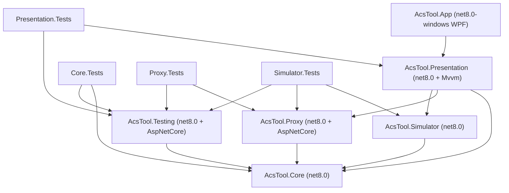
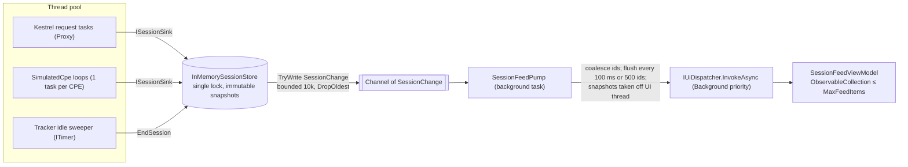
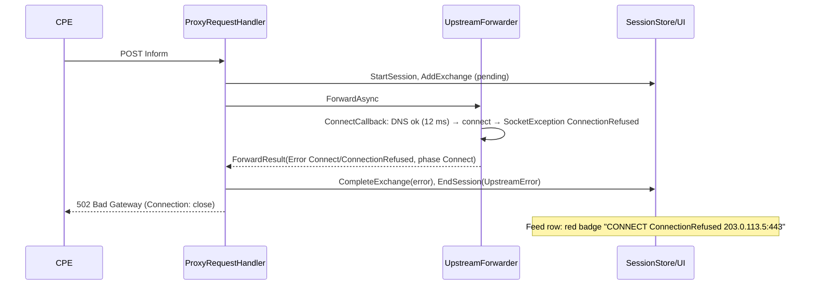
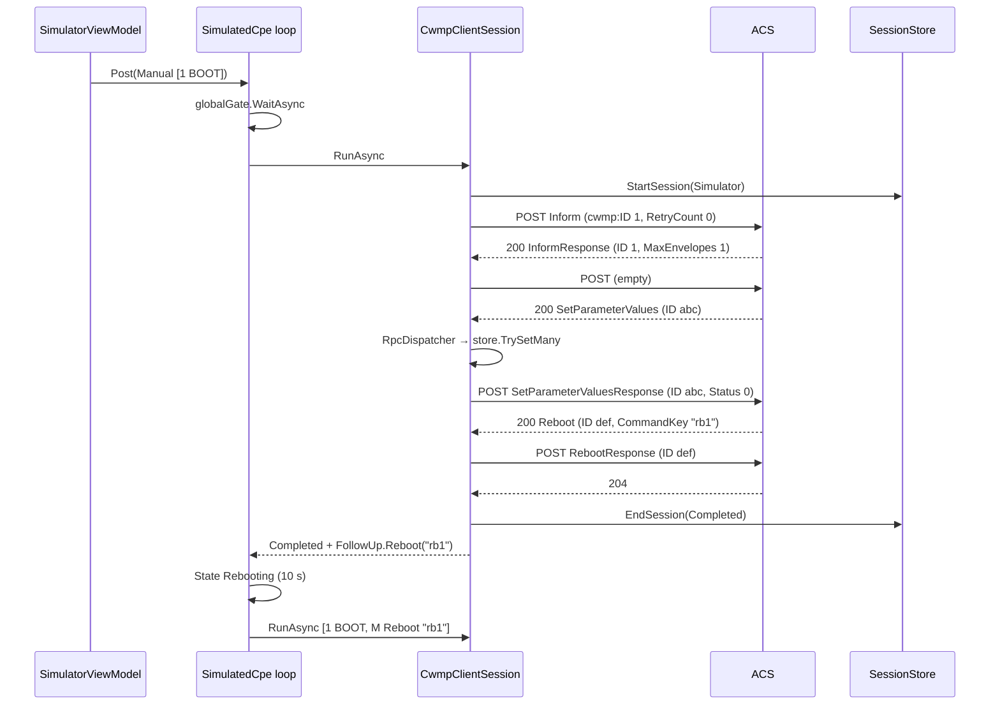
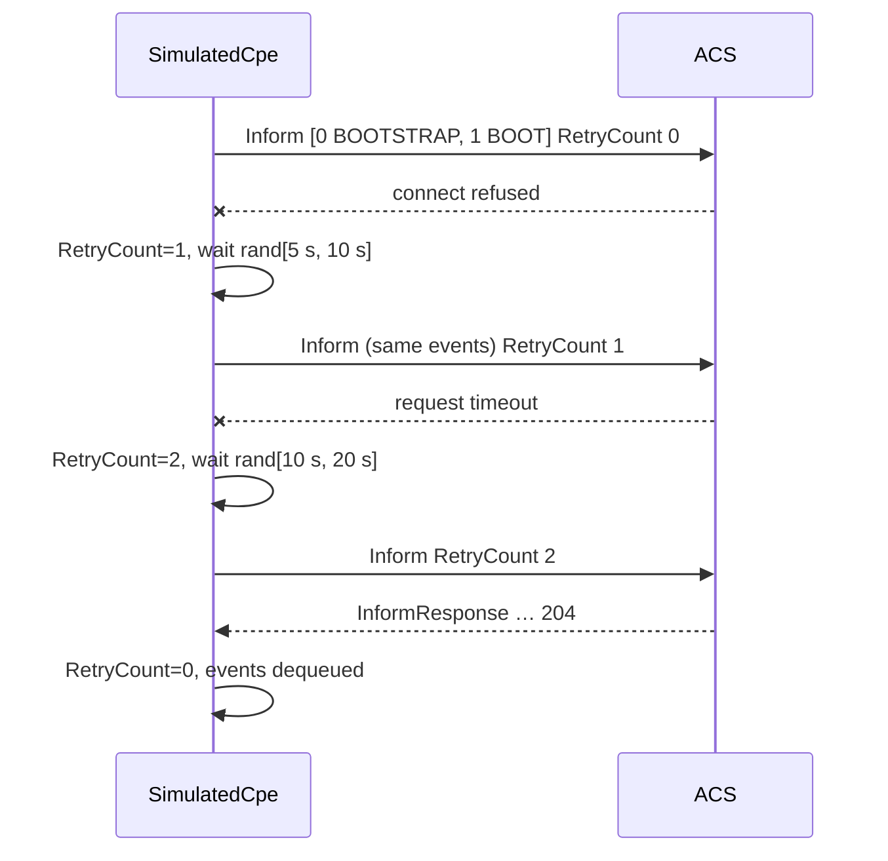

# ACS TR-069 Proxy & Inform Simulator — Implementation Plan

| Field | Value |
|---|---|
| Document | `docs/PLAN.md` |
| Author | PlannerBot (for DevOrchestrator → CoderBot → ReviewerBot / TesterBot) |
| Date | 2026-10-28 |
| Status | Ready for implementation |
| Target | Windows 10/11 x64 desktop, .NET 8 (`net8.0` libraries, `net8.0-windows` WPF app) |
| Build box | Linux (libraries + tests build and run; WPF app builds only) |

> **How to use this document.** Sections 1–2 define *what* (requirement IDs `FR-*`, `NFR-*`).
> Section 3 defines *how* (projects, types, threading). Section 4 describes the UI. Section 5 is the
> ordered task list CoderBot executes milestone by milestone; every task references requirement IDs.
> Section 6 lists risks and open questions; each open question already has a **default decision**
> so nothing blocks implementation. Appendices hold SOAP fixtures and reference tables.

---

## Table of contents

1. [Overview, goals, non-goals](#1-overview-goals-non-goals)
2. [Requirements](#2-requirements)
3. [Architecture](#3-architecture)
4. [UI wireframe notes](#4-ui-wireframe-notes)
5. [Task breakdown, test strategy, review checklist](#5-task-breakdown)
6. [Risks and open questions](#6-risks-and-open-questions)
- [Appendix A — SOAP fixtures](#appendix-a--soap-fixtures)
- [Appendix B — CWMP reference tables](#appendix-b--cwmp-reference-tables)
- [Appendix C — Sample settings.json](#appendix-c--sample-settingsjson)

---

## 1. Overview, goals, non-goals

### 1.1 Problem

The user develops a custom TR-069 ACS. When a test modem (CPE) "does not show up" on the ACS, it is
unclear whether the Inform never left the LAN, died on DNS/TCP/TLS, was rejected by auth, or reached
the ACS and was mishandled. A second need is to generate controlled, repeatable CWMP traffic without
physical modems.

### 1.2 Solution summary

A single Windows desktop app, **AcsTool**, with two modes:

- **Proxy mode**: an HTTP listener on the user's PC. Test modems' `ManagementServer.URL` is pointed at
  the app (e.g. `http://192.168.1.10:7547/acs`). Each CWMP request (Inform, CPE-originated RPCs,
  empty POSTs, RPC responses) is captured, parsed, shown live, and forwarded to the real ACS over HTTP or
  HTTPS. The ACS response is captured, parsed, shown, and relayed back to the CPE. Upstream failures are
  classified as DNS, Connect, TLS, Timeout, HTTP status, or Protocol, so the user can see exactly where
  an Inform dies.
- **Simulator mode**: one or many synthetic CPEs that send configurable Informs (DeviceId, events,
  ParameterList), run the full CWMP session (Inform → InformResponse → empty POST → ACS RPCs → 204),
  answer common RPCs from an in-memory parameter store, and follow TR-069 retry/backoff and periodic
  inform rules.

Both modes feed one **session model** that drives a live feed, a detail pane (parsed summary plus
optional raw SOAP), and JSON/raw-XML export.

### 1.3 Goals

- G1: Answer "did the Inform reach the ACS, and what did the ACS say?" within one glance at the feed.
- G2: Faithful pass-through. The proxy must not change CWMP semantics. Auth, cookies, SOAP bodies,
  and status codes are relayed unchanged, except for explicitly listed header rewrites.
- G3: Repeatable synthetic CPE traffic, from 1 to about 200 CPEs, configurable without editing code.
- G4: Linux-testable core. All protocol, proxy, simulator, and view-model logic runs under `dotnet test`
  on Linux.
- G5: Cheap raw capture. Raw bytes are always kept (bounded); pretty-printing and parsing for display
  happen lazily.

### 1.4 Non-goals

- NG1: Not an ACS. The app never acts as the authoritative ACS (aside from the test-only `FakeAcs`).
- NG2: Not a transparent/intercepting proxy (no ARP/WCCP/iptables, no TLS MITM of CPE→proxy traffic
  beyond an optional self-signed HTTPS listener).
- NG3: No full TR-098/TR-181 data-model validation. Parameter stores are free-form name/type/value maps.
- NG4: No load-testing guarantees beyond about 200 concurrent simulated CPEs.
- NG5: No multi-user, remote, or Windows Service deployment. This is a personal desktop tool.
- NG6: No STUN/UDP connection requests, XMPP (TR-069 Annex K), or TR-369/USP.
- NG7: No firmware file serving for Download in v1 (the simulator fakes the transfer).

---

## 2. Requirements

Priority: **MVP** = must be in the MVP cut (milestones M0–M4); **v1** = later milestones; **Stretch** = optional.

### 2.1 Functional: common / core (FR-C)

| ID | Requirement | Priority |
|---|---|---|
| FR-C-01 | Parse SOAP 1.1 CWMP envelopes for cwmp namespaces `urn:dslforum-org:cwmp-1-0` … `cwmp-1-4`, and detect the version used. | MVP |
| FR-C-02 | Extract header fields: `cwmp:ID` (with `mustUnderstand`), `cwmp:HoldRequests`, `cwmp:SessionTimeout`, `cwmp:NoMoreRequests` (legacy). | MVP |
| FR-C-03 | Identify the body method (Inform, InformResponse, GetParameterValues, …, Fault) and produce a typed model for known methods and a generic element tree for unknown ones. | MVP |
| FR-C-04 | Produce a one-line summary and a key/value detail summary per message (e.g. `Inform 00D09E-SN123 [1 BOOT, M Reboot] 14 params`). | MVP |
| FR-C-05 | Treat an empty body (Content-Length 0 or whitespace only) as "Empty POST" (CPE→ACS) or "Empty response" (ACS→CPE). | MVP |
| FR-C-06 | Parse SOAP Faults including the `cwmp:Fault` detail (FaultCode, FaultString, SetParameterValuesFault list). | MVP |
| FR-C-07 | Tolerate malformed or non-CWMP bodies: never throw to callers. Return `ParseResult` with errors/warnings, and keep the raw bytes. | MVP |
| FR-C-08 | Build CWMP messages: Inform, InformResponse, RPC responses, CPE Faults, TransferComplete, and ACS RPC requests (for the test FakeAcs). | MVP |
| FR-C-09 | A unified session model (`SessionRecord` / `ExchangeRecord`) used by both modes, with timings and an outcome. | MVP |
| FR-C-10 | Export sessions to JSON (summary plus embedded text/base64 raw bodies) and to a raw-XML ZIP (one file per message). | v1 |
| FR-C-11 | Import a previously exported JSON session file for viewing (read-only). | Stretch |

### 2.2 Functional: Proxy (FR-P)

| ID | Requirement | Priority |
|---|---|---|
| FR-P-01 | Listen for HTTP on a configurable bind address (default `0.0.0.0`) and port (default `7547`), on any path. Start/stop from the UI without restarting the app. | MVP |
| FR-P-02 | Forward each incoming request to a configured upstream ACS base URL (`http://` or `https://`). Incoming path+query is appended to the upstream base path (default `PathMode=PassThrough`) or replaced by a fixed upstream path (`PathMode=Fixed`). | MVP |
| FR-P-03 | Relay the method, body bytes, and end-to-end headers unchanged (`SOAPAction`, `Content-Type`, `Authorization`, `Cookie`, …). Strip hop-by-hop headers (RFC 9110 §7.6.1: `Connection`, `Keep-Alive`, `Proxy-*`, `TE`, `Trailer`, `Transfer-Encoding`, `Upgrade`, plus headers named in `Connection`). | MVP |
| FR-P-04 | Relay upstream status, headers (incl. `WWW-Authenticate`, `Set-Cookie`), and body back to the CPE unchanged, except for the rewrites in FR-P-12. | MVP |
| FR-P-05 | Accept chunked request bodies and forward them with a fixed `Content-Length`. Forward empty POSTs with `Content-Length: 0`. Relay 204 with no body. | MVP |
| FR-P-06 | Group requests into CWMP sessions per CPE: a new session starts on Inform. Later requests are correlated by connection, then cookie, then client IP (§3.6.3). | MVP |
| FR-P-07 | Detect session end: an empty upstream response (204, or 200 with an empty body) to a CPE empty POST, an upstream fault/error, or an idle timeout (default 30 s, configurable). | MVP |
| FR-P-08 | Classify upstream failures as `Dns`, `Connect`, `Tls`, `Timeout` (with phase), `HttpStatus` (≥400 other than 401), `Protocol`, `Canceled`, or `Unknown`. Show the classification prominently on the exchange and session. | MVP |
| FR-P-09 | On upstream failure, answer the CPE with `502 Bad Gateway` (DNS/Connect/TLS/Protocol) or `504 Gateway Timeout` (timeout). Option `FailureMode=Abort` resets the CPE connection instead, to mimic a network drop. | MVP |
| FR-P-10 | Configurable timeouts: connect (default 10 s) and total request (default 30 s). | MVP |
| FR-P-11 | HTTP auth pass-through: Basic and Digest `Authorization` and `WWW-Authenticate` are relayed byte-for-byte. 401 challenges are relayed to the CPE and recorded as `AuthChallenge` (not an error). The challenge and the retried request stay in one session. Path pass-through preserves the Digest `uri` (§3.6.5). | v1 (raw relay already works in MVP via FR-P-03/04) |
| FR-P-12 | Header rewrite options: Host = upstream host (default) or preserve; strip the `Domain` attribute from `Set-Cookie` (default on); strip `Secure` from `Set-Cookie` when downstream is HTTP and upstream is HTTPS (default on); optionally add `X-Forwarded-For` (default off); flag 3xx `Location` pointing away from the proxy as a warning (not rewritten). | v1 |
| FR-P-13 | Cookie handling modes: **PassThrough** (default; proxy stores nothing, the CPE handles cookies) and **ManagedPerCpe** (proxy keeps a `CookieContainer` per CPE session, for CPEs with broken cookie support). | v1 |
| FR-P-14 | Upstream connection affinity: one dedicated upstream `SocketsHttpHandler` per CPE session (max 1 connection), disposed at session end. | MVP |
| FR-P-15 | TLS validation modes for an HTTPS upstream: `Strict` (default), `IgnoreErrors`, `PinnedThumbprint` (SHA-256 of leaf, list), `CustomCa` (PEM/DER root file). Allowed protocol versions are configurable (default: OS default). | v1 |
| FR-P-16 | Capture TLS facts per session: server certificate subject/issuer/SHA-256 thumbprint/expiry, plus `SslPolicyErrors` and chain status (especially on failure). | v1 |
| FR-P-17 | Optional HTTPS downstream listener (CPE→proxy) with a user-supplied PFX or a generated self-signed certificate. | Stretch |
| FR-P-18 | Optional client certificate (PFX) for upstream mutual TLS. | Stretch |
| FR-P-19 | Per-exchange timings: total (MVP), plus phases DNS, TCP connect, time to response headers, and time to relay (v1). | MVP/v1 |
| FR-P-20 | Pause/resume the feed display without stopping forwarding. | v1 |

### 2.3 Functional: Simulator (FR-S)

| ID | Requirement | Priority |
|---|---|---|
| FR-S-01 | CPE profile editor: DeviceId (Manufacturer, OUI [6 hex], ProductClass, SerialNumber), ACS URL, credentials, cwmp version (1-0..1-4, default 1-0), data-model root (`InternetGatewayDevice.` TR-098 / `Device.` TR-181). | MVP |
| FR-S-02 | ParameterList editor: name, xsd type (`string`, `int`, `unsignedInt`, `long`, `unsignedLong`, `boolean`, `dateTime`, `base64`, `hexBinary`), value, writable flag, include-in-Inform flag, notification (0/1/2). Default seeds per data model (Appendix B.4). | MVP |
| FR-S-03 | Event selection: multi-select of standard event codes (Appendix B.1) with a CommandKey for `M …` events, plus free-text vendor events (`X <OUI> …`). | MVP |
| FR-S-04 | "Send Inform now" with the selected events runs one CWMP session: Inform → InformResponse → (CPE requests such as TransferComplete unless HoldRequests) → empty POST → handle ACS RPCs → end on an empty ACS response. | MVP |
| FR-S-05 | Each simulated CPE keeps an in-memory parameter store seeded from the ParameterList. RPCs read and write this store. | MVP |
| FR-S-06 | RPC handling: GetRPCMethods, GetParameterNames, GetParameterValues, SetParameterValues, GetParameterAttributes, SetParameterAttributes, AddObject, DeleteObject, Reboot, FactoryReset, Download, ScheduleInform. Unknown methods get Fault 9000, which is logged. Per-method override: `Auto` / `Fault <code>` / `NoResponse(delay)`. | MVP: GRM, GPV, GPN, SPV, unknown→9000; v1: rest |
| FR-S-07 | Echo `cwmp:ID` from each ACS request in the CPE response. Send a unique `cwmp:ID` on CPE requests. Honor `HoldRequests`. Send `MaxEnvelopes=1`. | MVP |
| FR-S-08 | Follow-ups: after Reboot → new session with `1 BOOT` + `M Reboot`(CommandKey). After Download → `DownloadResponse Status=1`, then a later session with `7 TRANSFER COMPLETE` + `M Download` and a TransferComplete RPC. After ScheduleInform → session with `3 SCHEDULED` + `M ScheduleInform` after DelaySeconds. After FactoryReset → `0 BOOTSTRAP` + `1 BOOT` with the store reseeded. | v1 |
| FR-S-09 | Periodic Inform: enable flag, interval (s), optional PeriodicInformTime phase, ±jitter percentage (default 0). Event `2 PERIODIC`. | v1 |
| FR-S-10 | Session retry per TR-069 §3.2.1.1: wait from `CWMPRetryMinimumWaitInterval` (m, default 5 s) and `CWMPRetryIntervalMultiplier` (k, default 2000): random in `[m·(k/1000)^(n-1), m·(k/1000)^n]` seconds for retry n, with n capped at 10. `RetryCount` in the Inform. Undelivered events retained. Optional max retries (default unlimited). | v1 |
| FR-S-11 | Raw SOAP override for the Inform: user-edited XML template with placeholders (`{{SerialNumber}}`, `{{OUI}}`, `{{Manufacturer}}`, `{{ProductClass}}`, `{{CurrentTime}}`, `{{RetryCount}}`, `{{CwmpId}}`, `{{Events}}`, `{{ParameterList}}`, `{{Param:Name}}`). Validate well-formedness before sending; sending invalid XML requires the explicit "send anyway" flag. | v1 |
| FR-S-12 | Multiple CPEs: a profile has an instance count N and a serial pattern (e.g. `SIM{0:D6}`, start index 1). Each instance has its own store, HTTP handler, and cookies. Global concurrency limit (default 32 concurrent sessions). Start/stop all. Staggered start (spread 0–5 s by default). | v1 |
| FR-S-13 | HTTP auth for the simulator: Basic and Digest via handler credentials. Cookies via a per-CPE `CookieContainer`. | MVP (Basic + cookies), v1 (Digest verified) |
| FR-S-14 | Simulator TLS options mirror FR-P-15. | v1 |
| FR-S-15 | Value change: a UI edit of a parameter with Notification 1 (passive) queues `4 VALUE CHANGE`; Notification 2 (active) also triggers an immediate session. | v1 |
| FR-S-16 | Connection Request listener: one Kestrel listener (default port 7548) at `/cr/{serial}` with Digest auth. A valid GET triggers a `6 CONNECTION REQUEST` session. `ConnectionRequestURL` is reported in the Inform. | Stretch |
| FR-S-17 | Persist CPE profiles as JSON files (MVP). Import/export a profile file (v1). | MVP/v1 |
| FR-S-18 | Per-CPE status in the UI: Idle, InSession, WaitingRetry(n, until), Rebooting, Stopped, Error(last). | MVP (basic), v1 (full) |

### 2.4 Functional: UI (FR-U)

| ID | Requirement | Priority |
|---|---|---|
| FR-U-01 | Main window with **Proxy** and **Simulator** tabs, plus a **Settings** window. | MVP |
| FR-U-02 | Live session feed (virtualized grid): time, source, device, client, events/first method, exchange count, outcome badge, duration. Newest on top and an auto-scroll toggle. | MVP |
| FR-U-03 | Detail pane for the selected session: exchange list (seq, method, status, duration), parsed summary of the selected exchange, request/response headers, and a collapsible raw SOAP viewer (lazy pretty-print, copy button). | MVP (plain text), v1 (syntax highlight) |
| FR-U-04 | Filter the feed by text (serial/OUI/IP/method), outcome, and source. | v1 |
| FR-U-05 | Export the selected or all sessions (JSON / raw XML ZIP). Copy a single message as XML. | v1 (copy: MVP) |
| FR-U-06 | Clear feed. Status bar with listener state, active sessions, total sessions, and capture memory used. | MVP |
| FR-U-07 | Settings: proxy defaults, TLS, timeouts, capture limits, logging level and folder, theme (Light/Dark/System). | MVP (proxy + capture), v1 (rest) |
| FR-U-08 | Errors are shown as non-modal banners. Listener bind failures (port in use, access denied, address not available) show an actionable message. | MVP |
| FR-U-09 | Log panel (collapsible) showing the in-app log ring buffer. | v1 |

### 2.5 Non-functional (NFR)

| ID | Requirement |
|---|---|
| NFR-01 | **Platforms**: Core, Proxy, Simulator, Presentation, and Testing target `net8.0` and build and test on Linux. App targets `net8.0-windows` with `UseWPF` and `EnableWindowsTargeting=true` (builds on Linux, runs only on Windows). |
| NFR-02 | **No admin rights** needed to run, including listening on 0.0.0.0 (rules out HttpListener's URL ACL requirement; §3.2). |
| NFR-03 | **Responsiveness**: the UI thread never blocks on I/O. Feed updates are batched at ≤10 Hz. The UI stays responsive at 200 req/s of ingest. |
| NFR-04 | **Proxy overhead**: under 5 ms p95 added latency for bodies under 64 KB on loopback (excluding upstream time). |
| NFR-05 | **Bounded memory**: configurable max sessions (default 5,000), max captured bytes per body (default 1 MiB; bodies are still forwarded fully), and a total capture budget (default 256 MiB) that evicts the oldest ended sessions. |
| NFR-06 | **Fidelity**: proxied bodies are byte-identical. Header changes are limited to FR-P-03/12. |
| NFR-07 | **Robustness**: a malformed request or a failing upstream never crashes the listener. Unhandled exceptions are logged and surfaced. |
| NFR-08 | **Security**: XML parsing with DTD prohibited, no resolver (XXE-safe), and a max document size. Credentials are stored with DPAPI (CurrentUser) on Windows and never logged. `Authorization` is redacted in exports by default. The `IgnoreErrors` TLS mode is visibly flagged. The listener is meant for a trusted LAN (documented). |
| NFR-09 | **Testability**: time via `TimeProvider`, randomness via `IRandom`, paths via `IAppPaths`, UI thread via `IUiDispatcher`. At least 80% line coverage on Core, Proxy, and Simulator. |
| NFR-10 | **Logging**: Microsoft.Extensions.Logging. Serilog rolling file in `%LOCALAPPDATA%\AcsTool\logs` (7 files retained). In-app ring buffer of 2,000 entries. |
| NFR-11 | **Persistence**: settings and profiles are JSON in `%APPDATA%\AcsTool\`, schema-versioned, and written atomically. |
| NFR-12 | **Code quality**: nullable enabled, warnings as errors in CI, `.editorconfig`, analyzers `latest-recommended`, and no sync-over-async. |
| NFR-13 | **Packaging**: `dotnet publish -r win-x64 --self-contained`. Needs no runtime install (includes the WindowsDesktop and AspNetCore frameworks). |
| NFR-14 | **Startup** under 2 s. The proxy does not auto-start unless "Start proxy on launch" is enabled. |

---

## 3. Architecture

### 3.1 Key decisions

| # | Decision | Rationale |
|---|---|---|
| D1 | **Kestrel** (in-process, `WebApplication.CreateSlimBuilder`, single terminal middleware) as the proxy listener | §3.2: no http.sys URL ACL/admin, cross-platform (Linux tests), connection IDs and raw headers available, and works with `TestServer`. |
| D2 | **`net8.0`** via one MSBuild property `AcsToolTfm` in `Directory.Build.props` | As requested. .NET 8 support ends 2026-11-10, so a one-line switch to `net10.0` (LTS) is pre-planned (R1/Q1). **Done: now `net10.0` (Q1 resolved).** |
| D3 | **`AcsTool.Presentation` (net8.0)** holds all ViewModels (CommunityToolkit.Mvvm) | ViewModels are unit-testable on Linux. WPF-specific code (Dispatcher, dialogs, converters, AvalonEdit) stays in `AcsTool.App` behind interfaces. |
| D4 | **Hand-written parser (XmlReader→XDocument) and builders**, no WCF/SoapCore | CWMP is a small, quirky SOAP 1.1 dialect (soap-enc arrays, namespace variance, unqualified children). We need tolerance and full control. |
| D5 | **Store is the source of truth; `Channel<SessionChange>` carries only change notifications**, coalesced by a UI pump | A dropped or late notification cannot corrupt state, and batching keeps UI updates ≤10 Hz (NFR-03). |
| D6 | **One upstream `SocketsHttpHandler` per proxied CPE session** (MaxConnectionsPerServer=1) | Mirrors downstream connection affinity (Digest nonce and session stickiness), isolates managed cookies, and yields per-session TLS facts. |
| D7 | **Cookie default = PassThrough** with Domain/Secure stripping | Most faithful. Managed mode is opt-in. |
| D8 | **Buffer whole bodies in memory** (hard limit 10 MiB) | CWMP bodies are KB-sized. Makes capture trivial, converts chunked to Content-Length, and simplifies diagnostics. |
| D9 | **Simulator auth via built-in `SocketsHttpHandler` credentials** (Basic/Digest) | Robust and spec-correct. Trade-off: the 401 round-trip is not visible to our capture handler (shown as a note). A custom visible Digest handler is a Stretch item (Q7). |
| D10 | **`HttpMessageInvoker` over our own handler** for proxy upstream; our own CTS timeouts | No default headers or base address. Timeouts we own can be classified by phase. |

### 3.2 Listener choice: Kestrel vs HttpListener

| Concern | HttpListener (http.sys) | Kestrel |
|---|---|---|
| Bind `http://+:7547/` for LAN modems | Needs `netsh http add urlacl url=http://+:7547/ user=…` (admin, once) or the app running elevated. Without it only `localhost` works, which is useless for modems. | No ACL. Any user can bind any port (Windows has no privileged ports). Only the one-time Windows Firewall prompt. |
| HTTPS downstream | Cert must be bound with `netsh http add sslcert` (admin). | PFX loaded in code via `ListenOptions.UseHttps(cert)`. |
| Linux tests | Managed fallback implementation differs from Windows http.sys behavior. | Identical code path on Linux. Real loopback Kestrel and `TestServer` in tests. |
| Raw access | http.sys normalizes some headers, and connection identity is limited. | `Connection.Id`, `RemoteIpAddress/Port`, raw ordered headers, `BodyReader`. |
| Status | Legacy, not recommended for new development. | Actively developed, high performance. |

**Decision: Kestrel**, hosted from a `net8.0` class library via `<FrameworkReference Include="Microsoft.AspNetCore.App" />`.
Settings: `AddServerHeader=false`, `Limits.MaxRequestBodySize=10 MiB`, `Limits.KeepAliveTimeout=2 min`,
`Limits.RequestHeadersTimeout=30 s`, `AllowSynchronousIO=false`, `Listen(IPAddress, port)`. No routing, no
static files, no host filtering. Consequence: the WPF app needs the ASP.NET Core shared framework, which
self-contained publishing covers (NFR-13).

### 3.3 Solution layout

```
acs-tr069-tool/
├─ AcsTool.sln
├─ Directory.Build.props          # AcsToolTfm=net8.0, LangVersion latest, Nullable, ImplicitUsings, analyzers, TWAE in CI
├─ Directory.Packages.props       # central package management
├─ global.json                    # SDK 8.0.4xx, rollForward latestFeature
├─ .editorconfig  .gitignore  README.md
├─ build.sh / build.ps1           # restore, build all, test (Linux runs all tests; App build only)
├─ docs/PLAN.md
├─ src/
│  ├─ AcsTool.Core/               # net8.0 — no ASP.NET, no WPF
│  │  ├─ Cwmp/                    # CwmpNamespaces, CwmpVersion, EventCodes, FaultCodes, XsdTypes
│  │  ├─ Model/                   # CwmpEnvelope, CwmpHeader, Messages/*.cs (records)
│  │  ├─ Parsing/                 # ICwmpParser, CwmpParser, ParseResult, IMessageSummarizer, MessageSummarizer
│  │  ├─ Building/                # ICwmpMessageBuilder, CwmpMessageBuilder, IInformBuilder, InformTemplateRenderer
│  │  ├─ Sessions/                # SessionRecord, SessionSnapshot, ExchangeRecord, HttpMessageCapture, ISessionSink, ISessionStore, InMemorySessionStore
│  │  ├─ Net/                     # UpstreamError(Kind), ErrorClassifier, PhaseTracker, ConnectCallbackFactory, TlsOptions, TlsValidatorFactory, TlsInfo, IUpstreamHandlerFactory, HeaderUtil
│  │  ├─ Export/                  # IExportService, ExportService (JSON + raw ZIP), DTOs, AuthRedactor
│  │  ├─ Settings/                # AppSettings & sub-records, ISettingsStore, JsonSettingsStore, IAppPaths, ISecretProtector, AcsToolJsonContext
│  │  └─ Util/                    # IRandom, XmlPretty, AtomicFile
│  ├─ AcsTool.Proxy/              # net8.0 + FrameworkReference Microsoft.AspNetCore.App
│  │  ├─ ProxyServer.cs  ProxyOptions.cs  ProxyRequestHandler.cs  IncomingRequest.cs
│  │  ├─ IUpstreamForwarder.cs  UpstreamForwarder.cs  ForwardResult.cs
│  │  ├─ CpeSessionTracker.cs  ProxySession.cs  HeaderRewriter.cs  ProxyBindException.cs
│  │  └─ ServiceCollectionExtensions.cs
│  ├─ AcsTool.Simulator/          # net8.0 (+ AspNetCore FrameworkReference only for the stretch CR listener)
│  │  ├─ Profiles/                # CpeProfile, ParameterDefinition, RetryPolicy, PeriodicInformSettings, RpcBehavior, MultiInstanceSettings, IProfileStore, JsonProfileStore, DefaultProfiles
│  │  ├─ Cpe/                     # SimulatedCpe, CpeState, CpeTrigger, ParameterStore, PendingEventQueue
│  │  ├─ Session/                 # CwmpClientSession, ICwmpTransport, HttpCwmpTransport, CaptureHandler
│  │  ├─ Rpc/                     # IRpcHandler, RpcDispatcher, Handlers/*.cs
│  │  ├─ Scheduling/              # RetryBackoff, PeriodicSchedule
│  │  ├─ SimulationEngine.cs  ServiceCollectionExtensions.cs
│  │  └─ ConnectionRequest/       # ConnectionRequestListener (stretch)
│  ├─ AcsTool.Presentation/       # net8.0 + CommunityToolkit.Mvvm — ViewModels and UI abstractions
│  │  ├─ Abstractions/            # IUiDispatcher, IDialogService, IFileDialogService, IClipboardService, IBannerService
│  │  ├─ Feed/                    # SessionFeedPump, SessionFeedViewModel, SessionItemViewModel, FeedFilter
│  │  ├─ Detail/                  # SessionDetailViewModel, ExchangeItemViewModel
│  │  ├─ Proxy/ProxyViewModel.cs
│  │  ├─ Simulator/               # SimulatorViewModel, CpeProfileEditorViewModel, ParameterRowViewModel, EventChoiceViewModel, CpeInstanceViewModel
│  │  ├─ Settings/SettingsViewModel.cs
│  │  └─ Shell/MainViewModel.cs, LogPanelViewModel.cs
│  └─ AcsTool.App/                # net8.0-windows, WinExe, UseWPF, EnableWindowsTargeting
│     ├─ App.xaml(.cs)            # Generic Host bootstrap, DI composition root, Serilog
│     ├─ Views/                   # MainWindow, ProxyView, SimulatorView, SessionFeedView, SessionDetailView, CpeProfileEditorView, SettingsWindow, LogPanelView
│     ├─ Services/                # WpfUiDispatcher, WpfDialogService, WpfFileDialogService, WpfClipboardService, DpapiSecretProtector, WindowsAppPaths
│     ├─ Converters/  Themes/ (Light.xaml, Dark.xaml)  Resources/
└─ tests/
   ├─ AcsTool.Testing/            # net8.0 helper lib: FakeAcs (real Kestrel on 127.0.0.1:0, scriptable), Fixtures loader, TestCerts, SynchronousUiDispatcher
   ├─ AcsTool.Core.Tests/
   ├─ AcsTool.Proxy.Tests/        # unit + integration (CPE client → ProxyServer → FakeAcs)
   ├─ AcsTool.Simulator.Tests/    # unit + integration (SimulatedCpe → FakeAcs; also SimulatedCpe → Proxy → FakeAcs)
   ├─ AcsTool.Presentation.Tests/
   └─ fixtures/                   # *.xml SOAP samples, linked as content (CopyToOutputDirectory) into test projects
```

The App has **no test project**. It stays thin: XAML views, bindings, and platform adapters only.

### 3.4 Project references



Rules: Core references no project. Proxy and Simulator never reference each other. Simulator.Tests may
reference Proxy for end-to-end tests. App references only Presentation and owns the composition root.

### 3.5 Core: key types and interfaces

Signatures are indicative. CoderBot may adjust names but must keep the responsibilities and the test seams.

#### 3.5.1 CWMP model

```csharp
public enum CwmpVersion { V1_0, V1_1, V1_2, V1_3, V1_4, Unknown }
public static class CwmpNamespaces {
    public const string SoapEnv = "http://schemas.xmlsoap.org/soap/envelope/";
    public const string SoapEnc = "http://schemas.xmlsoap.org/soap/encoding/";
    public const string Xsd = "http://www.w3.org/2001/XMLSchema";
    public const string Xsi = "http://www.w3.org/2001/XMLSchema-instance";
    public static string For(CwmpVersion v);              // "urn:dslforum-org:cwmp-1-0" … "-1-4"
    public static CwmpVersion Detect(string? ns);         // Unknown if not urn:dslforum-org:cwmp-1-[0-4]
}

public sealed record CwmpHeader(string? Id, bool IdMustUnderstand = true, bool? HoldRequests = null,
                                uint? SessionTimeout = null, bool? NoMoreRequests = null);

public enum CwmpMessageKind {
    Empty, Inform, InformResponse, TransferComplete, TransferCompleteResponse,
    GetRPCMethods, GetRPCMethodsResponse, GetParameterNames, GetParameterNamesResponse,
    GetParameterValues, GetParameterValuesResponse, SetParameterValues, SetParameterValuesResponse,
    GetParameterAttributes, GetParameterAttributesResponse, SetParameterAttributes, SetParameterAttributesResponse,
    AddObject, AddObjectResponse, DeleteObject, DeleteObjectResponse, Reboot, RebootResponse,
    FactoryReset, FactoryResetResponse, Download, DownloadResponse, ScheduleInform, ScheduleInformResponse,
    Fault, Unknown, NotXml, NotSoap }

public sealed record CwmpEnvelope(CwmpVersion Version, string? CwmpNamespace, CwmpHeader Header,
    CwmpMessageKind Kind, string MethodLocalName, CwmpMessage? Message, XElement? BodyElement);

public abstract record CwmpMessage;
public sealed record DeviceIdStruct(string Manufacturer, string OUI, string ProductClass, string SerialNumber) {
    public string Key => $"{OUI}-{SerialNumber}";
}
public sealed record EventStruct(string EventCode, string CommandKey = "");
public sealed record ParameterValue(string Name, string Value, string XsdType = "xsd:string");
public sealed record InformMessage(DeviceIdStruct DeviceId, IReadOnlyList<EventStruct> Events, uint MaxEnvelopes,
    string CurrentTime /*raw*/, uint RetryCount, IReadOnlyList<ParameterValue> Parameters) : CwmpMessage {
    public DateTimeOffset? CurrentTimeParsed { get; init; }
}
public sealed record InformResponseMessage(uint MaxEnvelopes) : CwmpMessage;
public sealed record GetRpcMethodsMessage : CwmpMessage;
public sealed record GetRpcMethodsResponseMessage(IReadOnlyList<string> Methods) : CwmpMessage;
public sealed record GetParameterNamesMessage(string ParameterPath, bool NextLevel) : CwmpMessage;
public sealed record ParameterInfo(string Name, bool Writable);
public sealed record GetParameterNamesResponseMessage(IReadOnlyList<ParameterInfo> List) : CwmpMessage;
public sealed record GetParameterValuesMessage(IReadOnlyList<string> Names) : CwmpMessage;
public sealed record GetParameterValuesResponseMessage(IReadOnlyList<ParameterValue> Values) : CwmpMessage;
public sealed record SetParameterValuesMessage(IReadOnlyList<ParameterValue> Values, string ParameterKey) : CwmpMessage;
public sealed record SetParameterValuesResponseMessage(int Status) : CwmpMessage;
public sealed record ParameterAttribute(string Name, int Notification, IReadOnlyList<string> AccessList);
public sealed record GetParameterAttributesMessage(IReadOnlyList<string> Names) : CwmpMessage;
public sealed record GetParameterAttributesResponseMessage(IReadOnlyList<ParameterAttribute> List) : CwmpMessage;
public sealed record SetParameterAttributesMessage(IReadOnlyList<SetParameterAttributeStruct> List) : CwmpMessage;
public sealed record AddObjectMessage(string ObjectName, string ParameterKey) : CwmpMessage;
public sealed record AddObjectResponseMessage(uint InstanceNumber, int Status) : CwmpMessage;
public sealed record DeleteObjectMessage(string ObjectName, string ParameterKey) : CwmpMessage;
public sealed record DeleteObjectResponseMessage(int Status) : CwmpMessage;
public sealed record RebootMessage(string CommandKey) : CwmpMessage;
public sealed record FactoryResetMessage : CwmpMessage;
public sealed record DownloadMessage(string CommandKey, string FileType, string Url, string Username, string Password,
    ulong FileSize, string TargetFileName, uint DelaySeconds, string SuccessUrl, string FailureUrl) : CwmpMessage;
public sealed record DownloadResponseMessage(int Status, string StartTime, string CompleteTime) : CwmpMessage;
public sealed record TransferCompleteMessage(string CommandKey, uint FaultCode, string FaultString,
    string StartTime, string CompleteTime) : CwmpMessage;
public sealed record ScheduleInformMessage(uint DelaySeconds, string CommandKey) : CwmpMessage;
public sealed record EmptyResponseMessage(CwmpMessageKind Kind) : CwmpMessage;   // RebootResponse, FactoryResetResponse, ScheduleInformResponse, SetParameterAttributesResponse, TransferCompleteResponse
public sealed record CwmpFault(string SoapFaultCode, string SoapFaultString, uint FaultCode, string FaultString,
    IReadOnlyList<SetParameterValuesFaultItem> SpvFaults) : CwmpMessage;
public sealed record SetParameterValuesFaultItem(string ParameterName, uint FaultCode, string FaultString);
```

#### 3.5.2 Parsing and summaries

```csharp
public interface ICwmpParser { ParseResult Parse(ReadOnlySpan<byte> body, string? contentType = null); } // never throws
public sealed record ParseResult(CwmpEnvelope? Envelope, CwmpMessageKind Kind,
    IReadOnlyList<string> Warnings, IReadOnlyList<string> Errors) { public bool IsEmpty => Kind == CwmpMessageKind.Empty; }

public interface IMessageSummarizer { MessageSummary Summarize(ParseResult result); }
public sealed record MessageSummary(CwmpMessageKind Kind, string Title, string OneLine,
    IReadOnlyList<KeyValuePair<string, string>> Fields, DeviceIdStruct? DeviceId,
    IReadOnlyList<EventStruct>? Events, CwmpFault? Fault, bool? HoldRequests, string? CwmpId,
    CwmpVersion Version, IReadOnlyList<string> Warnings);
```

Parser rules:

1. Empty: length 0, or only whitespace/BOM → `Empty`.
2. Encoding: BOM or XML declaration, else UTF-8. A `Content-Type` charset that disagrees is a warning only.
3. `XmlReaderSettings { DtdProcessing = Prohibit, XmlResolver = null, MaxCharactersInDocument = 20_000_000, IgnoreComments = true, IgnoreProcessingInstructions = true }`.
   Load via `XDocument.Load(reader)`. An `XmlException` → `NotXml` with the error message and line/position.
4. Envelope/Header/Body are matched by **local name**. If the namespace ≠ SOAP 1.1 env, add the warning "non-standard SOAP envelope namespace" (SOAP 1.2 `http://www.w3.org/2003/05/soap-envelope` is reported explicitly). No Envelope → `NotSoap`.
5. cwmp namespace: from the first Body child element's namespace, else from the Header `ID` element. `CwmpNamespaces.Detect`.
6. cwmp elements are matched by local name in any namespace, with a warning if not a `cwmp-1-x` namespace.
   RPC children are normally unqualified, but qualified children are also accepted.
7. Arrays: `soap-enc:arrayType` counts are compared with the actual number of items. A mismatch is a warning.
8. `Value/@xsi:type` → `XsdType` (default `xsd:string`, warning if missing in an Inform).
9. `CurrentTime` keeps the raw string. ISO-8601 parse failure is a warning.
10. Unknown body element → `Unknown` (keep `MethodLocalName` + `BodyElement`). `Fault` → `CwmpFault` (Detail/cwmp:Fault).
11. Body with >1 child (MaxEnvelopes>1 semantics or junk) → use the first, with the warning "multiple body elements".

Summary title examples: `Inform 00D09E-SN123 [0 BOOTSTRAP, 1 BOOT]`, `InformResponse`, `GPV ×12`,
`SPV ×3 key=abc`, `Fault 9005 Invalid parameter name`, `Empty`, `Not XML (line 3)`.

#### 3.5.3 Building

```csharp
public interface ICwmpMessageBuilder {
    byte[] Build(CwmpMessage message, CwmpVersion version, CwmpHeader header);       // UTF-8 without BOM
    string BuildString(CwmpMessage message, CwmpVersion version, CwmpHeader header);
    byte[] BuildFault(uint faultCode, string faultString, CwmpVersion version, string? cwmpId,
                      IReadOnlyList<SetParameterValuesFaultItem>? spvFaults = null); // faultcode Client for 9001..9019 arg errors, Server otherwise
}
public interface IInformBuilder {
    InformMessage Create(DeviceIdStruct id, IEnumerable<EventStruct> events, IEnumerable<ParameterValue> parameters,
                         uint retryCount, DateTimeOffset now, uint maxEnvelopes = 1);
}
public interface IInformTemplateRenderer { TemplateRenderResult Render(string template, InformTemplateContext ctx); }
public sealed record TemplateRenderResult(string Xml, bool WellFormed, string? Error, IReadOnlyList<string> UnknownPlaceholders);
```

Builder output rules:
- Declare `soap-env`, `soap-enc`, `xsd`, `xsi`, and `cwmp` on the Envelope (the most interoperable form). Add `<?xml version="1.0" encoding="UTF-8"?>`.
- Header: `<cwmp:ID soap-env:mustUnderstand="1">…</cwmp:ID>`. `HoldRequests` only when set.
- Arrays: `soap-enc:arrayType="cwmp:EventStruct[n]"`, `"cwmp:ParameterValueStruct[n]"`, `"xsd:string[n]"`, `"cwmp:ParameterInfoStruct[n]"`.
- Children unqualified. `Value` carries `xsi:type`. `CurrentTime` is formatted `yyyy-MM-ddTHH:mm:sszzz`.
- Deterministic output (attribute order, no random IDs inside the builder), so snapshot tests are stable.
- The template renderer XML-escapes substituted values. `{{Events}}` and `{{ParameterList}}` expand to the full `<Event>` / `<ParameterList>` elements.

#### 3.5.4 Session model and store

```csharp
public enum SessionSource { Proxy, Simulator }
public enum SessionOutcome { InProgress, Completed, AuthFailed, UpstreamError, AcsFault, CpeFault,
                             HttpError, Abandoned, Superseded, Canceled, ProtocolError }

public sealed class HttpMessageCapture {                 // immutable
    public string? Method { get; init; }  public string? Url { get; init; }  public int? StatusCode { get; init; }
    public IReadOnlyList<KeyValuePair<string, string>> Headers { get; init; } = [];
    public ReadOnlyMemory<byte> Body { get; init; }      // possibly truncated copy
    public long OriginalLength { get; init; }  public bool Truncated { get; init; }
}
public sealed record ExchangeTimings(DateTimeOffset Started, TimeSpan? Dns = null, TimeSpan? Connect = null,
    TimeSpan? ToResponseHeaders = null, TimeSpan? Total = null);
public sealed record ExchangeRecord(int Seq, HttpMessageCapture Request, MessageSummary RequestSummary,
    HttpMessageCapture? Response, MessageSummary? ResponseSummary, UpstreamError? Error,
    ExchangeTimings Timings, IReadOnlyList<string> Notes) { public bool IsPending => Response is null && Error is null; }

public sealed record SessionStart(SessionSource Source, string ClientEndpoint, string TargetUrl,
    DeviceIdStruct? DeviceId, IReadOnlyList<EventStruct> Events, CwmpVersion Version, string? Label);
public sealed record SessionSnapshot(Guid Id, SessionSource Source, string ClientEndpoint, string TargetUrl,
    DeviceIdStruct? DeviceId, IReadOnlyList<EventStruct> Events, CwmpVersion Version, DateTimeOffset Started,
    DateTimeOffset? Ended, SessionOutcome Outcome, UpstreamError? LastError, TlsInfo? Tls,
    ImmutableList<ExchangeRecord> Exchanges, long CapturedBytes, IReadOnlyList<string> Notes);

public enum SessionChangeKind { Added, Updated, Ended, Removed, Cleared }
public readonly record struct SessionChange(Guid SessionId, SessionChangeKind Kind);

public interface ISessionSink {                          // producers; thread-safe; non-blocking
    Guid StartSession(SessionStart start);
    int AddExchange(Guid sessionId, HttpMessageCapture request, MessageSummary summary, DateTimeOffset started);
    void CompleteExchange(Guid sessionId, int seq, HttpMessageCapture? response, MessageSummary? summary,
                          UpstreamError? error, ExchangeTimings timings, IReadOnlyList<string>? notes = null);
    void UpdateSession(Guid sessionId, Func<SessionSnapshot, SessionSnapshot> patch);   // DeviceId, Tls, Notes
    void EndSession(Guid sessionId, SessionOutcome outcome);
}
public interface ISessionStore : ISessionSink {          // consumers
    ChannelReader<SessionChange> Changes { get; }
    SessionSnapshot? Get(Guid id);
    IReadOnlyList<SessionSnapshot> GetAll();             // ordered by Started
    void Clear();
    CaptureStats Stats { get; }                          // Sessions, Active, CapturedBytes, Evicted, DroppedNotifications
}
public sealed class InMemorySessionStore : ISessionStore { /* ctor(CaptureSettings, TimeProvider); see §3.8 */ }
```

Records are immutable snapshots replaced under the store lock (`Dictionary<Guid, SessionSnapshot>` + a
`LinkedList`/ordered index for eviction). Capture truncation happens in a helper
`HttpMessageCapture.From(..., maxBytes)`, which copies `min(len, max)` bytes.

#### 3.5.5 Networking helpers (shared by Proxy and Simulator)

```csharp
public enum UpstreamErrorKind { None, Dns, Connect, Tls, Timeout, HttpStatus, Protocol, Canceled, BodyTooLarge, Unknown }
public enum RequestPhase { Dns, Connect, Tls, AwaitingResponse, ReadingBody }
public sealed record UpstreamError(UpstreamErrorKind Kind, RequestPhase Phase, string Message,
    string? ExceptionType = null, string? SocketError = null, int? HttpStatus = null, string? TlsDetail = null);

public sealed class PhaseTracker {   // one per exchange; written by ConnectCallback/validation callback, read by classifier
    public void Reset(); public void MarkDnsDone(TimeSpan d, IPAddress[] addrs); public void MarkConnected(TimeSpan d, IPEndPoint ep);
    public void MarkTlsDone(); public void MarkHeaders(TimeSpan d);
    public RequestPhase CurrentPhase(bool isHttps);   // phase in which the request currently is
}
public static class ErrorClassifier {
    public static UpstreamError Classify(Exception ex, PhaseTracker tracker, bool isHttps, bool timedOutByUs, bool canceledByCaller);
    public static UpstreamError? FromStatus(int status);   // ≥400 and ≠401 → HttpStatus; else null
}

public enum TlsValidationMode { Strict, IgnoreErrors, PinnedThumbprint, CustomCa }
public sealed record TlsOptions(TlsValidationMode Mode = TlsValidationMode.Strict, IReadOnlyList<string>? PinnedSha256 = null,
    string? CustomCaPath = null, SslProtocols Protocols = SslProtocols.None /*OS default*/,
    string? ClientCertPfxPath = null, string? ClientCertPasswordProtected = null);
public sealed record TlsInfo(string? Subject, string? Issuer, string? ThumbprintSha256, DateTimeOffset? NotBefore,
    DateTimeOffset? NotAfter, string PolicyErrors, string? ChainStatus, bool AcceptedByOverride);

public sealed record UpstreamHandlerOptions(TimeSpan ConnectTimeout, TlsOptions Tls, bool UseCookies,
    CookieContainer? Cookies, ICredentials? Credentials, bool AllowAutoRedirect, bool UseSystemProxy);
public interface IUpstreamHandlerFactory {
    SocketsHttpHandler Create(UpstreamHandlerOptions options, Func<PhaseTracker> currentTracker, Action<TlsInfo> onTls);
}
```

**Classification algorithm** (each branch unit-tested):

1. `OperationCanceledException` with the caller token canceled → `Canceled`.
2. `OperationCanceledException` with our timeout CTS fired → `Timeout`, phase = `tracker.CurrentPhase(isHttps)`
   (`Dns` if DNS not done, `Connect` if not connected, `Tls` if HTTPS and TLS not done, else `AwaitingResponse`/`ReadingBody`).
3. `HttpRequestException.HttpRequestError` (.NET 8):
   `NameResolutionError` → `Dns`; `ConnectionError` → `Connect` (record the inner `SocketException.SocketErrorCode`, e.g.
   `ConnectionRefused`, `HostUnreachable`, `NetworkUnreachable`, `TimedOut`, `ConnectionReset`);
   `SecureConnectionError` → `Tls` (inner `AuthenticationException` message + last `TlsInfo.PolicyErrors`);
   `ResponseEnded`, `InvalidResponse`, `HttpProtocolError` → `Protocol`; `Unknown`/other → walk inner exceptions (rule 4).
4. Fallback inner-exception walk: `SocketException` HostNotFound/TryAgain/NoData → `Dns`, other SocketException → `Connect`,
   `AuthenticationException` → `Tls`, `IOException` during body read → `Protocol`, else `Unknown`.
5. Response status ≥ 400 and ≠ 401 → `HttpStatus` (set by the forwarder, not an exception). 401 → no error, note `AuthChallenge`.

**ConnectCallback** (`ConnectCallbackFactory.Create(connectTimeout, trackerAccessor)`): resolve with
`Dns.GetHostAddressesAsync(host, ct)` (record duration, `MarkDnsDone`). On `SocketException`, throw
`new HttpRequestException(HttpRequestError.NameResolutionError, msg, ex)`. Then try each address with
`Socket.ConnectAsync` (`NoDelay=true`) under a linked CTS with `CancelAfter(connectTimeout)`. Record duration and endpoint
(`MarkConnected`), and return `new NetworkStream(socket, ownsSocket: true)`. A connect failure throws
`HttpRequestException(HttpRequestError.ConnectionError, msg, socketEx)`. A connect-timeout throws the same with message
"connect timed out after Xs" and `SocketError=TimedOut`, so it is classified `Connect` (sub-reason TimedOut) rather than the
generic request timeout. Note: `SocketsHttpHandler` calls ConnectCallback once per new connection. Handlers are scoped to one
proxy session (or one simulated CPE) with `MaxConnectionsPerServer=1`, and exchanges are serialized by that session's Gate (or CPE
loop), so the `currentTracker` accessor always returns the tracker of the exchange in flight. No `AsyncLocal` is needed.

**TLS validation** (`TlsValidatorFactory.Create(options, onTls)` → `RemoteCertificateValidationCallback`):
- Always build `TlsInfo` from the leaf (subject, issuer, SHA-256 of `RawData`, validity, `sslPolicyErrors`,
  chain status flags joined) and call `onTls`. Also `tracker.MarkTlsDone()` is invoked when validation returns true.
- `Strict`: `errors == SslPolicyErrors.None`.
- `IgnoreErrors`: `true` (TlsInfo.AcceptedByOverride = errors != None). The UI flags it.
- `PinnedThumbprint`: true iff the leaf SHA-256 (hex, normalize case and strip `:`/spaces) ∈ pins. Chain and name errors are ignored (documented).
- `CustomCa`: new `X509Chain { ChainPolicy = { TrustMode = CustomRootTrust, CustomTrustStore = { ca }, RevocationMode = NoCheck } }`,
  plus the original chain's extra certs. Valid iff `chain.Build(leaf)` and `(errors & RemoteCertificateNameMismatch) == 0`
  and not `RemoteCertificateNotAvailable`.
- Negotiated TLS protocol/cipher: not available through SocketsHttpHandler without wrapping SslStream ourselves → Stretch (Q8).
- `SslOptions.EnabledSslProtocols = options.Protocols`. `CertificateRevocationCheckMode = NoCheck` for non-Strict, `Online` is not used (avoid hangs on test networks; documented).
- Client cert (Stretch): `SslOptions.ClientCertificates = { pfx }`.

#### 3.5.6 Settings and persistence

```csharp
public interface IAppPaths { string ConfigDir { get; } string ProfilesDir { get; } string LogsDir { get; } string DefaultExportDir { get; } }
public interface ISettingsStore { Task<AppSettings> LoadAsync(CancellationToken ct); Task SaveAsync(AppSettings s, CancellationToken ct); }
public interface ISecretProtector { string Protect(string plain); string Unprotect(string stored); }
// Windows: DPAPI CurrentUser → "dpapi:<base64>"; Linux/tests: PlainSecretProtector → "plain:<text>"
public sealed record AppSettings(int SchemaVersion, ProxySettings Proxy, CaptureSettings Capture,
    SimulatorSettings Simulator, UiSettings Ui, LoggingSettings Logging) { public static AppSettings Default { get; } }
public sealed record ProxySettings(string BindAddress = "0.0.0.0", int Port = 7547, string UpstreamUrl = "http://localhost:7557",
    PathMode PathMode = PathMode.PassThrough, string? FixedUpstreamPath = null, HostHeaderMode HostHeader = HostHeaderMode.Upstream,
    CookieMode CookieMode = CookieMode.PassThrough, bool StripCookieDomain = true, bool StripCookieSecureOnHttp = true,
    bool AddXForwardedFor = false, FailureMode FailureMode = FailureMode.StatusCode, int ConnectTimeoutSeconds = 10,
    int RequestTimeoutSeconds = 30, int SessionIdleTimeoutSeconds = 30, TlsOptions? Tls = null, bool UseSystemProxy = false,
    bool StartOnLaunch = false, int MaxRequestBodyBytes = 10_485_760);
public sealed record CaptureSettings(int MaxSessions = 5000, int MaxCapturedBodyBytes = 1_048_576,
    long CaptureBudgetBytes = 268_435_456, int MaxFeedItems = 2000);
public sealed record SimulatorSettings(int MaxConcurrentSessions = 32, int DefaultRequestTimeoutSeconds = 30,
    int RebootDelaySeconds = 10, int DownloadDurationSeconds = 5, string UserAgent = "AcsTool-Sim/1.0",
    SoapActionMode SoapAction = SoapActionMode.Empty);
public sealed record UiSettings(ThemeMode Theme = ThemeMode.System, bool NewestOnTop = true, bool AutoScroll = true, bool ShowRawByDefault = false);
public sealed record LoggingSettings(LogLevel MinimumLevel = LogLevel.Information, bool FileLoggingEnabled = true);
```

- Windows paths: `%APPDATA%\AcsTool\settings.json`, `%APPDATA%\AcsTool\profiles\{id}.json`, `%LOCALAPPDATA%\AcsTool\logs\`,
  default export dir `%USERPROFILE%\Documents\AcsTool\exports`.
- Atomic writes via `AtomicFile.WriteAllBytesAsync` (write `*.tmp`, flush, then `File.Move(tmp, path, overwrite: true)`).
- `System.Text.Json` source-generated `AcsToolJsonContext` (camelCase, enums as strings, indented). Missing fields → defaults.
  A corrupt file → back up to `settings.json.bad-{timestamp}`, load defaults, and show a banner.
- `SchemaVersion = 1`. A future migration hook is `SettingsMigrator.Migrate(JsonNode)`.

#### 3.5.7 Export

```csharp
public interface IExportService {
    Task ExportJsonAsync(IReadOnlyList<SessionSnapshot> sessions, Stream output, ExportOptions o, CancellationToken ct);
    Task ExportRawZipAsync(IReadOnlyList<SessionSnapshot> sessions, Stream output, ExportOptions o, CancellationToken ct);
    Task<IReadOnlyList<SessionSnapshot>> ImportJsonAsync(Stream input, CancellationToken ct);  // stretch FR-C-11
}
public sealed record ExportOptions(bool IncludeBodies = true, bool RedactAuthorization = true, bool PrettyXml = false);
```

- JSON (`Utf8JsonWriter`, streaming): `{ "format":"acstool-sessions", "version":1, "exportedAt":"…", "app":"AcsTool 1.0",
  "sessions":[{ "id","source","clientEndpoint","targetUrl","deviceId":{…},"events":[…],"cwmpVersion","started","ended","outcome",
  "lastError":{…},"tls":{…},"notes":[…],"exchanges":[{ "seq","timings":{…},"error":{…},"notes":[…],
  "request":{"method","url","headers":[[k,v]…],"bodyText"|"bodyBase64","originalLength","truncated","summary":{…}},
  "response":{"status","headers","bodyText"|"bodyBase64",…,"summary":{…}} }] }] }`.
  Bodies are UTF-8 text when valid UTF-8, else base64.
- Raw ZIP (`ZipArchive`): folder per session `{yyyyMMdd-HHmmss}_{deviceKey|unknown}_{id:N[..8]}/` with
  `{seq:000}-req-{Kind}.xml`, `{seq:000}-resp-{status}-{Kind}.xml`, empty bodies as `…-empty.txt` (headers only),
  `headers.txt` per exchange, and `session.json` (session-level summary).
- Redaction: `Authorization: Basic <redacted user=alice>`, `Authorization: Digest username="alice" <redacted>`.
  `Cookie`/`Set-Cookie` are kept (session-scoped and needed for debugging).

### 3.6 Proxy design

#### 3.6.1 Components

```csharp
public sealed class ProxyServer : IAsyncDisposable {
    public ProxyServer(ProxySettings settings, ProxyRequestHandler handler, CpeSessionTracker tracker, ILoggerFactory lf);
    public ProxyState State { get; }                        // Stopped, Starting, Running, Stopping, Faulted
    public event EventHandler<ProxyState>? StateChanged;
    public IReadOnlyList<string> BoundUrls { get; }
    public Task StartAsync(CancellationToken ct);           // throws ProxyBindException(Reason: PortInUse | AccessDenied | AddressNotAvailable | Other)
    public Task StopAsync(CancellationToken ct);            // graceful 5 s, then abort; active sessions end as Canceled
}
public sealed class ProxyRequestHandler {                  // the terminal middleware: Task HandleAsync(HttpContext ctx)
    public ProxyRequestHandler(ProxySettings s, ICwmpParser parser, IMessageSummarizer summ, CpeSessionTracker tracker,
        IUpstreamForwarder forwarder, ISessionSink sink, HeaderRewriter rewriter, TimeProvider time, ILogger<ProxyRequestHandler> log);
}
public interface IUpstreamForwarder {
    Task<ForwardResult> ForwardAsync(ProxySession session, IncomingRequest request, CancellationToken ct);
}
public sealed record IncomingRequest(string Method, string PathAndQuery, IReadOnlyList<KeyValuePair<string, string>> Headers,
    ReadOnlyMemory<byte> Body, string RemoteIp, int RemotePort, string ConnectionId, bool IsHttps);
public sealed record ForwardResult(Uri UpstreamUri, int? StatusCode, IReadOnlyList<KeyValuePair<string, string>> Headers,
    ReadOnlyMemory<byte> Body, UpstreamError? Error, ExchangeTimings Timings);

public sealed class CpeSessionTracker : IAsyncDisposable {
    public CpeSessionTracker(ProxySettings s, IUpstreamHandlerFactory handlers, ISessionSink sink, TimeProvider time, ILogger<CpeSessionTracker> log);
    public ProxySession Resolve(IncomingRequest req, ParseResult parsed, MessageSummary summary);   // §3.6.3
    public void ObserveResponse(ProxySession s, ForwardResult r);          // indexes Set-Cookie values, tracks last status
    public ValueTask EndAsync(ProxySession s, SessionOutcome outcome);     // sink.EndSession + dispose handler + unindex
    public int ActiveCount { get; }
    // Sweeper: ITimer from TimeProvider every 5 s ends sessions idle > SessionIdleTimeout as Abandoned
}
public sealed class ProxySession : IAsyncDisposable {
    public Guid SessionId { get; }  public string ClientIp { get; }  public string? DeviceKey { get; set; }
    public SemaphoreSlim Gate { get; } = new(1, 1);          // serializes exchanges of this CPE session
    public HttpMessageInvoker Upstream { get; }              // over its own SocketsHttpHandler
    public PhaseTracker Tracker { get; }                     // reset per exchange (safe: Gate serializes)
    public CookieContainer? Cookies { get; }                 // ManagedPerCpe only
    public bool LastRequestWasEmpty { get; set; }  public int? LastStatus { get; set; }  public CwmpMessageKind LastRequestKind { get; set; }
    public bool SawFault { get; set; }  public DateTimeOffset LastActivity { get; set; }
}
public sealed class HeaderRewriter {
    public IEnumerable<KeyValuePair<string, string>> ForUpstreamRequest(IncomingRequest req, Uri upstream);
    public IEnumerable<KeyValuePair<string, string>> ForDownstreamResponse(ForwardResult r, bool downstreamHttps, bool upstreamHttps, IList<string> notes);
}
```

Upstream handler per session (from `IUpstreamHandlerFactory`): `AllowAutoRedirect=false`,
`UseCookies = (CookieMode==ManagedPerCpe)`, `AutomaticDecompression=None`, `UseProxy=settings.UseSystemProxy`,
`MaxConnectionsPerServer=1`, `PooledConnectionIdleTimeout=2 min`, `ConnectCallback` with the session's tracker,
`SslOptions` from TLS options, `Credentials=null`, `PreAuthenticate=false`, `Expect100ContinueTimeout=0`.
The session's `PhaseTracker` is captured by the ConnectCallback closure. Exchanges within a session are serialized by
`Gate`, so the tracker is never shared between concurrent requests.

#### 3.6.2 Request pipeline (`ProxyRequestHandler.HandleAsync`)

1. **Read body**: copy `ctx.Request.Body` into a `MemoryStream` sized from `ContentLength` (or 8 KB), up to
   `MaxRequestBodyBytes`. Over the limit → respond 413 and record a `BodyTooLarge` exchange in an orphan session.
   Chunked bodies are handled transparently by Kestrel.
2. **Snapshot headers** in received order (`ctx.Request.Headers` → list; multi-value headers split into separate pairs
   only for `Set-Cookie`-like semantics; others joined by `, ` as Kestrel provides). Build `IncomingRequest`.
3. **Parse** (`parser.Parse(body)`) and **summarize**. This is synchronous and cheap; for bodies over 256 KB, still inline (rare).
4. **Resolve session** via the tracker (may call `sink.StartSession`).
5. `await session.Gate.WaitAsync(ctx.RequestAborted)`; `try { … } finally { Gate.Release(); }`.
6. `seq = sink.AddExchange(...)`. The feed shows a pending exchange.
7. **Forward** (`UpstreamForwarder.ForwardAsync`):
   - `upstreamUri = PathMode switch { PassThrough => Combine(upstreamBase, req.PathAndQuery), Fixed => upstreamBase }`.
     Combine rule: upstream base path trimmed of its trailing `/` + incoming path (which starts with `/`), plus the incoming query.
   - `HttpRequestMessage(new HttpMethod(req.Method), upstreamUri) { Version = 1.1, VersionPolicy = RequestVersionExact }`.
     `Content = new ByteArrayContent(body)` **always** for POST (so `Content-Length: 0` goes out for empty POSTs).
     Headers from `HeaderRewriter.ForUpstreamRequest`: content headers (`Content-Type`, `Content-Encoding`, `Content-Language`)
     go to `Content.Headers`, others to `request.Headers`, all with `TryAddWithoutValidation` (verbatim).
     `Host` is rewritten to the upstream authority by default (set `request.Headers.Host` explicitly only in Preserve mode).
     If the CPE omits `Content-Type`, none is sent upstream (`ByteArrayContent` adds no Content-Type by itself).
   - `session.Tracker.Reset()`. `using cts = CreateLinkedTokenSource(ct, serverStopToken)`; `cts.CancelAfter(RequestTimeout)`.
   - `resp = await session.Upstream.SendAsync(msg, cts.Token)` (HttpMessageInvoker buffers nothing: read
     `resp.Content.ReadAsByteArrayAsync(cts.Token)` with a size guard of `MaxRequestBodyBytes`).
   - Exceptions → `ErrorClassifier.Classify`. Status → `ErrorClassifier.FromStatus`.
8. `sink.CompleteExchange(...)`. `tracker.ObserveResponse(...)`.
9. **Respond to CPE**:
   - Success: `ctx.Response.StatusCode = status`. Headers come from `HeaderRewriter.ForDownstreamResponse` (hop-by-hop removed,
     `Set-Cookie` rewrites, no `Transfer-Encoding`, `Content-Length` = body length, except 204/304 which get none).
     Write the body with `ctx.Response.Body.WriteAsync`.
   - Error + `FailureMode.StatusCode`: 502 (or 504 for Timeout) with an empty body and `Connection: close`.
     `FailureMode.Abort`: `ctx.Abort()`.
   - If writing to the CPE fails (CPE disconnected), add the note "CPE disconnected before response relayed".
10. **End-of-session evaluation** (§3.6.4).

Non-POST requests (GET from a browser, OPTIONS, etc.) are forwarded as well (fidelity), but outside a known session they
land in an orphan session labeled "Non-CWMP request".

#### 3.6.3 Session correlation (`CpeSessionTracker.Resolve`)

Indexes (all under one `lock`): `byConnection: Dictionary<string, ProxySession>`, `byCookie: Dictionary<string, ProxySession>`
(the `name=value` pairs seen in upstream `Set-Cookie`), `byIp: Dictionary<string, List<ProxySession>>` (active only).

1. **Request is an Inform**:
   a. **Auth retry rule**: if a session is found via connection or IP for the same DeviceKey and its `LastStatus == 401`,
      reuse it (the CPE is re-sending the Inform with credentials).
   b. Else, if an active session exists with the same `ClientIp` + DeviceKey, end it as `Superseded`.
   c. Create a new `ProxySession` (handler from the factory). `sink.StartSession(Proxy, endpoint, upstream, DeviceId, Events, Version)`.
2. **Not an Inform**: lookup order: (a) `ConnectionId`; (b) any `Cookie` pair from the request in `byCookie`;
   (c) the most recently active session for `ClientIp`; if several are active, take the most recent and add the note "ambiguous correlation by IP".
   (d) None → create an **orphan** session (DeviceKey null, label "Unknown session from {ip}").
3. Every resolved session indexes the request's ConnectionId (a CPE may reconnect mid-session) and updates `LastActivity`.
4. Several CPEs behind one NAT IP still separate correctly via ConnectionId and cookies. The IP fallback is best-effort and documented.

#### 3.6.4 Session end rules

| Condition (evaluated after each exchange) | Outcome |
|---|---|
| CPE request was empty AND upstream returned 204, or 200 with an empty body | `Completed` (`AcsFault`/`CpeFault` if a Fault was seen during the session) |
| Upstream returned an empty 2xx to a non-empty, non-Inform CPE request | keep open (the CPE should follow with an empty POST); note "empty ACS response" |
| Upstream returned an empty 2xx to an **Inform** | `ProtocolError` (ACS must answer InformResponse), session ended |
| Upstream error (Dns/Connect/Tls/Timeout/Protocol) | `UpstreamError` |
| 401 twice in a row for the same request kind, or 403 | `AuthFailed` |
| Other status ≥ 400 | `HttpError` |
| No activity for `SessionIdleTimeout` (default 30 s) | `Abandoned` |
| New Inform from the same IP+DeviceKey (not auth retry) | `Superseded` |
| Proxy stopped | `Canceled` |

On end: `sink.EndSession`, remove from indexes, and dispose the handler (closing the upstream TCP connection; the
downstream keep-alive connection is left to Kestrel).

#### 3.6.5 Auth pass-through details (FR-P-11)

- The proxy never generates credentials. `Authorization` and `WWW-Authenticate` are relayed verbatim.
  `Proxy-Authorization`/`Proxy-Authenticate` are hop-by-hop and stripped (CWMP does not use them).
- **Digest `uri`**: the CPE computes `HA2 = MD5(method ":" digest-uri)`, where digest-uri is the request-target it used.
  Many servers also check that `uri=` equals the request-target they received. Therefore:
  - Default `PathMode=PassThrough` with an upstream base URL **without** a path forwards a byte-identical request-target.
    Configure the CPE's ACS URL with the same path as the real ACS (e.g. `http://pc:7547/acs` → `https://acs.example.com/acs`).
  - If the upstream base URL has a path, or `PathMode=Fixed` changes the path, the UI shows a warning: "Digest auth will
    fail if the ACS validates the uri parameter."
  - Absolute-form `uri` values (rare) are not rewritten.
  - `Host` is not part of the Digest hash, so the default Host rewrite is safe. Some ACSes bind the realm to the Host;
    "Preserve Host" exists for that.
  - `qop=auth-int` hashes the body, which is relayed byte-identically, so it works.
  - Nonce/connection affinity: per-session upstream connection (D6) keeps challenge and response on one upstream connection.
- **401 flow**: the challenge exchange is recorded with note `AuthChallenge` and outcome is unchanged. The auth retry rule
  (§3.6.3 1a) keeps both Informs in one session. The detail pane shows the scheme, realm, qop, and algorithm from
  `WWW-Authenticate`, and the scheme + username from `Authorization` (never the response hash or password).
- **Basic**: relayed. The UI shows `Basic user=<decoded username>`.

#### 3.6.6 Cookie modes (FR-P-13)

- **PassThrough (default)**: `UseCookies=false`. `Cookie` and `Set-Cookie` are relayed. With FR-P-12 rewrites on, the
  `Domain=` attribute is removed (else an RFC 6265 CPE would reject a cookie for `acs.example.com` received from
  `192.168.1.10`), and `Secure` is removed when the CPE↔proxy leg is HTTP but upstream is HTTPS (else the CPE would never
  send it back). Without these rewrites the proxy itself would break ACS session affinity. Each rewrite adds a note on the exchange.
- **ManagedPerCpe**: `UseCookies=true` with the session's `CookieContainer`. The incoming `Cookie` header is dropped and
  upstream `Set-Cookie` is consumed (not relayed, but still captured and shown). The container lives as long as the
  ProxySession. For CPEs with broken cookie stacks.

### 3.7 Simulator design

#### 3.7.1 Components

```csharp
public enum DataModelRoot { InternetGatewayDevice, Device }
public sealed record CpeProfile(Guid Id, string Name, DeviceIdStruct DeviceId, string AcsUrl,
    string? Username, string? PasswordProtected, CwmpVersion Version, DataModelRoot Root,
    IReadOnlyList<ParameterDefinition> Parameters, IReadOnlyList<EventStruct> DefaultEvents,
    PeriodicInformSettings Periodic, RetryPolicy Retry, IReadOnlyDictionary<string, RpcBehavior> RpcBehaviors,
    string? RawInformTemplate, bool UseRawTemplate, bool SendInvalidTemplate, MultiInstanceSettings Instances,
    TlsOptions Tls, int RequestTimeoutSeconds = 30, uint MaxEnvelopes = 1, int SchemaVersion = 1);
public sealed record ParameterDefinition(string Name, string XsdType, string Value, bool Writable = true,
    bool IncludeInInform = false, int Notification = 0);
public sealed record PeriodicInformSettings(bool Enabled = false, uint IntervalSeconds = 300, DateTimeOffset? PhaseTime = null, double JitterPercent = 0);
public sealed record RetryPolicy(uint MinimumWaitSeconds = 5, uint IntervalMultiplier = 2000, int? MaxRetries = null);
public sealed record MultiInstanceSettings(int Count = 1, string SerialPattern = "{serial}", int StartIndex = 1, double StaggerSeconds = 5);
public enum RpcBehaviorKind { Auto, Fault, NoResponse }
public sealed record RpcBehavior(RpcBehaviorKind Kind = RpcBehaviorKind.Auto, uint FaultCode = 9000, int DelaySeconds = 0);

public sealed class ParameterStore {                       // per CPE; internal lock for UI snapshot reads
    public ParameterStore(IEnumerable<ParameterDefinition> seed);
    public IReadOnlyList<StoredParameter> Snapshot();
    public LookupResult GetValues(IReadOnlyList<string> namesOrPartialPaths);        // fault 9005 on unknown
    public NamesResult GetNames(string path, bool nextLevel);                        // synthesizes object nodes ("X.Y.")
    public SpvResult TrySetMany(IReadOnlyList<ParameterValue> values, string parameterKey);  // atomic: validate all then commit
    public AddObjectResult AddObject(string objectPath, string parameterKey);       // path must end with '.'
    public FaultOr<int> DeleteObject(string instancePath, string parameterKey);
    public AttributesResult GetAttributes(IReadOnlyList<string> names); public FaultOr<Unit> SetAttributes(...);
    public IReadOnlyList<ParameterValue> TakeChangedForValueChange();               // passive/active notified params changed by non-ACS edits
    public void ApplyLocalEdit(string name, string value);                          // UI edit → may mark changed
    public void Reseed(IEnumerable<ParameterDefinition> seed);
}

public enum CpeStateKind { Idle, InSession, WaitingRetry, Rebooting, Stopped, Error }
public sealed record CpeState(CpeStateKind Kind, uint RetryCount, DateTimeOffset? NextAttempt, string? LastError, Guid? CurrentSessionId);

public abstract record CpeTrigger {
    public sealed record Manual(IReadOnlyList<EventStruct> Events) : CpeTrigger;
    public sealed record Edit(IReadOnlyList<ParameterValue> Values) : CpeTrigger;   // UI parameter edits, applied in-loop
    public sealed record Stop : CpeTrigger;
}

public sealed class SimulatedCpe : IAsyncDisposable {
    public SimulatedCpe(CpeProfile profile, DeviceIdStruct deviceId, ICwmpTransportFactory transports, RpcDispatcher rpc,
        ICwmpParser parser, ICwmpMessageBuilder builder, IInformBuilder inform, ISessionSink sink, SemaphoreSlim globalGate,
        SimulatorSettings settings, TimeProvider time, IRandom rnd, ILogger log);
    public string DeviceKey { get; }  public CpeState State { get; }  public ParameterStore Store { get; }
    public event EventHandler<CpeState>? StateChanged;      // raised on loop thread; VM marshals via IUiDispatcher
    public bool Post(CpeTrigger trigger);                   // Channel<CpeTrigger>.TryWrite
    public Task StartAsync(CancellationToken ct);           // starts the loop; queues profile DefaultEvents if "start with boot" chosen
    public Task StopAsync();
}

public interface ICwmpTransport : IAsyncDisposable {
    Task<TransportResponse> PostAsync(ReadOnlyMemory<byte> body, string? soapAction, CancellationToken ct);
}
public sealed record TransportResponse(int? StatusCode, IReadOnlyList<KeyValuePair<string, string>> Headers,
    ReadOnlyMemory<byte> Body, UpstreamError? Error, ExchangeTimings Timings, HttpMessageCapture RequestCapture);
public interface ICwmpTransportFactory { ICwmpTransport Create(CpeProfile profile, ISecretProtector secrets); }

public sealed class CwmpClientSession {                    // one CWMP session; unit-testable with a fake ICwmpTransport
    public Task<ClientSessionResult> RunAsync(ClientSessionContext ctx, CancellationToken ct);
}
public sealed record ClientSessionResult(SessionOutcome Outcome, bool InformAccepted, IReadOnlyList<FollowUp> FollowUps, UpstreamError? Error);

public interface IRpcHandler { CwmpMessageKind Handles { get; } RpcResult Handle(CwmpEnvelope request, RpcContext ctx); }
public sealed record RpcResult(CwmpMessage? Response, CwmpFault? Fault, FollowUp? FollowUp);
public abstract record FollowUp {
    public sealed record Reboot(string CommandKey) : FollowUp;
    public sealed record FactoryReset : FollowUp;
    public sealed record Download(DownloadMessage Request) : FollowUp;
    public sealed record ScheduleInform(uint DelaySeconds, string CommandKey) : FollowUp;
}
public sealed class RpcDispatcher { public RpcResult Dispatch(CwmpEnvelope req, RpcContext ctx); }   // applies RpcBehavior overrides first

public sealed class SimulationEngine : IAsyncDisposable {
    public IReadOnlyList<SimulatedCpe> Cpes { get; }
    public event EventHandler? CpesChanged;
    public Task<IReadOnlyList<SimulatedCpe>> StartProfileAsync(CpeProfile profile, bool sendBootNow, CancellationToken ct);  // expands instances
    public Task StopProfileAsync(Guid profileId);
    public Task StopAllAsync();
    public int MaxConcurrentSessions { get; }                 // global SemaphoreSlim, default 32
}
public static class RetryBackoff {
    public static (TimeSpan Min, TimeSpan Max) Range(uint retryCount, uint m, uint k);   // retryCount ≥ 1; capped at 10
    public static TimeSpan Next(uint retryCount, uint m, uint k, IRandom rnd);
}
```

Serial expansion: `SerialPattern` supports `{serial}` (profile serial), `{i}` (index), and `{i:D6}` (formatted index),
e.g. `SIM{i:D6}` → `SIM000001…`. Duplicate serials within the engine are rejected with a validation error.

**HttpCwmpTransport**: per CPE, `HttpClient(handler) { Timeout = Infinite }` (we own timeouts). The handler comes from
`IUpstreamHandlerFactory` with `UseCookies=true`, `CookieContainer` per CPE, `Credentials = new NetworkCredential(user, pass)`
when set (handles Basic and Digest challenges), `PreAuthenticate=true`, `AllowAutoRedirect=true` (max 5; TR-069 allows ACS
redirects), and `MaxConnectionsPerServer=1`. The outer `CaptureHandler : DelegatingHandler` records the final request/response.
Note: the 401 leg handled inside `SocketsHttpHandler` is not visible. If the final status is 401, the session ends
`AuthFailed`. Headers: `Content-Type: text/xml; charset="utf-8"` on non-empty bodies; `SOAPAction` per `SoapActionMode`
(`Empty` = `SOAPAction: ""` default, `MethodName` = `"urn:dslforum-org:cwmp-1-0#Inform"`, `Omit`). The empty POST has no
`Content-Type`/`SOAPAction` and `Content-Length: 0`. `User-Agent` from settings.

#### 3.7.2 CWMP client session state machine (`CwmpClientSession.RunAsync`)

```
 StartSession (sink) ─► build Inform (builder or rendered raw template), cwmp:ID = "{n}" (per-CPE counter)
   POST Inform ─► response
     ├─ transport error / timeout                       → Fail(UpstreamError)
     ├─ 401 after handler auth                          → Fail(AuthFailed)
     ├─ other non-2xx                                   → Fail(HttpError)
     ├─ Fault (e.g. 8005 Retry request, 8002 internal)  → Fail(AcsFault)
     ├─ empty or non-InformResponse body                → Fail(ProtocolError)
     └─ InformResponse  (ID mismatch → note only; record HoldRequests from header)
   while pending CPE requests (TransferComplete) and HoldRequests != true:
        POST TransferComplete ─► expect TransferCompleteResponse (Fault → note, keep pending for next session)
   POST empty ─► response loop:
     ├─ empty body (204 or 200 len 0)                   → End(Completed)
     ├─ ACS request (RPC)  → RpcDispatcher → POST response/fault with echoed cwmp:ID ─► loop
     │     (HoldRequests=true from the ACS: CPE MUST NOT send requests → only responses/empty POSTs)
     ├─ ACS response/fault that is not a request         → note, POST empty ─► loop
     └─ transport error                                  → Fail(UpstreamError)
 Guards: max 1000 messages per session (→ ProtocolError); per-request timeout (profile.RequestTimeoutSeconds);
         session hard limit 10 min. NoResponse(delay) behavior → wait, then abort the session (Canceled, note "simulated hang").
```

After the session:
- **Inform accepted + session completed**: `RetryCount = 0`, delivered events dequeued, follow-ups scheduled.
- **Inform accepted but session failed later**: events count as delivered once the InformResponse arrives, so dequeue
  them, except `0 BOOTSTRAP`, which is kept until a fully successful session (spec). Count the failure (`RetryCount++`) and
  schedule a retry session at `RetryBackoff.Next`. A pending TransferComplete stays queued.
- **Inform not accepted**: `RetryCount++`, all events retained, retry at `RetryBackoff.Next(RetryCount, m, k)`. If
  `MaxRetries` is reached, state `Error` and stop retrying until a manual trigger.

**Event queue** (`PendingEventQueue`): single-type events (`0`–`6`, `8`, `9`, `10`, `11`, `12`, `13`, `14`) are de-duplicated.
`M …` events keep each CommandKey. Order: numeric events ascending, then `M` events, then `X` vendor events.
**Inform ParameterList** = forced params for the data model (Appendix B.4, from the store) ∪ params with `IncludeInInform` ∪
`TakeChangedForValueChange()` if `4 VALUE CHANGE` is present. `ParameterKey` updates come from SPV/AddObject/DeleteObject.

#### 3.7.3 RPC handler behavior (Auto mode)

| RPC | Auto behavior | Faults |
|---|---|---|
| GetRPCMethods | List of the supported methods above | — |
| GetParameterNames | Path `""` → root object. `NextLevel=true` → direct children (object nodes end with `.`). Writable from the store; objects writable=true if instances can be added | 9005 unknown path; 9003 if `NextLevel=true` on a leaf parameter |
| GetParameterValues | Each name. A partial path (ends with `.`) expands the subtree in store order | 9005 any unknown name |
| SetParameterValues | Validate all (exists, writable, type parse per xsd type, boolean ∈ {0,1,true,false}); commit atomically; `Status=0`; set `ManagementServer.ParameterKey`; ACS-originated changes are not queued as VALUE CHANGE | 9003 + items: 9005 unknown, 9008 not writable, 9006 type mismatch vs declared type, 9007 invalid value |
| GetParameterAttributes / SetParameterAttributes | Read/write Notification (0/1/2) and AccessList | 9005 unknown |
| AddObject | Next instance = max(existing)+1. Clones parameter names from the lowest existing instance with default values (string "", numbers 0, boolean false), else creates an empty object node. `Status=0` | 9005 not an object path |
| DeleteObject | Remove the instance subtree. `Status=0` | 9005 unknown instance |
| Reboot | `RebootResponse`. FollowUp Reboot: after the session ends, state `Rebooting` for `RebootDelaySeconds`, then a session with `1 BOOT` + `M Reboot`(CommandKey) | — |
| FactoryReset | `FactoryResetResponse`. FollowUp: reseed the store, then `0 BOOTSTRAP` + `1 BOOT` | — |
| Download | `DownloadResponse Status=1`, Start/CompleteTime `0001-01-01T00:00:00Z`. FollowUp after `DelaySeconds + DownloadDurationSeconds`: queue a TransferComplete (FaultCode 0, or the profile's configured simulated fault, e.g. 9010) and start a session with `7 TRANSFER COMPLETE` + `M Download`(CommandKey). If FileType starts with `1` (Firmware Upgrade Image) and the result is success, simulate a reboot first and add `1 BOOT` (no `M Reboot`, since the reboot was not caused by a Reboot RPC) | — |
| ScheduleInform | `ScheduleInformResponse`. FollowUp: after DelaySeconds, session with `3 SCHEDULED` + `M ScheduleInform`(CommandKey) | 9003 if DelaySeconds = 0 |
| Anything else (incl. Upload, ScheduleDownload, ChangeDUState, CancelTransfer, GetQueuedTransfers, GetAllQueuedTransfers, SetVouchers, GetOptions, Kicked) | Fault 9000 "Method not supported" + log warning | — |

Overrides (`RpcBehaviors[methodName]`): `Fault(code)` → that CWMP fault (faultstring from the table in Appendix B.2);
`NoResponse(delay)` → simulate a hung CPE for testing ACS timeouts.

#### 3.7.4 Per-CPE loop and scheduling

```
loop until canceled:
    trigger = await WaitForNextTriggerAsync(ct)   // earliest of: Channel<CpeTrigger> item, retry due, periodic due,
                                                  // follow-up due (reboot/download/schedule), active VALUE CHANGE
    if trigger is Edit: apply to store; if active-notify changed → enqueue 4 VALUE CHANGE and continue to session
    enqueue events for the trigger (Manual events / 2 PERIODIC / 3 SCHEDULED / follow-up events)
    await globalGate.WaitAsync(ct)
    try   { result = await new CwmpClientSession(...).RunAsync(ctx, ct) }
    finally { globalGate.Release() }
    apply result (retry/dequeue/follow-ups), update State, raise StateChanged
```

Timers use `TimeProvider` (`Task.Delay(due - now, time, ct)` raced against `channel.Reader.WaitToReadAsync`), so tests run
deterministically with `FakeTimeProvider`. The periodic schedule is `PhaseTime + j·Interval` (next future j), or
`lastSessionStart + Interval` without a phase, ± `JitterPercent`. A periodic due while in retry backoff is merged into
the retry (one session carries `2 PERIODIC` too). Only the loop touches `ParameterStore` writes (actor style). UI reads use
`Snapshot()` under the store's internal lock.

### 3.8 Threading model



Rules:

1. **Async all the way.** No `.Result`, `.Wait()`, or `GetAwaiter().GetResult()`. Library code uses `ConfigureAwait(false)`.
   ViewModels `await` services and resume on the UI thread. `[RelayCommand]` async commands with `CancellationToken` where long-running.
2. **Kestrel**: requests run on thread-pool threads. Different CPEs run in parallel. Exchanges of one `ProxySession` are
   serialized by `ProxySession.Gate` (`SemaphoreSlim(1,1)`), so capture order = processing order even for misbehaving CPEs.
3. **Simulator**: one loop task per CPE plus a global `SemaphoreSlim(MaxConcurrentSessions)`. Per-CPE mutable state is
   owned by its loop. UI edits arrive as `CpeTrigger.Edit` messages (`Channel<CpeTrigger>`, unbounded, single reader).
   `StateChanged` is raised on the loop thread, and the VM marshals via `IUiDispatcher.Post`.
4. **Store**: `InMemorySessionStore` takes one `lock` per operation (O(1); eviction amortized). Snapshots are immutable records,
   and exchanges are `ImmutableList<ExchangeRecord>`, so readers never lock beyond the dictionary lookup.
   After every mutation, `changes.Writer.TryWrite(...)` on a `BoundedChannel(10_000, DropOldest, SingleReader=true)`, using the
   `itemDropped` callback to increment `Stats.DroppedNotifications` and set a `ResyncRequested` flag.
5. **Pump** (`SessionFeedPump`, Presentation): `await reader.WaitToReadAsync(ct)`. Drain into `Dictionary<Guid, SessionChangeKind>`
   (precedence Cleared > Removed > Ended > Added > Updated). Keep draining until 100 ms have elapsed since the first item
   (`Task.Delay(100ms, time)`) or 500 distinct ids. Then take `store.Get(id)` snapshots on the pump thread and
   `await dispatcher.InvokeAsync(() => feed.Apply(batch))`. If `ResyncRequested`, do a full diff against `store.GetAll()`.
   This gives ≤10 UI dispatches/s regardless of load.
6. **Feed VM**: `Apply` inserts new `SessionItemViewModel`s (at the top if NewestOnTop), updates existing ones in place
   (`Update(snapshot)` → `OnPropertyChanged` only for changed fields), and trims to `MaxFeedItems` from the old end.
   Lookup is via `Dictionary<Guid, SessionItemViewModel>`. If the selected session is updated, `SessionDetailViewModel.Refresh(snapshot)`.
   While paused (FR-P-20), batches accumulate in a pending dictionary and apply on resume.
7. **Bounded memory**: the store evicts the oldest **ended** sessions while `count > MaxSessions` or
   `CapturedBytes > CaptureBudgetBytes` (raises `Removed`). Per-body capture is capped at `MaxCapturedBodyBytes` (forwarding
   always uses the full bytes). The feed cap is independent of the store cap.
8. **Lazy UI work**: raw XML pretty-printing (`XmlPretty.TryFormat`, ≤ 2 MiB, else raw) runs via `Task.Run` when the raw
   viewer is expanded and is cached per `ExchangeItemViewModel`. UTF-8 decoding is lazy too.
9. **Cancellation and shutdown**: `ProxyServer.StopAsync` cancels a server CTS linked into every forward. `SimulationEngine.StopAllAsync`
   cancels per-CPE CTSs and awaits loops (5 s cap, then logs). `MainWindow.Closing` → cancel close, `await MainViewModel.ShutdownAsync()`
   (stop proxy, stop simulator, save settings, flush Serilog), then close.
10. **Dispatcher abstraction**: `IUiDispatcher { bool CheckAccess(); Task InvokeAsync(Action a); void Post(Action a); }`. WPF:
    `Application.Current.Dispatcher.InvokeAsync(a, DispatcherPriority.Background)`. Tests: `SynchronousUiDispatcher`.

### 3.9 Data flow: sequence diagrams

#### 3.9.1 Proxy: session with Digest challenge, one RPC, and 204 end

```mermaid
sequenceDiagram
  participant CPE
  participant H as ProxyRequestHandler (Kestrel)
  participant T as CpeSessionTracker
  participant F as UpstreamForwarder (per-session handler)
  participant ACS
  participant S as SessionStore → Pump → UI
  CPE->>H: POST /acs Inform (no Authorization)
  H->>H: buffer body, parse + summarize
  H->>T: Resolve → new ProxySession (DeviceKey OUI-SN)
  H->>S: StartSession, AddExchange #1 (pending)
  H->>F: ForwardAsync
  F->>ACS: POST /acs Inform
  ACS-->>F: 401 WWW-Authenticate: Digest realm, nonce, qop
  H->>S: CompleteExchange #1 (note AuthChallenge)
  H-->>CPE: 401 + WWW-Authenticate (verbatim)
  CPE->>H: POST /acs Inform + Authorization: Digest uri="/acs"
  H->>T: Resolve → same session (auth-retry rule)
  H->>F: ForwardAsync (same upstream TCP connection)
  F->>ACS: POST /acs Inform + Authorization (verbatim)
  ACS-->>F: 200 InformResponse + Set-Cookie: sid=1; Domain=acs.example.com
  H->>S: CompleteExchange #2
  H-->>CPE: 200 InformResponse + Set-Cookie: sid=1 (Domain stripped)
  CPE->>H: POST (empty) Cookie: sid=1
  H->>F: forward
  F->>ACS: POST (Content-Length: 0)
  ACS-->>F: 200 GetParameterValues
  H-->>CPE: 200 GetParameterValues
  CPE->>H: POST GetParameterValuesResponse
  H->>F: forward
  F->>ACS: POST GetParameterValuesResponse
  ACS-->>F: 204 No Content
  H-->>CPE: 204
  Note over H,S: last CPE request was not empty → session stays open
  CPE->>H: POST (empty)
  F->>ACS: POST (empty)
  ACS-->>F: 204
  H-->>CPE: 204
  H->>T: EndAsync(Completed) → dispose upstream handler
  H->>S: EndSession(Completed)
```

#### 3.9.2 Proxy: upstream failure ("Inform dies on the network")



#### 3.9.3 Simulator: one CPE session with RPCs and a reboot follow-up



#### 3.9.4 Simulator: failure, backoff, retry



### 3.10 Configuration, DI, logging

- **Composition root** (`App.OnStartup`): `Host.CreateApplicationBuilder()`. Then `services.AddAcsToolCore()`,
  `.AddAcsToolProxy()`, `.AddAcsToolSimulator()`, `.AddAcsToolPresentation()`, and the WPF services
  (`IUiDispatcher`, dialogs, clipboard, `WindowsAppPaths`, `DpapiSecretProtector`). Register `TimeProvider.System`
  and `IRandom` (`SystemRandom` over `Random.Shared`). Load settings before showing `MainWindow` (resolved from DI).
- Library `Add*` extensions register only abstractions-friendly singletons. `InMemorySessionStore` is registered once
  and exposed as both `ISessionSink` and `ISessionStore`. `ProxyServer` is created per Start by a `ProxyServerFactory`
  from the current `ProxySettings` (settings changes apply on the next Start; the UI says so).
- Tests compose the same graph on Linux with `PlainSecretProtector`, `TempAppPaths`, and `SynchronousUiDispatcher`.
- **Logging**: `ILogger<T>` everywhere. The App adds Serilog (`Serilog.Extensions.Hosting`, `Serilog.Sinks.File`: rolling daily,
  7 files, 10 MB per file, `{Timestamp:o} [{Level:u3}] {SourceContext}: {Message:lj}{NewLine}{Exception}`) and an `InAppLogSink`
  (`ILoggerProvider`, ring buffer of 2,000, feeding the Log panel through its own throttled pump).
  Defaults: Information; `Microsoft.AspNetCore` set to Warning. Per-request lines at Debug. Bodies are logged only at Trace.
  `Authorization` is always redacted.
- Event ID ranges: 1000–1999 proxy, 2000–2999 simulator, 3000–3999 store/export/settings, 9000+ unhandled.
- Global handlers: `DispatcherUnhandledException` (log, banner, `Handled=true` for non-fatal), `TaskScheduler.UnobservedTaskException`
  (log, observe), and `AppDomain.CurrentDomain.UnhandledException` (log, flush).

### 3.11 NuGet packages (central versions in `Directory.Packages.props`)

| Package | Version (pin the latest patch at implementation time) | Used by |
|---|---|---|
| CommunityToolkit.Mvvm | 8.4.x | Presentation |
| Microsoft.Extensions.Hosting | 8.0.x | App |
| Microsoft.Extensions.Logging.Abstractions | 8.0.x | Core, Proxy, Simulator, Presentation |
| Microsoft.Extensions.DependencyInjection.Abstractions | 8.0.x | libraries (`Add*` extensions) |
| System.Security.Cryptography.ProtectedData | 8.0.x | App (DPAPI) |
| Serilog.Extensions.Hosting / Serilog.Sinks.File | 8.0.x / 6.0.x | App |
| AvalonEdit | 6.3.x | App (XML viewer with highlighting, v1) |
| *FrameworkReference* Microsoft.AspNetCore.App | shared framework | Proxy, Simulator, Testing |
| xunit / xunit.runner.visualstudio | 2.9.x / 2.8.x | tests |
| Microsoft.NET.Test.Sdk | 17.x | tests |
| Microsoft.AspNetCore.TestHost | 8.0.x | Proxy.Tests (in-memory handler tests) |
| Microsoft.Extensions.TimeProvider.Testing | 8.x | Simulator.Tests, Proxy.Tests, Presentation.Tests (`FakeTimeProvider`) |
| NSubstitute | 5.x | tests (sparingly; prefer fakes) |
| coverlet.collector | 6.x | tests |

Inbox on net8 (no package): `TimeProvider`, `System.Threading.Channels`, `System.Collections.Immutable`, `System.Text.Json`,
`System.IO.Compression`. Deliberately **not** used: FluentAssertions (v8 commercial license; use xUnit `Assert`),
SoapCore/WCF (D4), YARP (overkill; we need per-CPE handler control and capture, and the forwarding logic is about 200 lines).

### 3.12 Build on Linux, publish on Windows

- `Directory.Build.props`: `AcsToolTfm=net8.0`, `Nullable=enable`, `ImplicitUsings=enable`, `LangVersion=latest`,
  `AnalysisLevel=latest-recommended`, `TreatWarningsAsErrors=true` when `$(CI)=='true'`, `Deterministic=true`.
- `AcsTool.App.csproj`: `TargetFramework=$(AcsToolTfm)-windows`, `OutputType=WinExe`, `UseWPF=true`,
  `EnableWindowsTargeting=true`, `ApplicationManifest` (asInvoker, PerMonitorV2 DPI).
- `build.sh`: `dotnet restore AcsTool.sln && dotnet build AcsTool.sln -c Release --no-restore && dotnet test AcsTool.sln -c Release --no-build --collect:"XPlat Code Coverage"`.
  The App compiles on Linux but is never run there. No test project references it.
- Windows publish: `dotnet publish src/AcsTool.App -c Release -r win-x64 --self-contained true -o out/win-x64`.
- Optional CI: `ubuntu-latest` (build + all tests) and `windows-latest` (build + publish App, smoke start with `--smoke-exit`
  argument that starts the host, builds MainWindow hidden, and exits 0).

---

## 4. UI wireframe notes

General: a single `MainWindow` (min 1100×700) with a `TabControl` (Proxy | Simulator), a banner area under the toolbar,
and a status bar. Both tabs reuse the same **SessionFeedView** and **SessionDetailView** user controls, bound to a feed VM
filtered by `SessionSource`. Light/Dark themes via merged `ResourceDictionary`s. Monospace font (Cascadia Mono, fallback
Consolas) for raw/XML. Keyboard: `Ctrl+E` export, `Ctrl+L` clear, `Ctrl+F` focus filter, `F5` start/stop the current tab's
engine, `Ctrl+C` in the exchange list copies the selected raw message.

### 4.1 Main window and Proxy tab

```
┌ AcsTool ─────────────────────────────────────────────────────────────────────────────────────────┐
│ [ Proxy ] [ Simulator ]                                                   [⚙ Settings] [⤓ Export]│
├──────────────────────────────────────────────────────────────────────────────────────────────────┤
│ Listen [0.0.0.0     ▾] Port [7547 ]  →  Upstream [https://acs.example.com:7548        ]          │
│ TLS: Strict ▾   Cookies: PassThrough ▾   [▶ Start]  ● Running on http://192.168.1.10:7547        │
│ ⚠ Upstream base URL has a path; Digest auth may fail (uri mismatch)                     [dismiss]│
├────────────────────────────────────────────┬─────────────────────────────────────────────────────┤
│ Filter [serial / ip / method      ] Outcome ▾ │ Session 00D09E-SN123  192.168.1.50:51234          │
│ [⏸ Pause] [⟲ Clear] [☑ Auto-scroll]           │ Started 23:10:04.120  Duration 812 ms  ✔ Completed│
│────────────────────────────────────────────│ Events: 1 BOOT, M Reboot(rb1)   cwmp-1-0   TLS ✔  │
│ Time      Device          Client       Ev… │─────────────────────────────────────────────────────│
│ 23:10:04  00D09E-SN123    .1.50   1 BOOT ✔ │ #  Request              Response          ms        │
│ 23:09:58  00D09E-SN777    .1.51   2 PER  ✖ │ 1  Inform               401 challenge      14       │
│           CONNECT refused 203.0.113.5:443  │ 2  Inform               200 InformResp     95       │
│ 23:09:40  ?               .1.77   —      ⧗ │ 3  (empty)              200 GPV ×3         40       │
│ …                                          │ 4  GPVResponse ×3       204                31       │
│                                            │─────────────────────────────────────────────────────│
│                                            │ Summary | Headers | Raw ▸                           │
│                                            │ Method      Inform                                  │
│                                            │ DeviceId    Acme / 00D09E / IGD / SN123             │
│                                            │ Events      1 BOOT; M Reboot (rb1)                  │
│                                            │ RetryCount  0       MaxEnvelopes 1                  │
│                                            │ Params (14) InternetGatewayDevice.DeviceInfo.…      │
│                                            │ Warnings    —                                       │
├────────────────────────────────────────────┴─────────────────────────────────────────────────────┤
│ Proxy: Running · active 2 · sessions 148 · capture 3.2 MB / 256 MB · dropped 0                   │
└──────────────────────────────────────────────────────────────────────────────────────────────────┘
```

Proxy tab notes:
- The top bar binds to `ProxyViewModel` (`BindAddress`, `Port`, `UpstreamUrl`, `TlsMode`, `CookieMode`, `StartStopCommand`, `State`).
  Bind address dropdown: `0.0.0.0`, `127.0.0.1`, and each local IPv4 (from `NetworkInterface`). The "Running on" text lists
  the actual LAN URLs to copy into the CPE's ACS URL (a copy button for each).
- Fields are disabled while running (changes require a restart, as stated in a tooltip). Validation: port 1–65535 and upstream
  must be an absolute http/https URL. Errors show inline (`ObservableValidator`).
- Bind failure → red banner: "Port 7547 is already in use (another ACS/CPE tool?) — choose another port" / "Access denied binding
  0.0.0.0:80". On first start, a hint banner: "Windows Firewall may prompt; allow Private networks so modems can reach the proxy."
- Upstream HTTPS with `IgnoreErrors` → persistent amber chip "TLS validation disabled".

### 4.2 Session feed (shared control)

- `DataGrid` (virtualizing, recycling, read-only, row height 22) or `ListView` with `GridView`. Columns: Time (HH:mm:ss.fff),
  Source (P/S icon, only on a combined view), Device (`OUI-Serial` or `?`), Client (IP:port), Events (short codes, e.g. `0,1,M Reboot`),
  Ex (exchange count), Outcome badge (✔ Completed, ⧗ InProgress, ✖ UpstreamError, 🔒 AuthFailed, ⚠ Fault/HttpError/Protocol,
  ⌛ Abandoned, ↷ Superseded), Duration.
- A secondary line (row details, only when an error exists) shows the error classification text, e.g. `TLS: RemoteCertificateChainErrors (UntrustedRoot)`, `DNS: acs.example.lan not found`, `TIMEOUT awaiting response after 30 s`, `HTTP 500`.
- Row color via outcome (subtle background). Text filter matches device key, IP, method names, and error text (case-insensitive,
  debounced 250 ms). Outcome filter: All / Errors only / In progress / Completed.
- Context menu: Copy device key, Export session…, Copy as JSON, Remove from view.

### 4.3 Detail pane (shared control)

- Header block: device key, client endpoint, target URL, start/duration, outcome, cwmp version, events, TLS chip
  (click → popup with subject, issuer, SHA-256, expiry, policy errors), notes list (e.g. "Set-Cookie Domain stripped").
- Exchange list: `#`, Request kind (+ count, e.g. `GPV ×12`), Response (status + kind), ms, error icon. Pending rows show a spinner.
- Tabs for the selected exchange:
  - **Summary**: two-column key/value grid from `MessageSummary.Fields` for request then response. Parameter lists render as a
    nested grid (Name | Type | Value) with copy. Faults are highlighted (code + string + SPV items).
  - **Headers**: request and response header tables. `Authorization` is shown as scheme + user only, with a "reveal" toggle (off by default).
  - **Raw** (collapsed by default unless `ShowRawByDefault`): request/response split vertically. A read-only AvalonEdit with XML
    highlighting (MVP: `TextBox` with a monospace font), "Pretty" toggle (lazy), Copy, Save as… Truncated captures show the banner
    "Captured 1 MiB of 3.4 MiB".
  - **Timings** (v1): DNS / Connect / TLS* / Headers / Total bars.

### 4.4 Simulator tab

```
┌ [ Proxy ] [ Simulator ] ─────────────────────────────────────────────────────────────────────────┐
│ Profiles                 │ Profile: Acme IGD lab            [Save] [Duplicate] [Delete] [Import] │
│ ┌──────────────────────┐ │ ┌ Device ─────────────────────────────┐ ┌ ACS ───────────────────────┐ │
│ │● Acme IGD lab   (3)  │ │ │ Manufacturer [Acme          ]       │ │ URL [http://localhost:7547/acs]│
│ │  TR-181 router  (1)  │ │ │ OUI [00D09E] ProductClass [IGD    ] │ │ User [cpe1 ] Pass [•••••  ]  │ │
│ │  Load 100 CPEs (100) │ │ │ Serial [SN123   ] Instances [3 ]    │ │ cwmp [1-0 ▾]  TLS [Strict▾] │ │
│ └──────────────────────┘ │ │ Serial pattern [SIM{i:D6}] start [1]│ │ Timeout [30] s              │ │
│ [+ New] [+ From TR-098]  │ └─────────────────────────────────────┘ └─────────────────────────────┘ │
│ [+ From TR-181]          │ ┌ Events ───────────────────────────────────────────────────────────────┐│
│                          │ │ ☐0 BOOTSTRAP ☑1 BOOT ☐2 PERIODIC ☐3 SCHEDULED ☐4 VALUE CHANGE        ││
│                          │ │ ☐6 CONNECTION REQUEST ☐7 TRANSFER COMPLETE ☐M Reboot key[    ] …     ││
│                          │ │ Custom [X 00D09E MyEvent       ] [+]                                  ││
│                          │ └───────────────────────────────────────────────────────────────────────┘│
│                          │ ┌ Parameters ───────────────────────────────────── [+ Add] [Reset to defaults]
│                          │ │ Name                                         Type        Value   W Inf N│
│                          │ │ InternetGatewayDevice.DeviceInfo.SoftwareVersion  string  1.2.3  ☐ ☑ 0│
│                          │ │ InternetGatewayDevice.ManagementServer.PeriodicInformInterval unsignedInt 300 ☑ ☐ 0│
│                          │ └───────────────────────────────────────────────────────────────────────┘│
│                          │ ▸ Periodic & retry   ▸ RPC behavior   ▸ Raw Inform template              │
│                          │ [▶ Start CPEs] [⏹ Stop] [✉ Send Inform now] [■ Stop all]                │
├──────────────────────────┴─────────────────────────────────────────────────────────────────────────┤
│ Running CPEs                                                                                       │
│ Device              State          Retry  Next attempt   Last outcome   Sessions                   │
│ 00D09E-SIM000001    Idle           0      23:15:00 (P)   ✔ Completed    4      [Inform] [Edit…]    │
│ 00D09E-SIM000002    WaitingRetry   3      23:11:12       ✖ CONNECT      3      [Inform]            │
├────────────────────────────────────────────────────────────────────────────────────────────────────┤
│ Session feed (Simulator)                        │ Detail pane (same control as Proxy)              │
└─────────────────────────────────────────────────┴──────────────────────────────────────────────────┘
```

Simulator notes:
- **Profile list** (`SimulatorViewModel.Profiles`), persisted in `profiles/`. "+ From TR-098/TR-181" creates a profile seeded
  with Appendix B.4 defaults. A dirty indicator (●) appears when there are unsaved edits. Saving validates: OUI is 6 hex chars
  (uppercased), serial is non-empty, the URL is absolute, parameter names are unique and well-formed (no trailing `.` for
  leaves), and values parse for their type.
- **Parameters grid**: editable `DataGrid`. Type is a combobox of xsd types. Flags: W(ritable), Inf(orm), N(otification 0/1/2).
  Paste of TSV (`Name\tType\tValue`) is supported (v1). Forced Inform params (B.4) are shown with a lock icon (Inf cannot be unchecked).
- **Periodic & retry** expander: enable periodic, interval, phase time, jitter %, m, k (with a preview table "retry 1: 5–10 s …
  10+: 2560–5120 s"), max retries.
- **RPC behavior** expander: a grid of RPC names → behavior (Auto/Fault/NoResponse), fault code, delay. Plus the Download simulated
  result (FaultCode 0 / 9010 …) and reboot delay.
- **Raw Inform template** expander: a checkbox "Use raw template", an editor (AvalonEdit XML), a "Generate from current profile"
  button (renders the builder output with placeholders), a placeholder cheat sheet, a "Validate" button showing well-formedness,
  unknown placeholders, and a rendered preview. The "Send even if invalid" checkbox is shown in red.
- **Running CPEs** grid: binds `CpeInstanceViewModel` (state from `StateChanged`, marshalled). Per-row actions: "Inform" (popup
  with event picker, prefilled from the profile), "Edit…" (live parameter store editor: edits post `CpeTrigger.Edit`).
  Selecting a row filters the feed to that device.
- For >50 instances, the grid stays virtualized. A summary line shows "100 running · 12 in session · 3 retrying · 0 error".

### 4.5 Export dialog

```
┌ Export sessions ─────────────────────────────────┐
│ Scope   (•) Selected session  ( ) Filtered (37)  ( ) All (148) │
│ Format  (•) JSON   ( ) Raw XML (ZIP)   ( ) Both  │
│ ☑ Include message bodies   ☑ Redact Authorization│
│ ☐ Pretty-print XML                               │
│ File  [C:\Users\me\Documents\AcsTool\exports\…] [Browse]│
│                         [Cancel]  [Export]       │
└──────────────────────────────────────────────────┘
```
Runs async with progress in the status bar and is cancellable. A success banner offers "Open folder".

### 4.6 Settings window

Sections in a left nav: **Proxy** (default bind/port/upstream, path mode + fixed path, Host header mode, cookie mode and
rewrite toggles, X-Forwarded-For, failure mode 502/504 vs abort, connect/request/idle timeouts, system proxy, start on launch),
**TLS** (mode, pinned SHA-256 list editor with "Fetch from server" button (v1: connects once and shows the leaf SHA-256 to pin),
custom CA file picker, protocol checkboxes TLS 1.2/1.3, client cert PFX (stretch)), **Capture** (max sessions, per-body cap,
budget MB, feed max items), **Simulator** (max concurrent sessions, default timeout, reboot delay, download duration, user agent,
SOAPAction mode), **Logging** (level, file logging on/off, "Open log folder"), **Appearance** (theme, newest on top, raw shown by default).
Buttons: Save / Cancel / Restore defaults. The `SettingsViewModel` edits a copy and saves atomically.

### 4.7 Log panel (v1)

A collapsible bottom panel (toggle in the status bar) listing in-app log entries (time, level, category, message) with a level
filter and copy. Max 2,000 entries.

---

## 5. Task breakdown

Sizes: **S** ≤ half a day, **M** ≈ 1 day, **L** ≈ 2–3 days (for one focused implementer). Execute in order. Each milestone ends
green: `./build.sh` passes on Linux (build all incl. App, all tests pass). Commit per task with the task ID in the message
(`T2.3: CpeSessionTracker correlation`).

**MVP cut = M0–M4.** After M4, a user on Windows can run the proxy against an HTTP ACS, see live sessions with parsed
summaries and raw SOAP, and send a single simulated Inform session from one CPE profile.

### Milestone overview

| Milestone | Theme | MVP? | Exit criterion |
|---|---|---|---|
| M0 | Scaffolding and build | ✔ | Empty solution builds on Linux, test projects run, CI scripts present |
| M1 | Core: models, parser, builders, session store | ✔ | Fixture round-trip tests pass; store and notifications tested |
| M2 | Proxy MVP (HTTP forwarding, sessions, error classes) | ✔ | Integration tests: CPE client → proxy → FakeAcs full session; failure classification |
| M3 | Simulator MVP (single CPE, basic RPCs) | ✔ | Simulated CPE completes a session against FakeAcs, including GPV/SPV/unknown→9000 |
| M4 | WPF shell MVP (tabs, feed, detail, settings basics) | ✔ | App builds on Linux; on Windows the proxy and simulator are usable end-to-end |
| M5 | Auth and cookies | | Basic/Digest pass-through and simulator Digest verified; cookie modes |
| M6 | HTTPS/TLS options | | All four TLS modes tested with generated certs; TLS facts in UI |
| M7 | Full RPC set and follow-ups | | Reboot/Download/ScheduleInform/FactoryReset flows verified |
| M8 | Multi-CPE, periodic, retry/backoff | | 100 CPEs vs FakeAcs in a test; backoff table tests; FakeTimeProvider scheduling tests |
| M9 | Export and raw Inform template | | JSON/ZIP export verified; template rendering and validation |
| M10 | Polish, hardening, packaging (+ stretch) | | Perf/memory checks, log panel, filters, publish script; stretch items optional |

### M0 — Scaffolding and build

**T0.1 Solution skeleton** (S) · Reqs: NFR-01, NFR-12
- Create `AcsTool.sln`, `Directory.Build.props`, `Directory.Packages.props`, `global.json`, `.editorconfig`, `.gitignore`, and `README.md`
  (build/run instructions). Create all `src/*` and `tests/*` projects per §3.3 with the references in §3.4. Add `<FrameworkReference Include="Microsoft.AspNetCore.App"/>` to Proxy, Simulator, and Testing.
- App: `net8.0-windows`, `UseWPF`, `EnableWindowsTargeting`, `WinExe`, an empty `MainWindow`.
- Files: root files, all `.csproj`.
- Acceptance: `dotnet build AcsTool.sln -c Release` succeeds on Linux with zero warnings. Project graph matches §3.4 (no Proxy↔Simulator reference).

**T0.2 Test infrastructure** (S) · Reqs: NFR-09
- xUnit in each test project, `coverlet.collector`, the `tests/fixtures` folder linked as content (`<Content Include="..\fixtures\**" LinkBase="fixtures" CopyToOutputDirectory="PreserveNewest"/>`).
  `AcsTool.Testing` with `Fixtures.Load(name)` returning bytes/string, `SynchronousUiDispatcher`, and `TempAppPaths`.
- Acceptance: a smoke test per project passes in `dotnet test` on Linux. A fixture loads by name.

**T0.3 Build scripts** (S) · Reqs: NFR-01, NFR-13
- `build.sh` and `build.ps1` (restore/build/test, coverage), plus `publish.ps1` (win-x64 self-contained). Optional `.github/workflows/ci.yml` (ubuntu build+test; windows build+publish).
- Acceptance: `./build.sh` returns 0 on the Linux box. The scripts are documented in the README.

### M1 — Core: models, parsing, building, sessions (MVP)

**T1.1 CWMP constants and model records** (S) · Reqs: FR-C-01, FR-C-03
- `CwmpNamespaces`, `CwmpVersion`, `EventCodes` (Appendix B.1 constants + `IsSingle(code)`), `FaultCodes` (B.2 with default strings), `XsdTypes`, and all message records (§3.5.1).
- Files: `Core/Cwmp/*`, `Core/Model/**`.
- Acceptance: `CwmpNamespaces.Detect` maps 1-0..1-4 and unknown. Unit tests cover the event code helpers.

**T1.2 Sample fixtures** (S) · Reqs: FR-C-01..07
- Add fixtures from Appendix A plus variants: `inform-boot-cwmp10.xml`, `inform-bootstrap-cwmp12-tr181.xml`, `inform-periodic-unqualified-noprefix.xml`
  (default namespace style), `inform-nonstandard-soapns.xml`, `inform-arraytype-mismatch.xml`, `informresponse-cwmp10.xml`,
  `gpv-request.xml`, `gpv-response.xml`, `spv-request.xml`, `spv-response.xml`, `spv-fault.xml`, `fault-9005.xml`, `reboot.xml`,
  `download.xml`, `transfercomplete.xml`, `gpn-request.xml`, `getrpcmethods.xml`, `unknown-method.xml`, `not-xml.txt`,
  `xxe-attempt.xml`, `empty.txt` (0 bytes), `whitespace.txt`, `utf8-bom-inform.xml`, `utf16-inform.xml`.
- Acceptance: all files present. The XML ones are well-formed except the deliberately broken ones (a test asserts this list).

**T1.3 CwmpParser** (L) · Reqs: FR-C-01, FR-C-02, FR-C-03, FR-C-05, FR-C-06, FR-C-07, NFR-08
- Implement per §3.5.2 rules 1–11 for every message in §3.5.1.
- Files: `Core/Parsing/CwmpParser.cs`, `ParseResult.cs`.
- Acceptance: every fixture parses to the expected kind and fields (theory tests). XXE fixture → no external resolution, `NotXml` or
  error, no exception. Empty/whitespace → `Empty`. Random bytes (fuzz test, 1,000 iterations with a fixed seed) never throw.
  1 MB Inform with 5,000 params parses in < 50 ms (perf test marked `[Trait("Category","Perf")]`).

**T1.4 MessageSummarizer** (M) · Reqs: FR-C-04
- Titles and fields per §3.5.2, including fault and auth-free summaries. `Fields` ordering is stable.
- Acceptance: snapshot-style tests for each fixture's `OneLine`/`Title` (string asserts).

**T1.5 CwmpMessageBuilder and InformBuilder** (L) · Reqs: FR-C-08, FR-S-07
- Per §3.5.3 for: Inform, InformResponse, GetRPCMethods(+Response), GPN(+Response), GPV(+Response), SPV(+Response), GPA/SPA(+Responses),
  AddObject/DeleteObject(+Responses), Reboot(+Response), FactoryReset(+Response), Download(+Response), ScheduleInform(+Response),
  TransferComplete(+Response), Fault (incl. SPV fault items).
- Acceptance: **round-trip** tests: `Parse(Build(msg)) == msg` for every type and every cwmp version. Output for the Inform equals
  a golden file (`expected/inform-built-cwmp10.xml`). Values are XML-escaped (`<&>"'`). Fault `faultcode` is Client/Server per rule.

**T1.6 Session model and InMemorySessionStore** (M) · Reqs: FR-C-09, NFR-05
- §3.5.4, with eviction and the bounded `Channel<SessionChange>` (DropOldest + dropped counter + resync flag), `HttpMessageCapture.From` truncation, and `CaptureStats`.
- Acceptance: concurrency test (8 producers × 10,000 ops) with no exceptions and a consistent final state. Eviction respects
  MaxSessions and the byte budget and never evicts InProgress sessions. Notifications arrive for each mutation (when not full). Truncation sets flags.

**T1.7 Networking helpers** (M) · Reqs: FR-P-08, FR-P-10, FR-P-19
- `PhaseTracker`, `ErrorClassifier`, `ConnectCallbackFactory`, `HeaderUtil` (hop-by-hop set + `Connection`-listed headers), and
  `UpstreamHandlerFactory` (Strict TLS only in M1; other modes in M6).
- Acceptance: classifier unit tests for each branch of §3.5.5, using constructed exceptions. Live tests: DNS failure on `nonexistent.invalid`
  → `Dns`; connect to a closed loopback port → `Connect/ConnectionRefused`; connect timeout to an unroutable address (`10.255.255.1`, skippable
  if the environment differs) → `Connect/TimedOut`; a server that accepts but never responds → `Timeout/AwaitingResponse`.

**T1.8 Settings and paths** (S) · Reqs: NFR-11, FR-U-07
- `AppSettings` records with defaults (§3.5.6), `JsonSettingsStore` (source-gen context, atomic write, corrupt-file backup), `IAppPaths`, `ISecretProtector` + `PlainSecretProtector`, `IRandom`.
- Acceptance: load-missing → defaults; save/load round trip; a corrupt file is backed up and defaults returned; unknown JSON properties are ignored.

### M2 — Proxy MVP (MVP)

**T2.1 FakeAcs test server** (M) · Reqs: (test infra for FR-P-*, FR-S-*)
- In `AcsTool.Testing`: a real Kestrel app on `127.0.0.1:0` with a scriptable script per session:
  `FakeAcs.Script(s => s.ExpectInform().Respond(InformResponse).ExpectEmpty().Send(new GetParameterValuesMessage([...])).ExpectResponse<GetParameterValuesResponseMessage>().End204())`.
  Options: require Basic/Digest auth (implements Digest MD5 with qop=auth and validates `uri` against the request-target), set
  cookies with `Domain`, delay responses, return status codes, close the connection abruptly, and record everything received
  (headers, bodies, connection IDs). HTTPS via a test cert (M6).
- Acceptance: self-tests: a plain `HttpClient` scenario works; Digest validation rejects a wrong `uri`.

**T2.2 ProxyServer hosting** (M) · Reqs: FR-P-01, FR-U-08, NFR-02, NFR-07
- `ProxyServer` with slim builder, Kestrel options per §3.2, terminal middleware, start/stop, state events, and `ProxyBindException` mapping
  (`SocketError.AddressAlreadyInUse` → PortInUse, `AccessDenied`, `AddressNotAvailable`). Unhandled exceptions in the handler are
  caught → 500 to the CPE + logged + recorded.
- Acceptance: start on port 0 reports the bound URL; stop/start cycles 10× without leaks (handles disposed); binding a port already in use → PortInUse.

**T2.3 CpeSessionTracker and ProxySession** (M) · Reqs: FR-P-06, FR-P-07, FR-P-14
- Correlation per §3.6.3 (incl. the auth-retry rule), end rules per §3.6.4, an idle sweeper on `TimeProvider`, and per-session handler creation/disposal.
- Acceptance: unit tests with fake `IncomingRequest`s: same connection → same session; reconnect with cookie → same session; IP fallback
  with the ambiguity note; a new Inform supersedes; 401 then Inform reuses; idle → Abandoned after `FakeTimeProvider.Advance(31s)`; handler disposed at end.

**T2.4 UpstreamForwarder and HeaderRewriter (HTTP)** (L) · Reqs: FR-P-02, FR-P-03, FR-P-04, FR-P-05, FR-P-08, FR-P-09, FR-P-10, NFR-06
- Per §3.6.2 step 7 and FR-P-12 (Host rewrite and hop-by-hop in M2; cookie rewrites in M5). Path combination per PathMode.
- Acceptance (integration, FakeAcs): body byte-identical upstream (SHA-256 compare); `SOAPAction`, `Content-Type`, `Authorization`,
  `Cookie` verbatim; `Connection`/`Keep-Alive`/`Transfer-Encoding` not forwarded; chunked CPE request → upstream has a Content-Length;
  empty POST → upstream `Content-Length: 0`; 204 relayed with no body; 500 relayed and classified `HttpStatus`; upstream down → CPE gets 502 and the
  session is `UpstreamError/Connect`; upstream slow beyond the timeout → 504 and `Timeout/AwaitingResponse`; `FailureMode.Abort` → the client sees a connection reset.

**T2.5 ProxyRequestHandler wiring and capture** (M) · Reqs: FR-P-06, FR-P-19, FR-C-09, NFR-05
- Full pipeline §3.6.2 with sink calls, per-session Gate, total timings, CPE-disconnect note, and orphan sessions for non-CWMP/unknown traffic.
- Acceptance: integration test "full CWMP session through the proxy" (Inform → InformResponse → empty → GPV → GPVResponse → 204 → empty → 204):
  the store has one session, `Completed`, 5 exchanges in order, with parsed summaries. Two CPEs in parallel give two separate sessions.
  Pipelined requests from one CPE are processed in order (Gate).

**T2.6 Proxy DI and options** (S) · Reqs: FR-P-01, FR-P-10
- `AddAcsToolProxy()`, `ProxyServerFactory` (from `ProxySettings`).
- Acceptance: a test builds a ServiceProvider with Core + Proxy and starts/stops a proxy.

### M3 — Simulator MVP (MVP)

**T3.1 Profiles and default seeds** (M) · Reqs: FR-S-01, FR-S-02, FR-S-17
- `CpeProfile` and friends, `DefaultProfiles.Tr098()/Tr181()` (Appendix B.4), `JsonProfileStore` (one file per profile, atomic), and `ProfileValidator`.
- Acceptance: default profiles validate; save/load round trip; validation errors for bad OUI, empty serial, duplicate param names, and invalid typed values.

**T3.2 ParameterStore (core operations)** (M) · Reqs: FR-S-05, FR-S-06
- GetValues (incl. partial paths), GetNames (NextLevel semantics, synthesized object nodes), TrySetMany (atomic + fault items), Snapshot, Reseed.
- Acceptance: table-driven tests for each fault (9005/9006/9007/9008), atomicity (one bad item → nothing changed), `GetNames("InternetGatewayDevice.", true)`
  returns direct children only, and `ParameterKey` is updated on success.

**T3.3 HttpCwmpTransport and CaptureHandler** (M) · Reqs: FR-S-04, FR-S-13, FR-P-19
- §3.7.1 transport, using `IUpstreamHandlerFactory` (cookies, Basic credentials, timeouts, error classification shared with the proxy).
- Acceptance: against FakeAcs: cookies set by the ACS are returned on later POSTs; Basic auth succeeds; the empty POST has `Content-Length: 0` and no `Content-Type`;
  connect refused → `UpstreamError(Connect)`.

**T3.4 CwmpClientSession state machine** (L) · Reqs: FR-S-04, FR-S-07, FR-C-09
- §3.7.2 (without follow-up execution, which is M7), with a fake transport for unit tests.
- Acceptance: unit tests: happy path; ID echo for each RPC; HoldRequests=true suppresses TransferComplete; Fault InformResponse → AcsFault; empty response
  to Inform → ProtocolError; message cap; per-request timeout via the fake. The sink receives StartSession/exchanges/EndSession in order.

**T3.5 RpcDispatcher with MVP handlers** (M) · Reqs: FR-S-06
- Handlers: GetRPCMethods, GetParameterNames, GetParameterValues, SetParameterValues; anything else → Fault 9000 + log. `RpcBehavior` overrides `Fault(code)`.
- Acceptance: unit tests per handler, plus an unknown method (e.g. `Upload`) → 9000 with the echoed ID.

**T3.6 SimulatedCpe (single, manual trigger) and SimulationEngine (basic)** (M) · Reqs: FR-S-04, FR-S-18
- CPE loop with the trigger channel and Manual trigger only, `PendingEventQueue` (dedupe/order), state + `StateChanged`. Engine: start one profile (Count=1), Send Inform now, and stop. Global gate.
- Acceptance: integration vs FakeAcs scripted with SPV + GPV: the store reflects the SPV; the session is `Completed`; state goes Idle → InSession → Idle; stop cancels an in-flight session within 1 s.

**T3.7 Simulator → Proxy → FakeAcs end-to-end test** (S) · Reqs: FR-P-06, FR-S-04
- Acceptance: one simulated session through a running ProxyServer produces **two** session records (Simulator and Proxy) with identical exchange counts and kinds.

### M4 — WPF shell MVP (MVP)

**T4.1 Presentation abstractions and SessionFeedPump** (M) · Reqs: FR-U-02, NFR-03
- `IUiDispatcher`, `IDialogService`, `IFileDialogService`, `IClipboardService`, `IBannerService`; `SessionFeedPump` per §3.8 rule 5; `SessionFeedViewModel`/`SessionItemViewModel` (source filter, NewestOnTop, MaxFeedItems).
- Acceptance (Presentation.Tests, FakeTimeProvider + SynchronousUiDispatcher): 10,000 changes over 1 simulated second → ≤10 dispatches; items are updated in place (same instance);
  trimming to MaxFeedItems; resync after dropped notifications reproduces the store state.

**T4.2 SessionDetailViewModel** (M) · Reqs: FR-U-03
- Header facts, exchange list, selected exchange summary/headers, raw text (lazy UTF-8 decode, pretty-print via `Task.Run` with cache), and copy command.
- Acceptance: VM tests: selecting an exchange populates fields; pretty-print is invoked once (cached); a truncated body shows the banner text; Authorization is shown masked.

**T4.3 ProxyViewModel** (M) · Reqs: FR-P-01, FR-U-06, FR-U-08
- Bind/port/upstream fields with validation (`ObservableValidator`), Start/Stop async command, state, the bound URLs list (local IPv4s), banners for bind errors, and the Digest path warning.
- Acceptance: VM tests with a real ProxyServer on port 0: Start → Running; a second VM on the same port → PortInUse banner; invalid URL disables Start.

**T4.4 SimulatorViewModel and CpeProfileEditorViewModel (basic)** (L) · Reqs: FR-S-01, FR-S-02, FR-S-03, FR-S-17, FR-S-18
- Profile list (load/save/new from TR-098/TR-181/delete), editor (device, ACS, credentials via ISecretProtector, events with CommandKey, parameters grid rows),
  Start/Stop CPEs, Send Inform now, running CPE rows with state.
- Acceptance: VM tests: create → edit → save → reload equals; validation surfaces errors; Send Inform now against FakeAcs creates a Simulator session in the store.

**T4.5 MainViewModel, SettingsViewModel (proxy + capture), shutdown** (S) · Reqs: FR-U-01, FR-U-06, FR-U-07
- Status bar aggregates (listener state, active, total, capture MB, dropped). Settings load at startup and save on OK. `ShutdownAsync`.
- Acceptance: VM tests for status aggregation and settings round trip.

**T4.6 WPF App: bootstrap and views** (L) · Reqs: FR-U-01, FR-U-02, FR-U-03, FR-U-06, FR-U-08, NFR-10, NFR-14
- `App.xaml.cs` Generic Host + DI + Serilog file sink + global exception handlers; `WpfUiDispatcher`, dialog/file/clipboard services, `DpapiSecretProtector`, `WindowsAppPaths`.
  Views: MainWindow (tabs, banner host, status bar), ProxyView, SimulatorView (MVP subset), SessionFeedView (virtualized DataGrid, outcome badges, error sub-line), SessionDetailView
  (Summary/Headers/Raw with a monospace TextBox), SettingsWindow (Proxy + Capture pages), Light theme.
- Acceptance: builds on Linux with zero warnings. **Manual Windows smoke checklist** (documented in README, executed by the user or TesterBot on Windows): start the proxy on
  7547; the simulator profile pointing at `http://127.0.0.1:7547/acs` with upstream = a local ACS shows both sessions live; the raw view shows XML; closing the
  app stops everything cleanly. `--smoke-exit` flag supported.

> **MVP cut ends here.**

### M5 — Auth and cookies

**T5.1 Auth pass-through verification and UI facts** (M) · Reqs: FR-P-11
- Auth-retry correlation already exists. Add parsing of `WWW-Authenticate`/`Authorization` into display facts (scheme, realm, qop, algorithm, username) and `AuthFailed` detection (two consecutive 401s / 403).
- Acceptance: integration with FakeAcs requiring Digest, using a `HttpClient` with `NetworkCredential` acting as the CPE through the proxy: the session has Inform(401) + Inform(200); FakeAcs validated `uri` OK; a wrong password → `AuthFailed`; Basic works the same.

**T5.2 Path mode and Digest warning** (S) · Reqs: FR-P-02, FR-P-11
- `PathMode.Fixed`; the ProxyViewModel warning when the upstream base path is non-empty or Fixed mode is used.
- Acceptance: unit tests for URI combination (trailing slashes, query strings, encoded chars preserved); VM shows the warning.

**T5.3 Set-Cookie rewrites and cookie modes** (M) · Reqs: FR-P-12, FR-P-13
- Domain/Secure stripping with notes, X-Forwarded-For option, 3xx Location warning, and ManagedPerCpe mode.
- Acceptance: a FakeAcs cookie with `Domain=acs.test; Secure; HttpOnly; Path=/` reaches the CPE as `Path=/; HttpOnly` (with rewrites on) and unchanged (off).
  Managed mode: the CPE never sees Set-Cookie, but FakeAcs receives the cookie on subsequent requests of that session only, never in another CPE's session.

**T5.4 Simulator Digest** (S) · Reqs: FR-S-13
- Acceptance: SimulatedCpe completes a session against Digest-protected FakeAcs, and a note records "auth handled by handler". A wrong password → `AuthFailed` and a retry is scheduled.

### M6 — HTTPS/TLS options

**T6.1 Test certificates** (S) · Reqs: FR-P-15
- In `AcsTool.Testing`, generate at runtime with `CertificateRequest`: a test root CA, a server cert for `localhost`/`127.0.0.1` signed by it, a self-signed server cert, an expired cert, and a wrong-name cert. FakeAcs HTTPS mode with a chosen cert.
- Acceptance: FakeAcs serves HTTPS with each cert.

**T6.2 TlsValidatorFactory (all modes) and TlsInfo capture** (M) · Reqs: FR-P-15, FR-P-16, FR-S-14, NFR-08
- Per §3.5.5. Wire into `UpstreamHandlerFactory`. `ProxySession`/simulator sessions record `TlsInfo` via `sink.UpdateSession`.
- Acceptance matrix (integration): Strict vs self-signed → `Tls` error with `RemoteCertificateChainErrors`; IgnoreErrors → success + `AcceptedByOverride`; Pinned (correct SHA-256)
  → success, (wrong) → `Tls`; CustomCa (test root) → success, and the wrong-name cert under CustomCa → `Tls` (NameMismatch); expired under CustomCa → `Tls`. Protocol restriction to TLS 1.3 against a 1.2-only server (skip if the platform lacks support).

**T6.3 TLS UI** (M) · Reqs: FR-P-15, FR-P-16, FR-U-07
- Settings TLS page, the proxy-bar TLS dropdown, the TLS chip and popup in the detail pane, the amber "validation disabled" chip, and "Fetch server cert" (one-off connect showing the SHA-256 to pin).
- Acceptance: VM tests for the settings round trip and pin normalization (`AA:BB` → `aabb`).

### M7 — Full RPC set and follow-ups

**T7.1 Remaining RPC handlers** (L) · Reqs: FR-S-06
- GPA/SPA, AddObject, DeleteObject, Reboot, FactoryReset, Download, ScheduleInform, and the `NoResponse(delay)` behavior.
- Acceptance: unit tests per handler and fault per §3.7.3; AddObject numbering after deletes (max+1); NoResponse aborts the session after the delay (FakeTimeProvider).

**T7.2 Follow-up execution** (M) · Reqs: FR-S-08
- The loop executes `FollowUp`s: Reboot (state Rebooting, delay, `1 BOOT` + `M Reboot`), FactoryReset (reseed + `0 BOOTSTRAP` + `1 BOOT`),
  Download (delay → optional reboot → `7 TRANSFER COMPLETE` + `M Download` + TransferComplete request, with `1 BOOT` added if firmware), ScheduleInform (`3 SCHEDULED` + `M ScheduleInform`).
- Acceptance: integration with FakeAcs scripts issuing each RPC; the following session's Inform carries the exact events and CommandKeys. TransferComplete is held while HoldRequests=true and sent in a later session otherwise.

**T7.3 Value change notifications** (S) · Reqs: FR-S-15
- `Edit` trigger, passive/active semantics, and `4 VALUE CHANGE` param inclusion.
- Acceptance: a passive edit → the next periodic/manual Inform includes `4 VALUE CHANGE` + the param; an active edit → an immediate session; an ACS SPV does not trigger VALUE CHANGE.

### M8 — Multi-CPE, periodic, retry/backoff

**T8.1 RetryBackoff** (S) · Reqs: FR-S-10
- Per §2.3 FR-S-10 / Appendix B.3.
- Acceptance: table test of ranges for n=1..12 with m=5, k=2000 (matches B.3); custom m=10, k=1500; `Next` stays within range for 10,000 seeded samples.

**T8.2 Retry integration in the CPE loop** (M) · Reqs: FR-S-10, FR-S-18
- WaitingRetry state with NextAttempt, RetryCount in the Inform, event retention, MaxRetries → Error.
- Acceptance (FakeTimeProvider): ACS down for 3 attempts then up → Informs with RetryCount 0,1,2,3, waits within the ranges, final success resets to 0, and BOOTSTRAP retained until success.

**T8.3 Periodic inform** (M) · Reqs: FR-S-09
- Interval, phase, jitter, and merging with retries; `PeriodicInformInterval`/`PeriodicInformEnable` set via SPV update the schedule.
- Acceptance: with FakeTimeProvider, interval 60 s → sessions at t=60,120,180 (±0). A phase time aligns the first session. SPV of the interval to 30 s changes the next due time.

**T8.4 Multi-instance expansion and global concurrency** (M) · Reqs: FR-S-12
- Serial pattern expansion, duplicate check, staggered start, `MaxConcurrentSessions` gate, Stop all.
- Acceptance: 100 CPEs vs FakeAcs (each: Inform + 1 GPV + end) all complete within 30 s on the build box; FakeAcs never observes more than `MaxConcurrentSessions` concurrent sessions; every serial is unique; Stop all completes in < 5 s.

**T8.5 Simulator UI: multi-CPE, periodic and retry editors** (M) · Reqs: FR-S-09, FR-S-10, FR-S-12, FR-S-18
- Running CPEs grid with full state, the summary line, the Periodic & retry expander with the backoff preview, the RPC behavior expander, and the live store editor.
- Acceptance: VM tests: the backoff preview matches `RetryBackoff.Range`; the summary counts update from state events.

### M9 — Export and raw Inform template

**T9.1 ExportService (JSON + raw ZIP)** (M) · Reqs: FR-C-10, NFR-08
- Per §3.5.7, with streaming JSON, the ZIP layout, redaction, and cancellation.
- Acceptance: export 3 sessions → JSON validates against the documented shape (test reads it back with `JsonDocument`); binary bodies are base64; Authorization is redacted
  by default and present when disabled; the ZIP contains the expected file names; 1,000 sessions export in < 3 s.

**T9.2 Export UI** (S) · Reqs: FR-U-05
- Export dialog (§4.5), Copy as XML in the exchange list, and the context menu export.
- Acceptance: VM tests for scope selection (Selected/Filtered/All) passing the right snapshots.

**T9.3 InformTemplateRenderer and simulator integration** (M) · Reqs: FR-S-11
- Placeholders, XML escaping, well-formedness check, unknown-placeholder report, "Generate from profile", and the send-invalid flag.
- Acceptance: rendering the generated template with no edits is byte-equal to the builder output; invalid XML is blocked unless the flag is set; the FakeAcs receives exactly the rendered bytes.

**T9.4 Session import (stretch)** (S) · Reqs: FR-C-11
- Acceptance: export → import → snapshots equal (bodies included).

### M10 — Polish, hardening, packaging

**T10.1 Feed filtering and pause** (S) · Reqs: FR-U-04, FR-P-20
- Acceptance: VM tests: debounced text filter, outcome filter, pause accumulates and resume applies.

**T10.2 Log panel and logging settings** (S) · Reqs: FR-U-09, NFR-10
- `InAppLogSink` provider, LogPanelViewModel, level switch at runtime.
- Acceptance: VM test: log entries appear, the ring buffer is capped at 2,000.

**T10.3 Settings window completion and themes** (M) · Reqs: FR-U-07
- All settings pages (§4.6), Dark theme, persisted UI prefs, and AvalonEdit XML highlighting in the Raw tab.
- Acceptance: settings round trip for every field (VM test); manual Windows check of both themes.

**T10.4 Performance and memory hardening** (M) · Reqs: NFR-03, NFR-04, NFR-05
- Benchmark tests (Perf trait, not run by default): proxy loopback 200 req/s for 60 s with FakeAcs, measure added latency p95 < 5 ms; the store stays within budget with 50,000 sessions; the pump keeps ≤10 dispatches/s.
- Acceptance: results recorded in `docs/PERF.md`.

**T10.5 Packaging** (S) · Reqs: NFR-13, NFR-14
- `publish.ps1`, app icon, version stamping (`<Version>` from props), README "Run on Windows", firewall note.
- Acceptance: the self-contained publish folder runs on a clean Windows VM (manual).

**T10.6 Stretch: Connection Request listener** (M) · Reqs: FR-S-16
- Kestrel listener `/cr/{serial}` with Digest (reuse FakeAcs Digest code moved to Core `DigestAuth` helper), `ConnectionRequestURL` in the Inform, triggers `6 CONNECTION REQUEST`.
- Acceptance: GET with valid Digest → 200 and a session with event 6 within 1 s; invalid → 401; unknown serial → 404.

**T10.7 Stretch: HTTPS downstream listener and client certificate** (M) · Reqs: FR-P-17, FR-P-18
- Acceptance: CPE-side `HttpClient` over HTTPS to the proxy (self-signed, trusted in the test) works; upstream mTLS with a FakeAcs requiring client certs works.

**T10.8 Stretch: visible Digest handler and TLS protocol/cipher capture** (M) · Reqs: FR-S-13, FR-P-16
- Custom `DigestAuthHandler` so 401 legs appear in simulator captures. A custom `SslStream` in ConnectCallback for HTTPS to capture the protocol and cipher.

### 5.1 Test strategy (for TesterBot)

**Principles**: everything except XAML runs on Linux under `dotnet test`. No real network beyond loopback (DNS failure tests use
the reserved `.invalid` TLD; the unroutable-address connect-timeout test is skippable via `[SkippableFact]`-style env check `ACSTOOL_SKIP_NET_TIMEOUT=1`).
Time-dependent logic uses `FakeTimeProvider`. Randomness uses a seeded `IRandom`. Tests run in parallel by default. Tests binding
ports always bind `127.0.0.1:0`.

| Layer | Project | What | Technique |
|---|---|---|---|
| Parsing/building | Core.Tests | Every fixture parses to the expected kind/fields; builder round-trip for all messages × all cwmp versions; golden output files; XXE/malformed/fuzz | `[Theory]` + `[MemberData]` over `tests/fixtures`; seeded byte fuzz |
| Summaries | Core.Tests | Titles/OneLine per fixture | string asserts |
| Store/notifications | Core.Tests | Concurrency, eviction, truncation, channel drops | parallel producers, deterministic asserts on final state |
| Error classification | Core.Tests | Each §3.5.5 branch; live DNS/connect/timeout | constructed exceptions + loopback sockets (`TcpListener` that never answers) |
| TLS | Proxy.Tests | 4 modes × cert kinds matrix | runtime-generated certs, FakeAcs HTTPS |
| Proxy | Proxy.Tests | Header fidelity, body fidelity (SHA-256), chunked, empty POST, 204, failure codes, correlation, auth, cookies, Gate ordering, stop/start | **in-process integration**: real `ProxyServer` on loopback + `FakeAcs` on loopback + `HttpClient` (or raw `TcpClient` for chunked/pipelined/keep-alive control) acting as CPE |
| Simulator | Simulator.Tests | Session state machine (fake transport), RPC handlers, store, follow-ups, retry/periodic schedules, 100-CPE run, E2E through the proxy | fake `ICwmpTransport` for unit tests; FakeAcs integration; FakeTimeProvider |
| ViewModels | Presentation.Tests | Pump batching, feed updates, detail VM, validation, commands, settings | `SynchronousUiDispatcher`, FakeTimeProvider, real store |
| App (WPF) | — (manual) | Smoke checklist on Windows (T4.6, T10.3, T10.5) | manual / optional windows CI `--smoke-exit` |

**FakeAcs** (T2.1) is the central integration fixture. Each test configures a script and asserts both what the CPE side saw and what
FakeAcs received (headers, bodies, connection IDs). `TestServer` (`Microsoft.AspNetCore.TestHost`) is used only where a real socket
is unnecessary (e.g. HeaderRewriter middleware tests); the proxy-under-test always uses real sockets because connection identity matters.

**Coverage target**: ≥80% line coverage for Core, Proxy, and Simulator (NFR-09), reported by coverlet (Cobertura).
**Perf tests** carry `[Trait("Category","Perf")]` and are excluded by default (`--filter Category!=Perf`).

Mandatory scenario list (each needs at least one integration test):
1. Happy CWMP session via the proxy (Inform → … → 204).
2. Digest challenge via the proxy (Inform 401 → Inform 200) in one session.
3. Upstream DNS failure → 502 + `Dns`.
4. Upstream connection refused → 502 + `Connect/ConnectionRefused`.
5. Upstream TLS untrusted → 502 + `Tls`.
6. Upstream slow → 504 + `Timeout/AwaitingResponse`.
7. ACS returns HTTP 500 → relayed + `HttpStatus`.
8. CPE abandons mid-session → `Abandoned` after the idle timeout.
9. Two CPEs concurrently → two sessions, no cross-talk (cookies, handlers).
10. Simulator: SPV then GPV reflects the new value.
11. Simulator: unknown RPC → Fault 9000 and the session continues to 204.
12. Simulator: Reboot → follow-up session with `1 BOOT`, `M Reboot`.
13. Simulator: retry backoff sequence with RetryCount increments.
14. Simulator → Proxy → FakeAcs: the two session records match.
15. Export round trip (JSON parse-back) with redaction.

### 5.2 Review checklist (for ReviewerBot)

- **Fidelity**: bodies are forwarded byte-identically (no string round-trip of the body anywhere in the proxy path). Only the documented header changes happen (FR-P-03/12). `TryAddWithoutValidation` is used. Content headers vs request headers are split correctly.
- **No sync-over-async** (`.Result`, `.Wait()`, `GetAwaiter().GetResult()`), no `async void` except WPF event handlers, and `ConfigureAwait(false)` in libraries.
- **Cancellation**: every async API takes a `CancellationToken` and passes it down. Timeouts use linked CTSs that are disposed.
- **Disposal**: per-session `SocketsHttpHandler`/`HttpMessageInvoker`, `SemaphoreSlim`, CTSs, `ProxyServer`, and `SimulatedCpe` are disposed. No `HttpClient` per request.
- **Threading**: no UI collection mutated off the UI thread; ProxySession.Gate always released in `finally`; no lock held across `await`; `ParameterStore` writes only from the CPE loop.
- **XML safety**: `DtdProcessing.Prohibit`, `XmlResolver = null`, size limits, and no `XmlDocument.LoadXml` with defaults.
- **Secrets**: no passwords or Authorization values in logs, exceptions, or exports (unless explicitly enabled). DPAPI is used on Windows.
- **Error classification**: new exception paths map to a specific `UpstreamErrorKind` (no silent `Unknown` when the type is known).
- **Bounded memory**: captures are truncated per settings, the store evicts, the feed caps, and there are no unbounded collections growing per request (indexes are cleaned on session end).
- **Spec conformance**: cwmp:ID echoed; MaxEnvelopes=1; event codes exact strings (`"0 BOOTSTRAP"`, `"M Reboot"`); soap-enc arrayType counts correct; fault codes from `FaultCodes`.
- **Layering**: Core has no ASP.NET/WPF; Proxy and Simulator do not reference each other; ViewModels have no `System.Windows` references (Presentation is net8.0, so the compiler enforces this).
- **Testability seams**: `TimeProvider`, `IRandom`, `IAppPaths`, and `IUiDispatcher` used, with no `DateTime.Now`, `new Random()`, or `Environment.GetFolderPath` in libraries.
- **Tests**: each task's acceptance criteria have matching tests, named `Method_Scenario_Expected`. No `Thread.Sleep` and no wall-clock waits > 2 s in unit tests.
- **UX**: errors surfaced as banners with actionable text; long operations are async with progress; no modal dialog for transient errors.

---

## 6. Risks and open questions

### 6.1 Risks

| ID | Risk | Likelihood / Impact | Mitigation |
|---|---|---|---|
| R1 | **.NET 8 reaches end of support on 2026-11-10**, days after this plan. | High / Medium | Single `AcsToolTfm` property. Retargeting to `net10.0` (LTS) is a one-line change plus package bumps (Q1). Avoid APIs deprecated in 9/10. |
| R2 | The WPF/XAML build on Linux with `EnableWindowsTargeting` hides issues that appear only on Windows (runtime XAML errors, DPAPI, firewall). | Medium / Medium | Keep the App thin; manual Windows smoke checklist; optional `windows-latest` CI with `--smoke-exit`. |
| R3 | CPE quirks (non-standard namespaces, missing `xsi:type`, odd cookie handling, HTTP/1.0, pipelining) break parsing or correlation. | Medium / Medium | Lenient parser with warnings; raw bytes always kept; ConnectionId-first correlation; ManagedPerCpe cookie mode; fixture library grows with every quirk found. |
| R4 | Header rewriting breaks auth or affinity (Digest `uri`, cookie Domain/Secure). | Medium / High | Path pass-through default, warnings, configurable rewrites with notes on each exchange, integration tests with a validating Digest FakeAcs. |
| R5 | Per-session upstream connections differ from how the CPE would connect directly (e.g. ACS behind a load balancer with source-IP stickiness sees the PC's IP, not the CPE's). | Medium / Medium | Documented. Optional `X-Forwarded-For`. The feed shows the upstream remote endpoint. |
| R6 | Windows Firewall blocks inbound connections from modems; users think the proxy is broken. | High / Medium | First-start banner, README section, and the status bar shows "0 requests received" with a hint after starting. |
| R7 | Memory growth under heavy simulator load with raw capture on. | Medium / Medium | Per-body cap, capture budget with eviction, and feed cap; perf test T10.4. |
| R8 | UI thread saturation with many sessions. | Low / High | Coalescing pump ≤10 Hz, virtualization, in-place updates, lazy pretty-print. |
| R9 | The simulator's built-in auth hides 401 legs, which confuses auth debugging in simulator mode. | Medium / Low | Note on the session; the proxy shows the legs when chained; stretch T10.8. |
| R10 | TLS revocation checks hang on isolated test networks. | Low / Medium | `RevocationMode=NoCheck` for non-Strict; Strict uses the OS default; documented. |
| R11 | Spec interpretation gaps (event retention across failed sessions, HoldRequests nuances, cwmp-1-3/1-4 additions). | Medium / Low | Simplified rules documented in §3.7.2. Unknown RPCs → 9000. The parser accepts newer namespaces generically. |
| R12 | Port conflicts on 7547 (the TR-069 connection-request port on the same PC, other tools). | Medium / Low | Clear PortInUse banner; the port is configurable; the simulator CR listener defaults to 7548. |

### 6.2 Open questions (each with the default decision taken)

| ID | Question | Default decision (implemented unless DevOrchestrator/user overrides) |
|---|---|---|
| Q1 | Stay on .NET 8 or move to .NET 10 LTS given the Nov 2026 end of support? | **Resolved (2026-10-29): net10.0.** The user chose .NET 10 LTS; `AcsToolTfm` is now `net10.0` (App `net10.0-windows`), SDK 10.0.403+ (branch chore/net10; see IMPLEMENTATION_NOTES "Migration to .NET 10"). Originally: build on net8.0, keep `AcsToolTfm` so switching is trivial. |
| Q2 | HTTPS between CPE and proxy needed (CPEs that only accept https ACS URLs)? | Not in MVP. Stretch T10.7 with a user-supplied or self-signed PFX. Most test modems accept http. |
| Q3 | Should the proxy support multiple upstream ACSes (routing by path or device)? | No. One upstream per proxy instance. Users can change the upstream and restart. |
| Q4 | Should captured sessions persist across app restarts automatically? | No. In-memory only. Explicit export/import. Avoids disk growth and secrets on disk. |
| Q5 | Behavior on upstream failure: 502/504 vs dropping the connection? | 502/504 with an empty body (default); `Abort` available. Both are "failure" to a CPE, and status codes are easier to see in CPE logs. |
| Q6 | Which cwmp version should the simulator default to? | `cwmp-1-0` (widest ACS compatibility). Selectable 1-0…1-4. Only the namespace changes; no version-specific RPCs are implemented. |
| Q7 | Simulator auth visibility (built-in vs custom Digest handler)? | Built-in `SocketsHttpHandler` credentials (D9); custom handler is stretch T10.8. |
| Q8 | Capture the negotiated TLS protocol/cipher? | Not in v1 (requires wrapping `SslStream` in ConnectCallback). Certificate facts and errors are captured. Stretch T10.8. |
| Q9 | Should the simulator really download firmware files for `Download`? | No (NG7). The transfer is simulated with a configurable duration and result fault code. Optional future: HEAD request to the URL to validate reachability. |
| Q10 | Single-file publish? | Self-contained folder by default. Single-file is optional (`-p:PublishSingleFile=true`) after verifying AvalonEdit/WPF resources load. |
| Q11 | Should Authorization headers be included in exports? | Redacted by default; a checkbox includes them. |
| Q12 | Combined feed (proxy + simulator in one list)? | Separate feeds per tab (filtered by source) from one shared store. A combined view is not planned. |
| Q13 | IPv6 listening? | Bind address accepts IPv6 literals (`::` = dual mode). Default `0.0.0.0` IPv4. |
| Q14 | Data-model validation against TR-098/TR-181 XML definitions? | No (NG3). Free-form names; GPN synthesizes the object hierarchy from names. |
| Q15 | Max number of simulated CPEs? | Soft limit 500 in validation (warning above 200), concurrency gate 32 by default. |
| Q16 | Where should the CoderBot repo live? | `/workspace/projects/acs-tr069-tool/` (this folder) as the repo root; `git init` in T0.1. |

---

## Appendix A — SOAP fixtures

### A.1 Inform (cwmp-1-0, TR-098, BOOT + M Reboot) — `tests/fixtures/inform-boot-cwmp10.xml`

```xml
<?xml version="1.0" encoding="UTF-8"?>
<soap-env:Envelope
    xmlns:soap-env="http://schemas.xmlsoap.org/soap/envelope/"
    xmlns:soap-enc="http://schemas.xmlsoap.org/soap/encoding/"
    xmlns:xsd="http://www.w3.org/2001/XMLSchema"
    xmlns:xsi="http://www.w3.org/2001/XMLSchema-instance"
    xmlns:cwmp="urn:dslforum-org:cwmp-1-0">
  <soap-env:Header>
    <cwmp:ID soap-env:mustUnderstand="1">1001</cwmp:ID>
  </soap-env:Header>
  <soap-env:Body>
    <cwmp:Inform>
      <DeviceId>
        <Manufacturer>Acme Networks</Manufacturer>
        <OUI>00D09E</OUI>
        <ProductClass>IGD</ProductClass>
        <SerialNumber>SN123456789</SerialNumber>
      </DeviceId>
      <Event soap-enc:arrayType="cwmp:EventStruct[2]">
        <EventStruct>
          <EventCode>1 BOOT</EventCode>
          <CommandKey></CommandKey>
        </EventStruct>
        <EventStruct>
          <EventCode>M Reboot</EventCode>
          <CommandKey>rb-20261028-01</CommandKey>
        </EventStruct>
      </Event>
      <MaxEnvelopes>1</MaxEnvelopes>
      <CurrentTime>2026-10-28T23:10:04+03:30</CurrentTime>
      <RetryCount>0</RetryCount>
      <ParameterList soap-enc:arrayType="cwmp:ParameterValueStruct[8]">
        <ParameterValueStruct>
          <Name>InternetGatewayDevice.DeviceSummary</Name>
          <Value xsi:type="xsd:string">InternetGatewayDevice:1.4[](Baseline:2, EthernetLAN:1, WiFiLAN:1, Time:1)</Value>
        </ParameterValueStruct>
        <ParameterValueStruct>
          <Name>InternetGatewayDevice.DeviceInfo.SpecVersion</Name>
          <Value xsi:type="xsd:string">1.0</Value>
        </ParameterValueStruct>
        <ParameterValueStruct>
          <Name>InternetGatewayDevice.DeviceInfo.HardwareVersion</Name>
          <Value xsi:type="xsd:string">HW-1.0</Value>
        </ParameterValueStruct>
        <ParameterValueStruct>
          <Name>InternetGatewayDevice.DeviceInfo.SoftwareVersion</Name>
          <Value xsi:type="xsd:string">FW-2.3.4</Value>
        </ParameterValueStruct>
        <ParameterValueStruct>
          <Name>InternetGatewayDevice.DeviceInfo.ProvisioningCode</Name>
          <Value xsi:type="xsd:string"></Value>
        </ParameterValueStruct>
        <ParameterValueStruct>
          <Name>InternetGatewayDevice.ManagementServer.ConnectionRequestURL</Name>
          <Value xsi:type="xsd:string">http://192.168.1.50:7547/cr/SN123456789</Value>
        </ParameterValueStruct>
        <ParameterValueStruct>
          <Name>InternetGatewayDevice.ManagementServer.ParameterKey</Name>
          <Value xsi:type="xsd:string"></Value>
        </ParameterValueStruct>
        <ParameterValueStruct>
          <Name>InternetGatewayDevice.WANDevice.1.WANConnectionDevice.1.WANIPConnection.1.ExternalIPAddress</Name>
          <Value xsi:type="xsd:string">198.51.100.23</Value>
        </ParameterValueStruct>
      </ParameterList>
    </cwmp:Inform>
  </soap-env:Body>
</soap-env:Envelope>
```

Expected parse: `Kind=Inform`, `Version=V1_0`, `Header.Id="1001"`, `DeviceId.Key="00D09E-SN123456789"`,
`Events=[("1 BOOT",""),("M Reboot","rb-20261028-01")]`, 8 parameters, no warnings.
Expected summary OneLine: `Inform 00D09E-SN123456789 [1 BOOT, M Reboot] 8 params`.

### A.2 InformResponse (ACS → CPE) — `informresponse-cwmp10.xml`

```xml
<?xml version="1.0" encoding="UTF-8"?>
<soap-env:Envelope xmlns:soap-env="http://schemas.xmlsoap.org/soap/envelope/"
    xmlns:soap-enc="http://schemas.xmlsoap.org/soap/encoding/"
    xmlns:xsd="http://www.w3.org/2001/XMLSchema" xmlns:xsi="http://www.w3.org/2001/XMLSchema-instance"
    xmlns:cwmp="urn:dslforum-org:cwmp-1-0">
  <soap-env:Header>
    <cwmp:ID soap-env:mustUnderstand="1">1001</cwmp:ID>
  </soap-env:Header>
  <soap-env:Body>
    <cwmp:InformResponse>
      <MaxEnvelopes>1</MaxEnvelopes>
    </cwmp:InformResponse>
  </soap-env:Body>
</soap-env:Envelope>
```

### A.3 GetParameterValues (ACS → CPE) and response — `gpv-request.xml`, `gpv-response.xml`

```xml
<soap-env:Envelope xmlns:soap-env="http://schemas.xmlsoap.org/soap/envelope/"
    xmlns:soap-enc="http://schemas.xmlsoap.org/soap/encoding/"
    xmlns:xsd="http://www.w3.org/2001/XMLSchema" xmlns:xsi="http://www.w3.org/2001/XMLSchema-instance"
    xmlns:cwmp="urn:dslforum-org:cwmp-1-0">
  <soap-env:Header><cwmp:ID soap-env:mustUnderstand="1">acs-7f3a</cwmp:ID></soap-env:Header>
  <soap-env:Body>
    <cwmp:GetParameterValues>
      <ParameterNames soap-enc:arrayType="xsd:string[2]">
        <string>InternetGatewayDevice.DeviceInfo.SoftwareVersion</string>
        <string>InternetGatewayDevice.ManagementServer.</string>
      </ParameterNames>
    </cwmp:GetParameterValues>
  </soap-env:Body>
</soap-env:Envelope>
```

```xml
<soap-env:Envelope xmlns:soap-env="http://schemas.xmlsoap.org/soap/envelope/"
    xmlns:soap-enc="http://schemas.xmlsoap.org/soap/encoding/"
    xmlns:xsd="http://www.w3.org/2001/XMLSchema" xmlns:xsi="http://www.w3.org/2001/XMLSchema-instance"
    xmlns:cwmp="urn:dslforum-org:cwmp-1-0">
  <soap-env:Header><cwmp:ID soap-env:mustUnderstand="1">acs-7f3a</cwmp:ID></soap-env:Header>
  <soap-env:Body>
    <cwmp:GetParameterValuesResponse>
      <ParameterList soap-enc:arrayType="cwmp:ParameterValueStruct[2]">
        <ParameterValueStruct>
          <Name>InternetGatewayDevice.DeviceInfo.SoftwareVersion</Name>
          <Value xsi:type="xsd:string">FW-2.3.4</Value>
        </ParameterValueStruct>
        <ParameterValueStruct>
          <Name>InternetGatewayDevice.ManagementServer.PeriodicInformInterval</Name>
          <Value xsi:type="xsd:unsignedInt">300</Value>
        </ParameterValueStruct>
      </ParameterList>
    </cwmp:GetParameterValuesResponse>
  </soap-env:Body>
</soap-env:Envelope>
```

### A.4 CPE Fault for SetParameterValues — `spv-fault.xml`

```xml
<soap-env:Envelope xmlns:soap-env="http://schemas.xmlsoap.org/soap/envelope/"
    xmlns:cwmp="urn:dslforum-org:cwmp-1-0">
  <soap-env:Header><cwmp:ID soap-env:mustUnderstand="1">acs-7f3b</cwmp:ID></soap-env:Header>
  <soap-env:Body>
    <soap-env:Fault>
      <faultcode>Client</faultcode>
      <faultstring>CWMP fault</faultstring>
      <detail>
        <cwmp:Fault>
          <FaultCode>9003</FaultCode>
          <FaultString>Invalid arguments</FaultString>
          <SetParameterValuesFault>
            <ParameterName>InternetGatewayDevice.DeviceInfo.SoftwareVersion</ParameterName>
            <FaultCode>9008</FaultCode>
            <FaultString>Attempt to set a non-writable parameter</FaultString>
          </SetParameterValuesFault>
        </cwmp:Fault>
      </detail>
    </soap-env:Fault>
  </soap-env:Body>
</soap-env:Envelope>
```

### A.5 Empty POST and end of session (HTTP level)

```
POST /acs HTTP/1.1
Host: 192.168.1.10:7547
Cookie: sid=abc123
Content-Length: 0

HTTP/1.1 204 No Content
```

### A.6 XXE attempt (must NOT resolve) — `xxe-attempt.xml`

```xml
<?xml version="1.0"?>
<!DOCTYPE foo [ <!ENTITY xxe SYSTEM "file:///etc/passwd"> ]>
<soap-env:Envelope xmlns:soap-env="http://schemas.xmlsoap.org/soap/envelope/">
  <soap-env:Body><x>&xxe;</x></soap-env:Body>
</soap-env:Envelope>
```

Expected: `Kind=NotXml` (DTD prohibited) with an error, and no file access.

---

## Appendix B — CWMP reference tables

### B.1 Event codes (TR-069 Amendment 6, §3.7.1.5)

| Code | Notes for the simulator |
|---|---|
| `0 BOOTSTRAP` | First contact or ACS URL change. Retained across retries until a successful session. |
| `1 BOOT` | Power-on/reboot. |
| `2 PERIODIC` | Periodic inform. |
| `3 SCHEDULED` | Result of ScheduleInform (with `M ScheduleInform`). |
| `4 VALUE CHANGE` | Notified parameter changed (params included in ParameterList). |
| `5 KICKED` | Kicked RPC (not implemented; selectable for sending). |
| `6 CONNECTION REQUEST` | Session triggered by a connection request. |
| `7 TRANSFER COMPLETE` | Completed Download/Upload (with TransferComplete RPC + `M Download`). |
| `8 DIAGNOSTICS COMPLETE` | Diagnostics finished. |
| `9 REQUEST DOWNLOAD` | CPE requests a download (RequestDownload RPC not implemented). |
| `10 AUTONOMOUS TRANSFER COMPLETE` | Selectable only. |
| `11 DU STATE CHANGE COMPLETE` | Selectable only. |
| `12 AUTONOMOUS DU STATE CHANGE COMPLETE` | Selectable only. |
| `13 WAKEUP` | Selectable only. |
| `14 HEARTBEAT` | Heartbeat (cwmp-1-4 era). Selectable only. |
| `M Reboot` | CommandKey from the Reboot RPC. |
| `M ScheduleInform` | CommandKey from ScheduleInform. |
| `M Download` | CommandKey from Download. |
| `M ScheduleDownload`, `M Upload`, `M ChangeDUState` | Selectable only. |
| `X <OUI> <event>` | Vendor-specific (free text). |

### B.2 Fault codes

CPE faults (sent by the simulator): 9000 Method not supported · 9001 Request denied · 9002 Internal error ·
9003 Invalid arguments · 9004 Resources exceeded · 9005 Invalid parameter name · 9006 Invalid parameter type ·
9007 Invalid parameter value · 9008 Attempt to set a non-writable parameter · 9009 Notification request rejected ·
9010 Download failure · 9011 Upload failure · 9012 File transfer server authentication failure ·
9013 Unsupported protocol for file transfer · 9014 Download failure: unable to join multicast group ·
9015 Download failure: unable to contact file server · 9016 Download failure: unable to access file ·
9017 Download failure: unable to complete download · 9018 Download failure: file corrupted ·
9019 Download failure: file authentication failure.
SOAP `faultcode`: `Client` for 9001, 9003, 9005–9009, 9012–9019 (argument/request errors), and `Server` otherwise.

ACS faults (parsed in the proxy and simulator): 8000 Method not supported · 8001 Request denied · 8002 Internal error ·
8003 Invalid arguments · 8004 Resources exceeded · 8005 Retry request.

### B.3 Session retry wait intervals (defaults m = 5 s, k = 2000)

| Retry # (n) | Wait range (s) |
|---|---|
| 1 | 5 – 10 |
| 2 | 10 – 20 |
| 3 | 20 – 40 |
| 4 | 40 – 80 |
| 5 | 80 – 160 |
| 6 | 160 – 320 |
| 7 | 320 – 640 |
| 8 | 640 – 1280 |
| 9 | 1280 – 2560 |
| 10 and later | 2560 – 5120 |

Formula: `min = m·(k/1000)^(n−1)`, `max = m·(k/1000)^n`, with `n = min(retryCount, 10)`. Choose uniformly at random within the range.

### B.4 Default seed parameters

Forced (always in the Inform ParameterList; Inf flag locked):

| TR-098 (`InternetGatewayDevice.`) | TR-181 (`Device.`) |
|---|---|
| `DeviceSummary` (string) | `RootDataModelVersion` (string, `2.15`) |
| `DeviceInfo.SpecVersion` (string, `1.0`) | `DeviceInfo.HardwareVersion` |
| `DeviceInfo.HardwareVersion` | `DeviceInfo.SoftwareVersion` |
| `DeviceInfo.SoftwareVersion` | `DeviceInfo.ProvisioningCode` |
| `DeviceInfo.ProvisioningCode` | `ManagementServer.ParameterKey` |
| `ManagementServer.ConnectionRequestURL` | `ManagementServer.ConnectionRequestURL` |
| `ManagementServer.ParameterKey` | `ManagementServer.AliasBasedAddressing` (boolean, `false`) |
| `WANDevice.1.WANConnectionDevice.1.WANIPConnection.1.ExternalIPAddress` | `IP.Interface.1.IPv4Address.1.IPAddress` |

Additional defaults (not in the Inform unless flagged): `DeviceInfo.Manufacturer`, `ManufacturerOUI`, `ProductClass`, `SerialNumber`
(mirroring DeviceId), `DeviceInfo.UpTime` (unsignedInt, auto-incremented by the simulator from start), `ManagementServer.URL`,
`ManagementServer.Username`, `ManagementServer.PeriodicInformEnable` (boolean, `true`), `ManagementServer.PeriodicInformInterval`
(unsignedInt, `300`), `ManagementServer.PeriodicInformTime` (dateTime), `ManagementServer.CWMPRetryMinimumWaitInterval` (unsignedInt, `5`),
`ManagementServer.CWMPRetryIntervalMultiplier` (unsignedInt, `2000`), `LANDevice.1.WLANConfiguration.1.SSID` / `WiFi.SSID.1.SSID`
(string, writable), and `Time.NTPServer1` (string, writable). DeviceInfo identity params are read-only. ManagementServer params are writable,
and SPV on `PeriodicInform*`/`CWMPRetry*` updates the live schedule (T8.3).

---

## Appendix C — Sample settings.json

```json
{
  "schemaVersion": 1,
  "proxy": {
    "bindAddress": "0.0.0.0",
    "port": 7547,
    "upstreamUrl": "https://acs.example.com:7548",
    "pathMode": "PassThrough",
    "fixedUpstreamPath": null,
    "hostHeader": "Upstream",
    "cookieMode": "PassThrough",
    "stripCookieDomain": true,
    "stripCookieSecureOnHttp": true,
    "addXForwardedFor": false,
    "failureMode": "StatusCode",
    "connectTimeoutSeconds": 10,
    "requestTimeoutSeconds": 30,
    "sessionIdleTimeoutSeconds": 30,
    "tls": { "mode": "CustomCa", "pinnedSha256": [], "customCaPath": "C:\\certs\\lab-root.cer", "protocols": "None" },
    "useSystemProxy": false,
    "startOnLaunch": false,
    "maxRequestBodyBytes": 10485760
  },
  "capture": { "maxSessions": 5000, "maxCapturedBodyBytes": 1048576, "captureBudgetBytes": 268435456, "maxFeedItems": 2000 },
  "simulator": { "maxConcurrentSessions": 32, "defaultRequestTimeoutSeconds": 30, "rebootDelaySeconds": 10,
                 "downloadDurationSeconds": 5, "userAgent": "AcsTool-Sim/1.0", "soapAction": "Empty" },
  "ui": { "theme": "System", "newestOnTop": true, "autoScroll": true, "showRawByDefault": false },
  "logging": { "minimumLevel": "Information", "fileLoggingEnabled": true }
}
```

*End of plan.*
