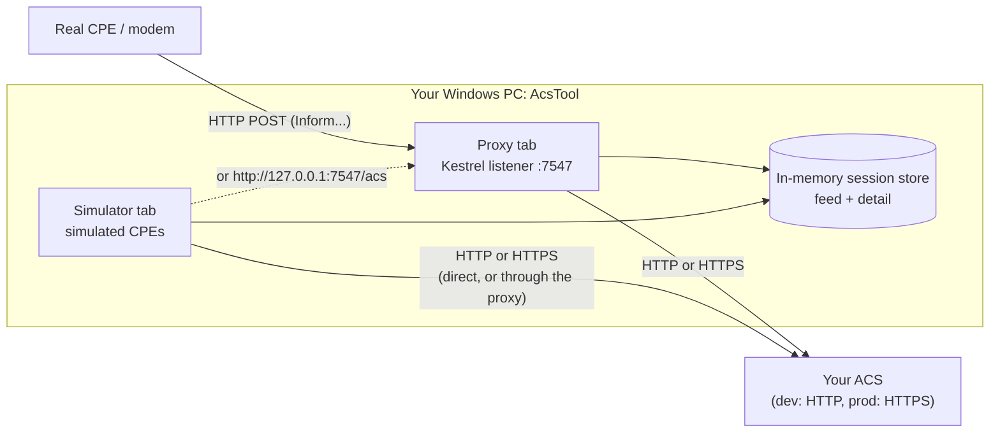

# AcsTool user guide

**AcsTool: ACS TR-069 Proxy & Inform Simulator** is a Windows desktop app (WPF, .NET 10) for engineers who build, run or troubleshoot a TR-069 (CWMP) Auto-Configuration Server (ACS). It does two jobs, one per tab:

| Mode | What it does | Typical question it answers |
|---|---|---|
| **Proxy** | Listens for CPE traffic on your PC (HTTP, port 7547 by default), forwards every request to your real ACS over HTTP or HTTPS, relays the answers back, and records each CWMP session in a live feed. | *"My modem says it sent an Inform. Did it reach the ACS? If not, where did it die: DNS, TCP, TLS, auth or the ACS itself?"* |
| **Simulator** | Acts as one or more fake CPEs. You edit the DeviceId, the event codes and the parameter list, then send an Inform to any ACS URL. It answers the basic ACS RPCs. | *"How does my ACS react to a `0 BOOTSTRAP` from a device it has never seen, with these parameters?"* |

Both tabs share the same session feed and detail pane, so every simulated or proxied session can be inspected message by message (summary, headers and raw XML).

## Who this guide is for

- **Network and ACS engineers** who point lab modems at the tool and need to see exactly what crosses the wire.
- **ACS developers** who want repeatable Informs without touching hardware.
- **Developers of AcsTool itself**: see [architecture.md](architecture.md).

You don't need to know C# to use the app. Basic TR-069 knowledge helps; [tr069-primer.md](tr069-primer.md) covers the parts the tool relies on.

## Documentation index

| Document | Read it when you want to... |
|---|---|
| [getting-started.md](getting-started.md) | install the .NET 10 SDK, build, publish and start the app for the first time |
| [ui-tour.md](ui-tour.md) | know what every window, tab, field and button does, with defaults |
| [proxy-mode.md](proxy-mode.md) | put the tool between a modem and your ACS, read the feed, understand session outcomes and error classes |
| [simulator-mode.md](simulator-mode.md) | build CPE profiles and send custom Informs |
| [settings-reference.md](settings-reference.md) | look up any setting in `settings.json` or a profile file: type, default, effect; file locations; DPAPI |
| [tr069-primer.md](tr069-primer.md) | refresh how a CWMP session works and how the tool tracks it |
| [troubleshooting.md](troubleshooting.md) | decode an error message or banner, plus the FAQ |
| [architecture.md](architecture.md) | understand the code: projects, data flow, threading, tests and CI |
| [roadmap.md](roadmap.md) | check what is **not available yet** (HTTPS listener, TLS UI, periodic Informs, export, ...) |

## What the current version can and cannot do

This guide describes the code on `main` at commit `7b8c906` (version 0.1.0, milestones M0–M4 done, then a .NET 10 migration).

**Available now**
- HTTP proxy listener (any local IPv4/IPv6 address, any port) forwarding to an `http://` or `https://` ACS.
- Basic and Digest authentication **pass-through**: the CPE's `Authorization` header and the ACS's challenge are relayed unchanged.
- Cookie handling: pass-through with `Set-Cookie` rewriting, or a per-CPE cookie jar managed by the proxy.
- Upstream error classification (DNS, Connect, TLS, Timeout, HTTP status, Protocol, ...) and 502/504 answers to the CPE.
- Live session feed with filter, outcome filter, pause, clear and auto-scroll, and a detail pane with Summary, Headers (Authorization redacted until you reveal it) and Raw (optionally pretty-printed) tabs.
- Simulator profiles (TR-098 or TR-181 templates) with DeviceId, ACS URL and credentials (password stored with DPAPI), CWMP version 1.0–1.4, request timeout, event codes (standard, `M` method events with CommandKey, custom), and an editable parameter list.
- Several simulated CPEs at once (one per profile), each answering GetRPCMethods, GetParameterNames, GetParameterValues and SetParameterValues.
- Settings window (Proxy and Capture pages), `settings.json` persistence, rolling Serilog file log.

**Not available yet** (details in [roadmap.md](roadmap.md))
- HTTPS **listener** for the CPE leg, TLS settings page, TLS fields in the profile editor.
- Periodic Informs, automatic retry/backoff, multi-instance profiles, raw SOAP/Inform templates, follow-up actions (reboot, download).
- Session export (JSON or ZIP), the in-app log panel, the dark theme.

> **Safety note.** The proxy listener is plain HTTP and has no access control. It is meant for a trusted lab LAN. By default it listens on all interfaces (`0.0.0.0`).
