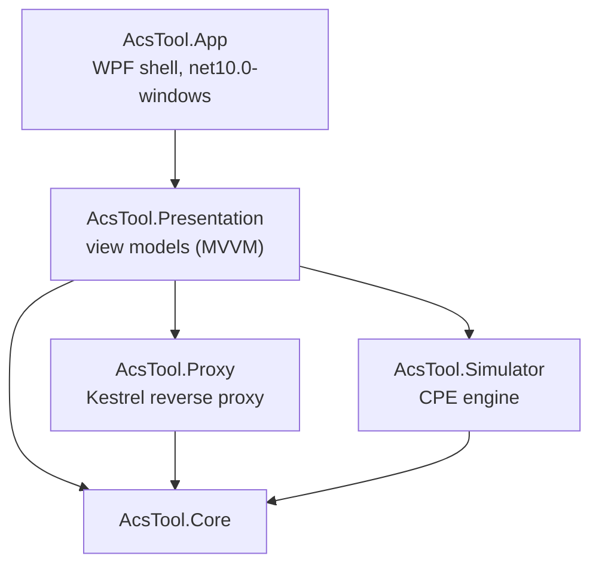
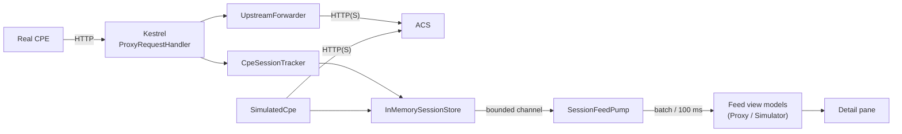
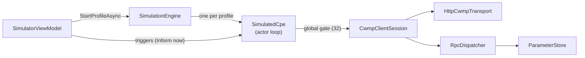

# Architecture

For developers who want to change AcsTool. It describes the code at `main` (7b8c906); planning documents are in [`docs/`](../): `PLAN.md` (milestones), `IMPLEMENTATION_NOTES.md` (what was built, review notes), `M5_TASKS.md`.

## Solution layout

| Project | Target | Content |
|---|---|---|
| `src/AcsTool.Core` | net10.0 | CWMP constants (`Cwmp/`), parser and summarizer (`Parsing/`), message and Inform builders (`Building/`), model records (`Model/`), upstream HTTP stack and error classification (`Net/`), session store (`Sessions/`), settings and persistence (`Settings/`), auth redaction (`Export/AuthRedactor`), utilities (XML pretty-printer). No UI or ASP.NET dependency. |
| `src/AcsTool.Proxy` | net10.0 + ASP.NET Core | `ProxyServer` (Kestrel lifecycle), `ProxyRequestHandler`, `CpeSessionTracker` (correlation and end rules), `UpstreamForwarder`, `HeaderRewriter`. |
| `src/AcsTool.Simulator` | net10.0 | `Profiles/` (profile model, templates, validator, JSON store), `Parameters/ParameterStore`, `Session/CwmpClientSession` + `PendingEventQueue`, `Rpc/RpcDispatcher`, `Transport/HttpCwmpTransport`, `Engine/SimulationEngine` + `SimulatedCpe`. |
| `src/AcsTool.Presentation` | net10.0 | CommunityToolkit.Mvvm view models: `Shell/` (main window, banners, status), `Proxy/`, `Simulator/`, `Feed/` (feed, pump), `Detail/`, `Settings/`. UI services behind interfaces (`Abstractions/`), so the whole layer is unit-tested on Linux. |
| `src/AcsTool.App` | net10.0-windows | WPF views (`Views/*.xaml`), converters, `App.xaml.cs` (host, Serilog, exception handlers), `PlatformServices.cs` (DPAPI, Windows paths, dialogs, clipboard, dispatcher). |
| `tests/*` | net10.0 | xUnit tests per project, plus `AcsTool.Testing` (FakeAcs, fixtures, temp paths) and `tests/fixtures/` (sample CWMP messages). |

The target framework is set once in `Directory.Build.props` (`AcsToolTfm`), and the SDK is pinned in `global.json` (10.0.403, roll forward to the latest feature band).

## Start-up and dependency injection

`App.OnStartup` builds a generic host (`Host.CreateApplicationBuilder`):

1. Serilog file logger (see [Logging](settings-reference.md#logging)).
2. Platform services: `IAppPaths` (Windows folders), `ISecretProtector` = `DpapiSecretProtector`, `IUiDispatcher`, dialog/file-dialog/clipboard services.
3. `AddAcsToolPresentation()`, which pulls in `AddAcsToolProxy()`, `AddAcsToolSimulator()` and `AddAcsToolCore()`. Everything is a singleton registered with `TryAdd`, so the App's platform registrations win over the Core defaults (e.g. `PlainSecretProtector`, used on Linux and in tests).
4. `MainViewModel.InitializeAsync()` loads settings and profiles, shows load banners, and starts the proxy if `startOnLaunch` is set.
5. `--smoke-exit` (used by CI) runs the whole start-up, then shuts down at once and exits with code 0.

On exit, the proxy and all CPEs are stopped and the in-memory settings are saved.

## Data flow

- **One session store** holds both proxy and simulator sessions (`SessionSource` tells them apart). It is the single source of truth: immutable snapshots replaced under one lock per operation, with eviction by count and memory budget (see [`capture`](settings-reference.md#capture-section)).
- Every change is published on a **bounded channel** (10,000 items, DropOldest). When an item is dropped, a counter increments (`dropped` in the status bar) and a resync is flagged, so the pump re-reads snapshots instead of trusting the lost deltas.
- **`SessionFeedPump`** reads the channel, coalesces changes for up to 100 ms or 500 distinct session ids, takes snapshots off the UI thread, and makes **one UI dispatch per batch**. Both feeds subscribe and filter by source.
- The **detail pane** re-reads the selected session's snapshot when the pump reports a change.

## Proxy pipeline

For each request, `ProxyRequestHandler`:

1. Reads the body (up to `maxRequestBodyBytes`; more → `413` and a one-shot session labelled *Request body too large*).
2. Parses it with `CwmpParser` (tolerant of unknown namespaces, prefixes and charset issues) and summarizes it.
3. Asks `CpeSessionTracker` for the session (connection id → cookie pair → IP fallback → new orphan). An Inform always starts a new session and supersedes the device's older one from the same IP.
4. Waits on the session's **gate** (`SemaphoreSlim(1)`), so exchanges of one session are serialized like a real CPE would do.
5. Forwards through `UpstreamForwarder`: one `HttpMessageInvoker` per CWMP session, created by `CpeSessionTracker` (`SocketsHttpHandler`, no automatic redirects, with the TLS callback, connect callback with phase tracking, optional system proxy), `HeaderRewriter` for both directions, cookies per mode.
6. Records exchange notes (header rewrites, end-rule notes) on the exchange; the detail pane's Summary tab shows them under **Proxy notes**. Classifies failures (`ErrorClassifier`: DNS/Connect/TLS/Timeout+phase/…), answers the CPE (`502`/`504`, or aborts), and records the exchange.
7. Applies the end rules (see [How a session ends](proxy-mode.md#how-a-session-ends)). A 1 s sweep timer ends idle sessions and finalizes those waiting for the 2 s completion grace.

`ProxyServer` owns Kestrel (`WebApplication.CreateSlimBuilder`), maps bind errors to `ProxyBindFailure` (port in use, access denied, address not available), and loads the custom CA once per start.

## Simulator pipeline

- `SimulationEngine` validates the profile (`ProfileValidator`), checks the DPAPI password can be decrypted and the device key isn't running, then creates one `SimulatedCpe`.
- Each `SimulatedCpe` is an **actor**: a single loop reading an unbounded single-reader trigger channel, so its state changes are serialized without locks. Each session waits on the engine's **global semaphore** (`maxConcurrentSessions`).
- `CwmpClientSession` runs one session: build Inform (`InformBuilder`), send, then the empty-POST/RPC loop until the ACS sends an empty response, within the 1,000-message and 10-minute limits. It records every exchange in the session store.
- `RpcDispatcher` maps method names to handlers (GetRPCMethods, GetParameterNames, GetParameterValues, SetParameterValues) with per-RPC overrides from `rpcBehaviors`.
- `ParameterStore` is the CPE's own copy of the parameters (thread-safe, ordered, typed validation for SetParameterValues).
- `HttpCwmpTransport` owns one `HttpMessageInvoker` per CPE (credentials, cookies, redirects, TLS options), with a 16 MiB response limit.

## Threading rules

| Where | Rule |
|---|---|
| Kestrel threads | Proxy requests; per-session gate serializes one CPE's exchanges. |
| `CpeSessionTracker` | One lock around all session-table changes; sweep timer runs under the same lock. |
| `InMemorySessionStore` | One lock per operation; readers get immutable snapshots. |
| Simulator | One actor loop per CPE; a global semaphore limits concurrent sessions. |
| UI thread | Only touched via `IUiDispatcher`, once per feed batch, and by view models reacting to state events. |

All time-dependent code takes a `TimeProvider`, so tests use `FakeTimeProvider` instead of sleeping.

## Persistence

- `JsonSettingsStore`: `settings.json`, System.Text.Json source-generated context (`AcsToolJsonContext`: camelCase, string enums, comments and trailing commas allowed), atomic writes, corrupt-file backup.
- `JsonProfileStore`: one file per profile in `profiles\`; unreadable files are skipped with a warning.
- `SettingsHolder`: the live settings, with a `Changed` event the view models and store listen to.
- Secrets: `ISecretProtector`; `DpapiSecretProtector` on Windows (`dpapi:` prefix, CurrentUser scope, entropy), `PlainSecretProtector` elsewhere (`plain:`).

## Tests

- **xUnit** projects for Core, Proxy, Simulator and Presentation, run on Linux and Windows. With the doc-review fixes (fix/doc-findings, b8d33bb): 556 tests, **553 passed, 3 skipped** on Linux (on Windows the DNS test runs too: 554 passed, 2 skipped).
- **`FakeAcs`** (`tests/AcsTool.Testing`) is a scriptable in-process ACS used by proxy and simulator tests; `AcsTool.Simulator.Tests` also runs simulator → proxy → FakeAcs end to end.
- **Fixtures** in `tests/fixtures/` cover CWMP 1.0–1.2 Informs, odd namespaces, faults and RPCs.
- **Skipped tests**: two documented known issues with CustomCa (UTF-8 BOM PEM, multi-certificate PEM: `NET10-01`, `NET10-02`) and a DNS test that skips when the resolver answers for `nonexistent.invalid`. The unroutable-connect timeout test can be skipped locally with `ACSTOOL_SKIP_NET_TIMEOUT=1`; the build scripts refuse that in CI.
- **Perf** tests (`[Trait("Category","Perf")]`) are excluded by default; `./build.sh --include-perf` runs them.

## Build and CI

| Command | Does |
|---|---|
| `./build.sh [--no-coverage] [--include-perf]` | Linux/macOS: restore, Release build of the whole solution (the WPF project compiles on Linux via `EnableWindowsTargeting`), tests with coverage. |
| `./build.ps1 [-NoCoverage]` | Same on Windows. |
| `./publish.ps1` | Self-contained `win-x64` publish to `out/win-x64/AcsTool.exe`. |

`.github/workflows/ci.yml` runs on every push and pull request:
- **linux**: `actions/checkout@v7`, `actions/setup-dotnet@v6` (SDK from `global.json`), a guard against `ACSTOOL_SKIP_NET_TIMEOUT`, then `./build.sh`.
- **windows**: same setup, `./build.ps1 -NoCoverage`, `./publish.ps1`, then starts `AcsTool.exe --smoke-exit` and fails if the exit code isn't 0.

Analyzers run at `AnalysisLevel 10.0-recommended`, pinned so a newer SDK doesn't enable new rules.

## Extending

- **New RPC in the simulator**: add a handler to `RpcDispatcher.CreateDefault()` and its message type to the parser/builder in Core; add a fixture and tests. Unknown methods already fault with 9000.
- **New summary field**: `MessageSummarizer` (also caps long lists at 200 items).
- **New setting**: add it to the record in `AppSettings.cs` with a default (old files keep working), expose it in `SettingsViewModel`/`SettingsWindow.xaml`, and document it in [settings-reference.md](settings-reference.md).
- Keep the Presentation layer free of WPF types, so it stays testable on Linux.
