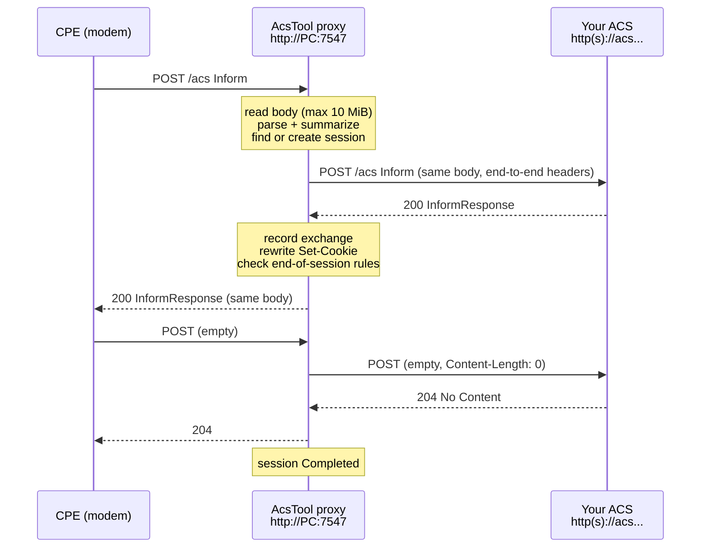
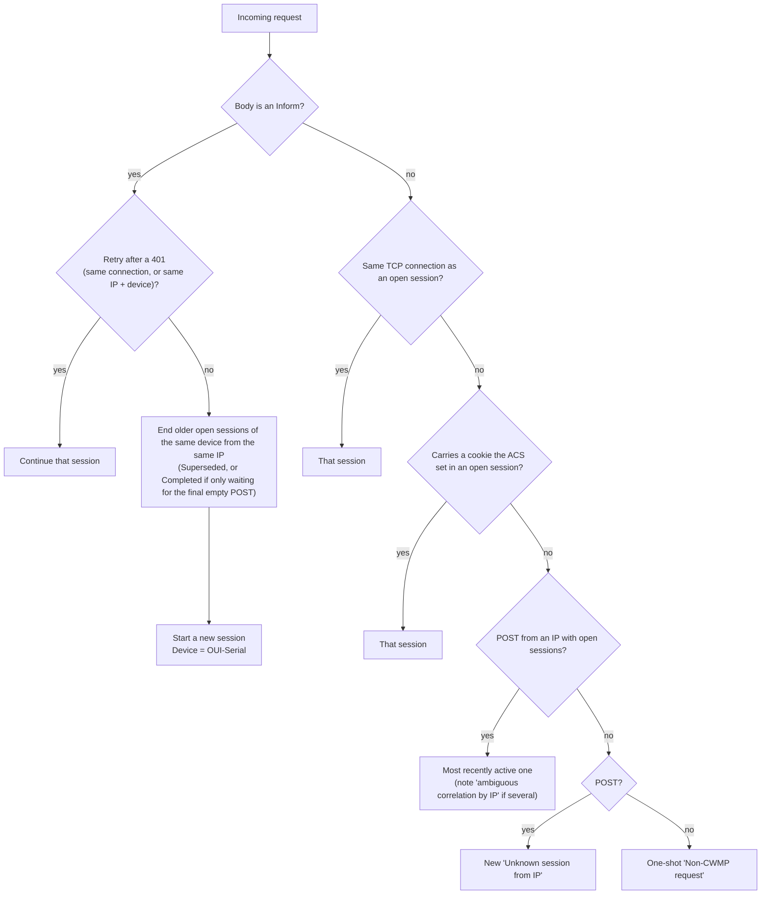

# Proxy mode

In proxy mode AcsTool sits between your CPEs and your ACS. The CPE thinks the tool *is* the ACS; the tool forwards every request to the real ACS, relays the answer, and records the whole CWMP session.



## Concepts

- **Explicit proxy, not transparent.** The CPE must be configured to use the tool's URL as its ACS URL. The tool does not intercept traffic on the network.
- **Plain HTTP on the CPE side.** The listener only speaks HTTP in this version. The ACS side can be HTTP or HTTPS. (An HTTPS listener is planned; see [roadmap.md](roadmap.md).)
- **Bytes are relayed, not re-written.** Request and response bodies are forwarded unchanged, byte for byte. Only specific headers are changed, and every change to a response is noted on the exchange.
- **One upstream connection per CWMP session.** Each proxied session gets its own HTTP client with a single connection to the ACS. This keeps Digest nonces and ACS session stickiness working, and keeps cookies of different CPEs apart.
- **Everything is captured in memory.** Sessions live in an in-memory store bounded by the [Capture settings](settings-reference.md#capture-section). Nothing is written to disk except the log; there is no export yet.

## Paths and the ACS URL

Two things decide which URL the ACS receives: the **upstream URL** on the Proxy tab, and the **path the CPE posts to** (the path in the CPE's ACS URL).

With **Path mode = PassThrough** (default), the forwarded URL is `upstream scheme://host:port` + `upstream path` (trailing `/` removed) + `CPE path and query`:

| Upstream URL | CPE's ACS URL | Forwarded to |
|---|---|---|
| `http://acs-dev.lab:7547` | `http://192.168.1.10:7547/acs` | `http://acs-dev.lab:7547/acs` |
| `https://acs.example.com` | `http://192.168.1.10:7547/cwmp?x=1` | `https://acs.example.com/cwmp?x=1` |
| `https://acs.example.com/tr069` | `http://192.168.1.10:7547/` | `https://acs.example.com/tr069/` |

With **Path mode = Fixed** (Settings window), every request goes to one path, whatever the CPE posts to: the **Fixed upstream path** if set, otherwise the upstream URL's own path and query. The CPE's query string is dropped.

**Recommendation:** keep the upstream URL **without a path** and put the ACS path in the CPE's ACS URL, e.g. upstream `http://acs-dev.lab:7547`, CPE ACS URL `http://<PC IP>:7547/acs`. Then the ACS sees the same path the CPE used, which matters for Digest auth: the Digest `uri` the CPE signs is its own request path. If the proxy changes the path, an ACS that checks `uri` rejects the login. That's why the app shows the warning banner *"Upstream base URL has a path; Digest auth may fail (uri mismatch)"* when you start with an upstream path in PassThrough mode. (Fixed mode can cause the same mismatch but shows no banner.)

The **⧉ URL buttons** next to the state text copy `http://<address>:<port>` without a path. Add your ACS path before pasting it into the CPE.

## HTTPS upstream and TLS modes

Use an `https://` upstream URL to reach a TLS ACS such as your production ACS. The CPE still talks plain HTTP to the proxy. The **TLS** drop-down on the Proxy tab picks how the ACS certificate is validated:

| Mode | Accepts the ACS certificate when... | Notes |
|---|---|---|
| **Strict** (default) | Windows trusts the chain **and** the host name matches. | Revocation is **not** checked (it would hang on isolated lab networks). Use this for a public or company-trusted certificate. |
| **IgnoreErrors** | Always. | For lab use only. A yellow banner *TLS validation disabled for the upstream ACS* stays up while it is in effect. The session's TLS line still shows the real policy errors. |
| **PinnedThumbprint** | The SHA-256 hash of the server's leaf certificate is in your pin list. Chain and name errors are ignored. | The pin list can only be set in `settings.json` (`proxy.tls.pinnedSha256`). **With an empty list, every HTTPS connection fails.** |
| **CustomCa** | The chain builds up to the CA certificate in your file, **and** the host name matches. | The file path can only be set in `settings.json` (`proxy.tls.customCaPath`). PEM, DER or password-less PFX. Without a path, or with an unreadable file, **Start fails** with a banner. |

What you see per session: the detail header shows `subject · issuer <issuer> · <policy errors>` of the ACS certificate, e.g. `CN=acs.example.com · issuer CN=Example CA · None`. A failed validation shows up as error class `TLS` (see [error classes](#upstream-error-classes)).

### Configuring PinnedThumbprint or CustomCa (hand edit)

There is no TLS page in the Settings window yet, so edit `settings.json` by hand:

1. **Close AcsTool.** The app saves its settings when it closes, which would overwrite your edit.
2. Open `%APPDATA%\AcsTool\settings.json` in a text editor. (If it doesn't exist yet, start and close the app once, or click **Save** in the Settings window.)
3. Replace `"tls": null` in the `proxy` section with one of:

   ```jsonc
   // CustomCa: trust your private CA for the upstream ACS
   "tls": {
     "mode": "CustomCa",
     "pinnedSha256": null,
     "customCaPath": "C:\\certs\\lab-root-ca.pem",
     "protocols": "None",
     "clientCertPfxPath": null,
     "clientCertPasswordProtected": null
   },
   ```

   ```jsonc
   // PinnedThumbprint: accept exactly these leaf certificates
   "tls": {
     "mode": "PinnedThumbprint",
     "pinnedSha256": [ "3f1c...e9a0" ],
     "customCaPath": null,
     "protocols": "None",
     "clientCertPfxPath": null,
     "clientCertPasswordProtected": null
   },
   ```

   Pins are the SHA-256 of the certificate's DER bytes in hex. Case, spaces and colons don't matter. In JSON, write backslashes in paths as `\\`. Comments (`//`) are accepted when the file is read, but the app drops them the next time it saves.
4. Start AcsTool. The Proxy tab's **TLS** drop-down now shows the mode. Changing the drop-down later keeps your pins and CA path.

To compute a pin from a certificate file in PowerShell 7 (`pwsh`):

```powershell
$c = [Security.Cryptography.X509Certificates.X509Certificate2]::new('C:\certs\acs.cer')
[Convert]::ToHexString([Security.Cryptography.SHA256]::HashData($c.RawData))
```

`protocols` restricts the TLS versions: `"None"` (default) lets Windows choose; `"Tls12"`, `"Tls13"` or `"Tls12, Tls13"` force them. `clientCertPfxPath` and `clientCertPasswordProtected` exist in the file format but are **not used yet** (no mutual TLS).

Known limitations of `CustomCa` in this version: only the **first** certificate of a PEM bundle is used, a PEM file saved with a UTF-8 BOM is rejected, and a password-protected PFX can't be used. See [roadmap.md](roadmap.md).

> Careful: **Restore defaults** + **Save** in the Settings window resets `tls` to `null` (Strict, no pins, no CA). See [settings-reference.md](settings-reference.md#restore-defaults).

## Authentication pass-through

The proxy never authenticates on its own. It relays:

- the CPE's `Authorization` header to the ACS, unchanged, and
- the ACS's `401` response with its `WWW-Authenticate` challenge back to the CPE.

So **Basic and Digest both work**, with the credentials configured **on the CPE**. Because each session uses one upstream connection, connection-bound Digest state on the ACS stays consistent.

The upstream URL must not contain `user:password@`; both the Proxy tab and the Settings window reject it with *"Remove user:password from the URL: the proxy does not use it. Configure credentials on the CPE; the proxy relays its Authorization header."*

How auth shows up in a session:

| What happens | Session result |
|---|---|
| ACS answers `401`, CPE retries with credentials, ACS accepts | One session; the `401` exchange carries the note `AuthChallenge`; ends normally |
| ACS answers `401` twice in a row to the same kind of message | **🔒 Auth failed** |
| ACS answers `403` | **🔒 Auth failed** |

The retry after a `401` is matched to the same session when it comes on the same connection, or from the same IP with the same device key. The `Authorization` value is masked in the Headers tab until you tick **Reveal Authorization**.

## Cookies

Many ACSs use a session cookie to tie the requests of one CWMP session together. Choose the behavior with **Cookies** on the Proxy tab (or Cookie mode in Settings):

**PassThrough** (default): the CPE's `Cookie` header goes to the ACS as is; the ACS's `Set-Cookie` headers come back to the CPE, rewritten so the CPE will send them back to the proxy:

| Rewrite | When | Setting | Note added to the exchange |
|---|---|---|---|
| Remove `Domain=` | Always | **Strip Set-Cookie Domain** (on) | `Set-Cookie Domain stripped` |
| Remove `Secure` | The CPE leg is HTTP and the upstream is HTTPS | **Strip Set-Cookie Secure when the CPE leg is HTTP** (on) | `Set-Cookie Secure stripped (CPE leg is HTTP)` |
| `Path=` → `Path=/` | The cookie path does not match the path the CPE posts to (e.g. ACS sets `Path=/tr069`, CPE posts to `/acs`) | always | `Set-Cookie Path /tr069 rewritten to / (CPE posts to /acs)` |

**ManagedPerCpe**: the proxy keeps a cookie jar **per CWMP session** and talks cookies with the ACS itself. The CPE's own `Cookie` header is not forwarded, and `Set-Cookie` is not relayed to the CPE (note: `Set-Cookie consumed by proxy (ManagedPerCpe)`). Use this for CPEs that handle cookies badly. A new session starts with an empty jar.

Cookies also help the proxy itself: a request carrying a cookie the ACS set earlier is matched to that session (see [correlation](#how-requests-are-grouped-into-sessions)).

## Other header handling

| Header | What the proxy does |
|---|---|
| `Host` | **Host header = Upstream** (default): the ACS gets its own host name. **Preserve**: the ACS gets the CPE's original `Host` value. |
| `X-Forwarded-For` | Off by default. When **Add X-Forwarded-For** is on, the CPE's IP is appended (an existing value is kept: `prior, cpe-ip`). |
| Hop-by-hop headers (`Connection`, `Keep-Alive`, `Transfer-Encoding`, `TE`, `Trailer`, `Upgrade`, `Proxy-Authenticate`, `Proxy-Authorization`, `Proxy-Connection`, and any listed in `Connection`) | Never forwarded, either way. |
| `Content-Length`, `Expect` | Recomputed / not forwarded. An empty POST goes out with `Content-Length: 0`. |
| `Location` on 3xx | Relayed unchanged, with the note `3xx Location points to … (not rewritten; the CPE may bypass the proxy)`. The proxy does not follow redirects itself. |
| `Server` | Kestrel adds no `Server` header of its own. |

**Use the system proxy for upstream** (off by default) makes the upstream connection go through the Windows system proxy settings.

## How requests are grouped into sessions

HTTP has no session id, so the proxy groups requests into CWMP sessions by these rules:



Requests of one session are forwarded one at a time, in order.

## How a session ends

After each exchange the proxy checks these rules, in this order:

| Situation | Outcome |
|---|---|
| The upstream request failed (no usable response) | **✖ Upstream error** (or **⊘ Canceled** if the proxy was being stopped) |
| The ACS answered the **Inform** with a SOAP Fault (not on 401/407) | **⚠ ACS fault**, at once. A Fault answering a later message does not end the session. |
| `401` (challenge) | Session continues; a second `401` in a row → **🔒 Auth failed** |
| `403` | **🔒 Auth failed** |
| Any other status ≥ 400 | **⚠ HTTP error** |
| Empty answer (204, or 2xx with empty body) to the CPE's **empty POST** | **✔ Completed** (or **⚠ ACS fault** / **⚠ CPE fault** if a fault was seen earlier in the session) |
| Empty answer to a CPE *response* after the CPE already sent its empty POST | The session waits for an optional final empty POST. It ends at that POST, or after **2 s** of silence, as Completed / ACS fault / CPE fault. |
| Empty answer to the **Inform** | **⚠ Protocol error** (note: *ACS answered the Inform with an empty response (InformResponse expected)*) |

Outside those rules:

| Situation | Outcome |
|---|---|
| No traffic for **Session idle timeout** (default 30 s) | **⌛ Abandoned** |
| The same device sends a new Inform from the same IP while its old session is open | old session **↷ Superseded** |
| You stop the proxy (or close the app) | open sessions **⊘ Canceled** |
| Request body larger than 10 MiB | One-shot session *Request body too large*, **⚠ Protocol error**; the CPE gets `413` and nothing is forwarded |

A background sweep runs every second, so a session that ends by the 2-second rule shows as *In progress* for up to about 3 seconds.

## Session outcomes

| Badge | Meaning in proxy mode |
|---|---|
| `⧗ In progress` | Still open |
| `✔ Completed` | Ended cleanly with empty messages from both sides |
| `✖ Upstream error` | The proxy could not get a usable answer from the ACS; see the error class |
| `🔒 Auth failed` | Two 401s in a row, or a 403 |
| `⚠ ACS fault` | The ACS sent a SOAP Fault (to the Inform, or earlier in a session that then ended normally) |
| `⚠ CPE fault` | The CPE sent a Fault (e.g. to a SetParameterValues) in a session that then ended normally |
| `⚠ HTTP error` | ACS status ≥ 400 other than 401/403 |
| `⚠ Protocol error` | Empty answer to an Inform, or an oversized request |
| `⌛ Abandoned` | Idle longer than the session idle timeout |
| `↷ Superseded` | Replaced by a new Inform from the same device |
| `⊘ Canceled` | Proxy stopped during the session |

## Upstream error classes

When forwarding fails, the exchange and the session get a classified error. The **Response** column and the red feed line show its short form.

| Short form (example) | Class | Typical cause | What the CPE receives |
|---|---|---|---|
| `DNS` | Dns | ACS host name doesn't resolve | `502 Bad Gateway` |
| `CONNECT ConnectionRefused` | Connect | Nothing listens on the ACS port; firewall reject; connect timeout (*connect to … timed out after 10s*) | `502` |
| `TLS RemoteCertificateChainErrors` | Tls | Untrusted or expired certificate, wrong host name, TLS version mismatch, pin not matched | `502` |
| `TIMEOUT AwaitingResponse` | Timeout | The ACS took longer than the **Request timeout** (30 s). The phase tells where: `Dns`, `Connect`, `Tls`, `AwaitingResponse` or `ReadingBody`. | `504 Gateway Timeout` |
| `PROTOCOL` | Protocol | Connection reset or closed by the ACS mid-request, invalid HTTP | `502` |
| `BODYTOOLARGE` | BodyTooLarge | ACS response larger than 10 MiB | `502` |
| `HTTP 500` | HttpStatus | The ACS answered with an error status (not 401) | The ACS response itself, unchanged |
| `CANCELED` | Canceled | Proxy stopped during the request | (connection closed) |
| `UNKNOWN` | Unknown | Anything else; see the message and the log | `502` |

The `502`/`504` answers have an empty body and `Connection: close`. With **Upstream failure = Abort** (Settings), the proxy instead drops the CPE connection without any answer, which mimics a network failure for the CPE.

## The live feed and the detail pane

The Proxy tab's feed lists proxied sessions only. The **Client** column is the CPE's `ip:port`, the **Device** column its `OUI-Serial`. Click a row to open it in the detail pane; the [UI tour](ui-tour.md#session-feed-shared) explains every column, filter and tab.

Useful habits:
- **Outcome = ErrorsOnly** to watch only failing devices.
- Type a serial number or an IP into **Filter**.
- **⏸ Pause** while you read; nothing is lost.
- On the **Raw** tab, **Copy request** gives you the exact Inform the modem sent, ready to replay with the simulator or a script.

## Walkthrough 1: put a lab modem behind the proxy

Goal: a controlled modem talks to your **dev ACS** (HTTP) through AcsTool so you can watch each session.

1. Find the PC's address on the modem's network: start the proxy once and look at the **⧉** URL buttons, or run `ipconfig`.
2. **Proxy tab:** Listen `0.0.0.0`, Port `7547`, Upstream `http://<dev-acs-host>:<port>` (no path), TLS `Strict`, Cookies `PassThrough`.
3. Click **▶ Start**. Allow the Windows Firewall prompt on **Private** networks. The state shows `● Running on http://192.168.1.10:7547 …`.
4. On the modem (web UI, TR-069 page, or your provisioning file), set **ACS URL** to `http://192.168.1.10:7547/acs`, using the path your ACS expects instead of `/acs`. Keep the modem's ACS username and password.
5. Trigger an Inform: reboot the modem, or use its "Inform now" / periodic-inform setting, or send a connection request from the ACS. (Connection requests go directly from the ACS to the modem; the proxy doesn't see them, only the Inform that follows.)
6. Within seconds the feed shows a row `<OUI>-<serial>` with events like `1` or `6`. Click it:
   - Exchange 1: `Inform … [1 BOOT] N params` → `200 InformResponse`.
   - Then `(empty)` → whatever the ACS sends (e.g. `GPV ×3`), the CPE's responses, and finally `(empty)` → `204`.
7. A healthy session ends **✔ Completed**. Anything else: see [session outcomes](#session-outcomes) and [troubleshooting.md](troubleshooting.md).

## Walkthrough 2: forward to the HTTPS production ACS

1. Stop the proxy. Set Upstream to `https://<prod-acs-host>/<path?>`; prefer no path, as explained in [Paths](#paths-and-the-acs-url).
2. Leave **TLS = Strict** if the ACS has a certificate Windows trusts (public CA, or your company CA installed in Windows).
3. Start and trigger an Inform. In the detail header, check the TLS line: `CN=… · issuer … · None` means validation passed.
4. If sessions fail with `TLS RemoteCertificateChainErrors`, the chain is not trusted:
   - Best: install the issuing CA in Windows (Current User → Trusted Root), or use **CustomCa** with the CA file ([hand edit](#configuring-pinnedthumbprint-or-customca-hand-edit)).
   - For a quick lab check only: **IgnoreErrors**. The yellow banner reminds you it's on.
5. `TLS RemoteCertificateNameMismatch` means the URL's host name is not in the certificate. Use the name the certificate was issued for.

The modem keeps talking plain HTTP to the proxy, so you can test HTTPS-ACS behavior with modems that have no certificates installed.

## Walkthrough 3: find out where an Inform dies

1. Point the modem at the proxy as in walkthrough 1.
2. Trigger an Inform and select the session. Read the **Response** column of exchange 1 and the red error line:

| You see | Meaning | Next step |
|---|---|---|
| No session at all | The Inform never reached the PC | Check the modem's ACS URL, routing, Windows Firewall, and that **Listen** isn't `127.0.0.1` |
| `DNS` | The PC can't resolve the ACS name | Fix DNS or use an IP |
| `CONNECT ConnectionRefused` / `CONNECT TimedOut` | ACS host reachable but port closed, or packets dropped | Check the ACS service, port and firewalls |
| `TLS …` | Certificate problem | See walkthrough 2 |
| `TIMEOUT AwaitingResponse` | The ACS accepted the connection but didn't answer in time | Check ACS load and logs; raise **Request timeout** if it is just slow |
| `401` then **🔒 Auth failed** | Wrong CPE credentials, or a Digest `uri` mismatch | Check credentials; remove the path from the upstream URL |
| `500` / **⚠ HTTP error** | The ACS failed while processing | Look at the ACS logs with the exact request from **Copy request** |
| `500 Fault 8005 …` (or `200 Fault …`) / **⚠ ACS fault** | The ACS rejected the Inform with a CWMP fault | The Summary tab shows `FaultCode` and `FaultString` |

## Walkthrough 4: Digest auth through the proxy

1. Configure the modem with its ACS username and password. Upstream URL without path, as in walkthrough 1.
2. Trigger an Inform. Expected exchanges: `Inform …` → `401`, `Inform …` → `200 InformResponse`, then the rest. The first exchange carries the note `AuthChallenge`.
3. On the **Headers** tab of exchange 2, `Authorization` shows `Digest username="…" <redacted>`; tick **Reveal Authorization** to compare the `uri` with the path the ACS received.
4. **🔒 Auth failed** after two `401`s means the ACS rejected the credentials. If the same credentials work without the proxy, check the [path rules](#paths-and-the-acs-url).

## Walkthrough 5: an ACS that relies on cookies

1. With **Cookies = PassThrough**, run a session and look at the notes on the InformResponse exchange, e.g. `Set-Cookie Domain stripped`. On the next exchange, the request headers should contain the cookie.
2. If the modem doesn't send the cookie back (the ACS then sees each POST as a new session), stop the proxy, switch **Cookies** to **ManagedPerCpe** and start again. The proxy now holds the cookie for the modem; the notes say `Set-Cookie consumed by proxy (ManagedPerCpe)`.
