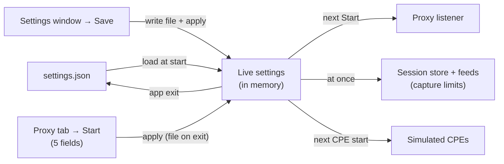

# Settings reference

Every setting AcsTool reads, its type, default and effect. Source of truth: `src/AcsTool.Core/Settings/AppSettings.cs` (app settings) and `src/AcsTool.Simulator/Profiles/CpeProfile.cs` (profiles).

## Where files live

| Path | Content | Written |
|---|---|---|
| `%APPDATA%\AcsTool\settings.json` | App settings | On **Save** in the Settings window, and when the app closes |
| `%APPDATA%\AcsTool\settings.json.bad-YYYYMMDDhhmmss` | Backup of a settings file that could not be parsed (timestamp in UTC) | At start-up, when needed |
| `%APPDATA%\AcsTool\profiles\<profile-id>.json` | One simulator profile per file | On **Save** in the profile editor; deleted by **Delete** |
| `%LOCALAPPDATA%\AcsTool\logs\acstool-YYYYMMDD.log` | Log file | Continuously |

`%APPDATA%` is usually `C:\Users\<you>\AppData\Roaming`, `%LOCALAPPDATA%` is `C:\Users\<you>\AppData\Local`. Type the path into Explorer's address bar to open it.

Files are written atomically (to `*.tmp`, then moved over the old file), so a crash never leaves half a file.

**Edit JSON files only while AcsTool is closed.** The app keeps settings in memory and writes them back on exit, and it reads profiles only at start-up.

## How settings are applied



- **Proxy settings** apply on the next **Start** of the proxy. The Proxy tab's five fields (Listen, Port, Upstream, TLS mode, Cookies) are copied into the live settings when you click Start, and saved to the file on exit or on the next Settings **Save**.
- **Capture limits** (max sessions, capture budget, feed size) apply immediately; older sessions are evicted at once if needed. *Max captured body* applies to the proxy on its next Start and to a simulated CPE when it is started.
- **Simulator settings** (file only) apply when a CPE is started. A new concurrency limit takes effect the next time a profile starts while no CPE is running.

## settings.json at a glance

This is the file the app writes with default values:

```json
{
  "schemaVersion": 1,
  "proxy": {
    "bindAddress": "0.0.0.0",
    "port": 7547,
    "upstreamUrl": "http://localhost:7557",
    "pathMode": "PassThrough",
    "fixedUpstreamPath": null,
    "hostHeader": "Upstream",
    "cookieMode": "PassThrough",
    "stripCookieDomain": true,
    "stripCookieSecureOnHttp": true,
    "addXForwardedFor": false,
    "failureMode": "StatusCode",
    "connectTimeoutSeconds": 10,
    "requestTimeoutSeconds": 30,
    "sessionIdleTimeoutSeconds": 30,
    "tls": null,
    "useSystemProxy": false,
    "startOnLaunch": false,
    "maxRequestBodyBytes": 10485760
  },
  "capture": {
    "maxSessions": 5000,
    "maxCapturedBodyBytes": 1048576,
    "captureBudgetBytes": 268435456,
    "maxFeedItems": 2000
  },
  "simulator": {
    "maxConcurrentSessions": 32,
    "defaultRequestTimeoutSeconds": 30,
    "rebootDelaySeconds": 10,
    "downloadDurationSeconds": 5,
    "userAgent": "AcsTool-Sim/1.0",
    "soapAction": "Empty"
  },
  "ui": {
    "theme": "System",
    "newestOnTop": true,
    "autoScroll": true,
    "showRawByDefault": false
  },
  "logging": {
    "minimumLevel": "Information",
    "fileLoggingEnabled": true
  }
}
```

Property names are camelCase; enum values are written as strings. Comments and trailing commas are accepted when reading. Missing sections or properties fall back to their defaults.

The **Where to edit** column below says where each setting can be changed: **Tab** (Proxy tab), **Window** (Settings window), **File** (`settings.json` only).

## `proxy` section

| Key | Type | Default | Where to edit | Effect |
|---|---|---|---|---|
| `bindAddress` | string | `"0.0.0.0"` | Tab (Listen), Window | Local address of the listener. `0.0.0.0` = all IPv4 interfaces, `127.0.0.1` = this PC only; any local IPv4/IPv6 address or `localhost`. |
| `port` | int | `7547` | Tab, Window | Listener TCP port (1–65535). |
| `upstreamUrl` | string | `"http://localhost:7557"` | Tab (→ Upstream), Window | Base URL of the ACS. `http` or `https`; no `user:password@`. |
| `pathMode` | `PassThrough` \| `Fixed` | `PassThrough` | Window | `PassThrough`: upstream path + CPE path + query. `Fixed`: always `fixedUpstreamPath` (or the upstream URL's own path). See [Paths](proxy-mode.md#paths-and-the-acs-url). |
| `fixedUpstreamPath` | string or null | `null` | Window | Path used in `Fixed` mode, e.g. `/tr069`. A missing leading `/` is added. |
| `hostHeader` | `Upstream` \| `Preserve` | `Upstream` | Window | `Upstream`: the ACS sees its own host name. `Preserve`: the ACS sees the CPE's `Host` header. |
| `cookieMode` | `PassThrough` \| `ManagedPerCpe` | `PassThrough` | Tab (Cookies), Window | See [Cookies](proxy-mode.md#cookies). |
| `stripCookieDomain` | bool | `true` | Window | Remove `Domain=` from `Set-Cookie` (PassThrough mode). |
| `stripCookieSecureOnHttp` | bool | `true` | Window | Remove `Secure` from `Set-Cookie` when the CPE side is HTTP and the ACS is HTTPS. |
| `addXForwardedFor` | bool | `false` | Window | Append the CPE IP to `X-Forwarded-For`. |
| `failureMode` | `StatusCode` \| `Abort` | `StatusCode` | Window | On upstream failure: answer the CPE `502`/`504` (StatusCode), or drop the CPE connection (Abort). |
| `connectTimeoutSeconds` | int | `10` | Window | TCP connect timeout to the ACS, total across all resolved addresses (1–300 in the window). Exceeding it gives `CONNECT … timed out`. |
| `requestTimeoutSeconds` | int | `30` | Window | Whole-request timeout to the ACS, including connect (1–3600). Exceeding it gives `TIMEOUT <phase>` and `504`. |
| `sessionIdleTimeoutSeconds` | int | `30` | Window | A proxied session with no traffic for this long ends as Abandoned (1–3600). |
| `tls` | object or null | `null` (= Strict) | Tab (mode only), File | Upstream TLS options; see [`proxy.tls`](#proxytls-object). |
| `useSystemProxy` | bool | `false` | Window | Send upstream traffic through the Windows system proxy. |
| `startOnLaunch` | bool | `false` | Window | Start the proxy automatically when the app starts. |
| `maxRequestBodyBytes` | int | `10485760` (10 MiB) | File | Largest request body accepted from a CPE (bigger → `413`, not forwarded) **and** largest response body accepted from the ACS (bigger → `BODYTOOLARGE`, CPE gets `502`). |

### `proxy.tls` object

Also used, with the same shape, as `tls` in a profile file. There it is not editable in the window, but a hand-edited value is used by the simulated CPE.

| Key | Type | Default | Effect |
|---|---|---|---|
| `mode` | `Strict` \| `IgnoreErrors` \| `PinnedThumbprint` \| `CustomCa` | `Strict` | Certificate validation for an `https://` upstream. See [TLS modes](proxy-mode.md#https-upstream-and-tls-modes). |
| `pinnedSha256` | array of strings or null | `null` | SHA-256 hashes (hex) of accepted leaf certificates, for `PinnedThumbprint`. Non-hex characters such as `:` are ignored. Empty list = nothing accepted. |
| `customCaPath` | string or null | `null` | CA certificate file (PEM, DER or password-less PFX) for `CustomCa`. Loaded once at Start; a missing or invalid file fails the Start. |
| `protocols` | string | `"None"` | Allowed TLS versions: `"None"` = OS default, or e.g. `"Tls12"`, `"Tls13"`, `"Tls12, Tls13"`. |
| `clientCertPfxPath` | string or null | `null` | **Not used yet** (mutual TLS is not implemented). |
| `clientCertPasswordProtected` | string or null | `null` | **Not used yet.** |

Revocation is never checked, in any mode.

## `capture` section

The capture settings bound how much the in-memory session store keeps. The store evicts the **oldest ended** sessions when there are more than `maxSessions`, or when the estimated memory exceeds `captureBudgetBytes`. Sessions in progress are never evicted.

| Key | Type | Default | Window field (unit, range) | Effect |
|---|---|---|---|---|
| `maxSessions` | int | `5000` | Max sessions (10–1,000,000) | Sessions kept in memory, both tabs together. |
| `maxCapturedBodyBytes` | int | `1048576` (1 MiB) | Max captured body (KiB, 1–102,400) | Per-message body kept for display. Longer bodies are still forwarded in full, but stored truncated (the Raw tab says `Captured X of Y`). Summaries are parsed from the full body. |
| `captureBudgetBytes` | long | `268435456` (256 MiB) | Capture budget (MiB, 16–16,384) | Estimated memory budget: body bytes + 2 × the characters of headers and summary fields. Shown in the status bar. |
| `maxFeedItems` | int | `2000` | Feed max items (100–100,000) | Rows per feed (each tab); the oldest rows drop off the list. They stay in memory until evicted by the store limits. |

## `simulator` section (file only)

| Key | Type | Default | Effect |
|---|---|---|---|
| `maxConcurrentSessions` | int | `32` | Sessions that may run at the same time across all simulated CPEs. |
| `userAgent` | string | `"AcsTool-Sim/1.0"` | `User-Agent` header of simulator requests. |
| `soapAction` | `Empty` \| `MethodName` \| `Omit` | `Empty` | `SOAPAction` header on non-empty simulator POSTs: `""`, `"urn:dslforum-org:cwmp-1-x#<Method>"`, or none. |
| `defaultRequestTimeoutSeconds` | int | `30` | **Not used** in this version (each profile has its own timeout). |
| `rebootDelaySeconds` | int | `10` | **Not used** (reboot follow-ups are not implemented). |
| `downloadDurationSeconds` | int | `5` | **Not used** (download follow-ups are not implemented). |

## `ui` section (file only)

| Key | Type | Default | Effect |
|---|---|---|---|
| `newestOnTop` | bool | `true` | New sessions are inserted at the top of the feeds (`false`: appended at the bottom). |
| `theme` | `System` \| `Light` \| `Dark` | `System` | **Not used**: the app always uses its light theme. |
| `autoScroll` | bool | `true` | **Not used**: the feed's Auto-scroll check box always starts on. |
| `showRawByDefault` | bool | `false` | **Not used.** |

## `logging` section (file only)

| Key | Type | Default | Effect |
|---|---|---|---|
| `minimumLevel` | log level | `Information` | **Not used**: the level is fixed at Information. |
| `fileLoggingEnabled` | bool | `true` | **Not used**: file logging is always on. |

## `schemaVersion`

`1`. Reserved for future migrations. A value of 0 or less is treated as 1.

## Restore defaults

**Restore defaults** in the Settings window resets the whole `proxy` and `capture` sections, not only the fields on screen. After **Save**:
- `proxy.tls` becomes `null`: TLS mode Strict, and your pins and custom CA path are **gone**;
- `proxy.maxRequestBodyBytes` goes back to 10 MiB.

The `simulator`, `ui` and `logging` sections are kept. If you use hand-edited TLS settings, back up `settings.json` first. This is a [known issue](troubleshooting.md#known-issues-fixes-planned); a fix to keep `tls` and `maxRequestBodyBytes` is planned.

## Corrupt or missing settings file

- **Missing**: defaults are used. The file is created the first time settings are saved (Settings **Save** or app exit).
- **Unparseable** (invalid JSON): the file is copied to `settings.json.bad-<UTC timestamp>`, defaults are loaded, and a yellow banner says so. The defaults overwrite `settings.json` on exit; fix the backup and copy it back while the app is closed if you want your values.
- Profile files that can't be read are skipped (a warning goes to the log) and the others load normally.

## Passwords and DPAPI

The only secrets AcsTool stores are **simulator profile passwords**. (The proxy stores no credentials: it relays the CPE's own `Authorization` header.)

- A password is encrypted with Windows DPAPI, scope **CurrentUser**, plus an app-specific entropy, and stored as `"passwordProtected": "dpapi:<base64>"` in the profile file. Plain text never touches the disk.
- Only the same Windows user on the same PC can decrypt it. Copying a profile to another PC or user, or some Windows profile resets, makes it unreadable.
- When a password can't be decrypted, the app shows a warning banner and a red note in the editor, keeps the stored value untouched (it's not wiped), and refuses to start that profile until you type a new password and save.
- A value starting with `plain:` (or with no prefix) is read as plain text. That's accepted for compatibility; the app itself never writes it on Windows.

Passwords are not written to the log. Captured `Authorization` headers are masked in the Headers tab until you tick **Reveal Authorization**, but they're kept in memory unmasked so you can reveal them.

## Profile file format

`%APPDATA%\AcsTool\profiles\<id>.json`, camelCase, enums as strings. Fields edited in the UI are marked ✎.

| Key | Type | Template default | Effect |
|---|---|---|---|
| `id` | GUID | new | Identity; also the file name. |
| `name` ✎ | string | `New TR-098 profile` / `New TR-181 profile` | Display name. |
| `deviceId` ✎ | object | `manufacturer` `AcsTool`, `oui` `00D09E`, `productClass` `IGD`/`Device2`, `serialNumber` `SIM098001`/`SIM181001` | Inform DeviceId. |
| `acsUrl` ✎ | string | `http://127.0.0.1:7547/acs` | Target URL. |
| `username` ✎ | string or null | `null` | HTTP auth user. |
| `passwordProtected` ✎ | string or null | `null` | DPAPI-protected password. |
| `version` ✎ | `V1_0`…`V1_4` | `V1_0` | CWMP namespace. |
| `root` | `InternetGatewayDevice` \| `Device` | from template | Data model root; decides the mandatory Inform parameters. |
| `parameters` ✎ | array | template list | Each: `name`, `xsdType`, `value`, `writable`, `includeInInform`, `notification`. |
| `defaultEvents` ✎ | array | `[{"eventCode":"1 BOOT","commandKey":""}]` | Ticked events. |
| `requestTimeoutSeconds` ✎ | int | `30` | Per-request timeout (1–600). |
| `rpcBehaviors` | map | `{}` | Per-RPC overrides: `kind` `Auto`/`Fault`/`NoResponse`, `faultCode` (9000–9899), `delaySeconds`. See [simulator-mode.md](simulator-mode.md#advanced-per-rpc-behavior-overrides-profile-json). |
| `tls` | object | `mode` `Strict` | Same shape as `proxy.tls`. Not editable in the window; a hand-edited value is used. |
| `maxEnvelopes` | uint | `1` | Inform `MaxEnvelopes` value. |
| `periodic` | object | `enabled` false, `intervalSeconds` 300, `phaseTime` null, `jitterPercent` 0 | **Not used yet** (no periodic Informs). |
| `retry` | object | `minimumWaitSeconds` 5, `intervalMultiplier` 2000, `maxRetries` null | **Not used yet** (no automatic retry). |
| `rawInformTemplate`, `useRawTemplate`, `sendInvalidTemplate` | string/bool | `null`, `false`, `false` | **Not used yet** (no raw templates). |
| `instances` | object | `count` 1, `serialPattern` `{serial}`, `startIndex` 1, `staggerSeconds` 5 | `count` must be 1; other values fail validation. |
| `schemaVersion` | int | `1` | Reserved. |
| `rootPrefix` | string | | Written for information only (`InternetGatewayDevice.` or `Device.`); ignored when read. |

## Logging

- File: `%LOCALAPPDATA%\AcsTool\logs\acstool-YYYYMMDD.log`; a new file every day, or when a file reaches 10 MB (`acstool-YYYYMMDD_001.log`, …). The 7 newest files are kept.
- Level: Information and above (ASP.NET Core and hosting internals: Warning and above).
- Line format: `<ISO timestamp> [INF] <source>: <message>` followed by any exception.
- Typical entries: proxy start (`Proxy listening on … → <upstream>`), bind failures, upstream user-info warnings, simulator session results (`Simulator session … ended: Completed`), unreadable profiles, corrupt settings, unhandled errors.
- There is no log viewer inside the app yet; open the file with any text editor.
