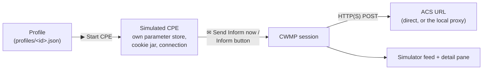
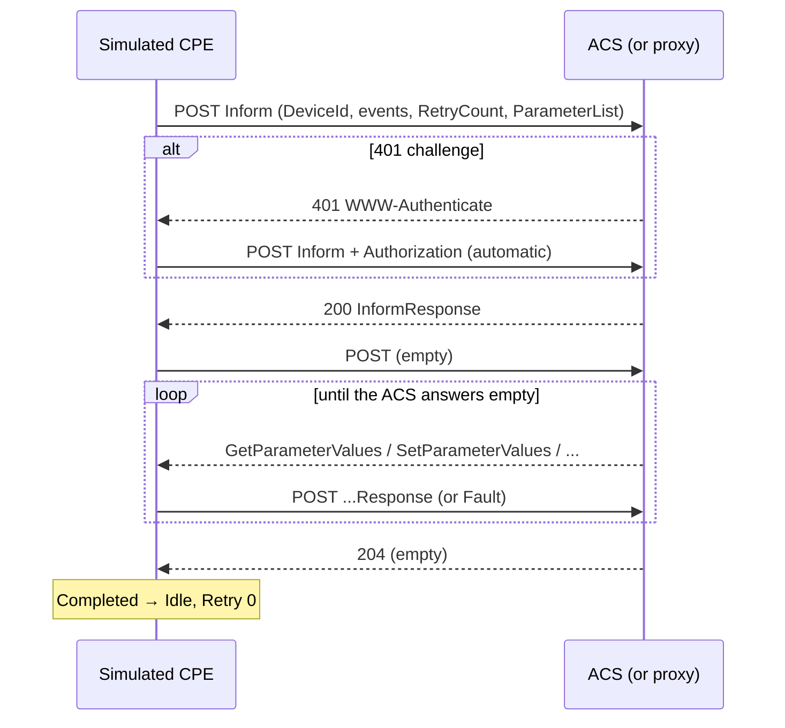

# Simulator mode

In simulator mode AcsTool plays the CPE. You describe a device in a **profile** (identity, ACS URL, credentials, events, parameters), start a **simulated CPE** from it, and send Informs on demand. The simulated CPE then answers the ACS's basic RPCs from its parameter list, just like a modem would.



## Concepts

| Term | Meaning |
|---|---|
| **Profile** | A saved device description. One JSON file per profile in `%APPDATA%\AcsTool\profiles\`. |
| **Simulated CPE** | A running instance of a profile, shown in **Running CPEs**. It has its own copy of the parameters, its own HTTP connection and cookie jar, and a queue of pending events. One CPE per profile in this version. |
| **Session** | One CWMP session the CPE opens: Inform, then the ACS's requests, until the ACS sends an empty response. Shown in the Simulator tab's feed. |
| **Device key** | `OUI-Serial`, e.g. `00D09E-SIM098001`. Two running CPEs can't share a device key. |

## Profiles

### Creating a profile

Click **+ From TR-098** or **+ From TR-181** in the Profiles list. Both templates start with:

| Field | TR-098 template | TR-181 template |
|---|---|---|
| Name | `New TR-098 profile` | `New TR-181 profile` |
| Manufacturer | `AcsTool` | `AcsTool` |
| OUI | `00D09E` | `00D09E` |
| ProductClass | `IGD` | `Device2` |
| Serial | `SIM098001` (next free number) | `SIM181001` (next free number) |
| Data model root | `InternetGatewayDevice.` | `Device.` |
| ACS URL | `http://127.0.0.1:7547/acs` (the local proxy) | same |
| User / Password | empty | empty |
| cwmp | `V1_0` | `V1_0` |
| Timeout (s) | `30` | `30` |
| Events | `1 BOOT` | `1 BOOT` |

The new profile shows as `● New TR-… profile` until you click **Save**. Saving validates the profile and writes the file; errors are listed under the command bar and in a red banner.

There is no import, duplicate or rename-file function; the file name is the profile's internal id. To copy a profile, create a new one from the same template and edit it.

### Validation rules

| Field | Rule | Error text |
|---|---|---|
| Name | not empty | `Name: Name is required` |
| OUI | 6 upper-case hex digits | `DeviceId.OUI: OUI must be 6 upper-case hex digits (e.g. 00D09E)` |
| Serial | not empty | `DeviceId.SerialNumber: Serial number is required` |
| Manufacturer | not empty, unless ProductClass is set | `DeviceId.Manufacturer: Manufacturer is required` |
| ACS URL | absolute `http://` or `https://` | `AcsUrl: ACS URL must be an absolute http:// or https:// URL` |
| Timeout | 1–600 s | `RequestTimeoutSeconds: Request timeout must be between 1 and 600 seconds` |
| Parameters | valid name under the root, unique, known type, value valid for the type, notification 0–2 | e.g. `Parameters[3]: Value 'abc' is not a valid xsd:unsignedInt for …` |

The same rules run on **▶ Start CPE** and **✉ Send Inform now**, which use the editor's current values even if they are not saved.

### DeviceId

The four Device fields become the Inform's `DeviceId` structure: `Manufacturer`, `OUI`, `ProductClass`, `SerialNumber`. Your ACS normally identifies a device by OUI + (ProductClass) + Serial, so changing the serial number is the quickest way to look like a brand-new device.

The template parameters `DeviceInfo.Manufacturer`, `…ManufacturerOUI`, `…ProductClass` and `…SerialNumber` are filled from the DeviceId **when the profile is created** (or when you click **Reset to defaults**). Editing the Device fields later does not update those parameters; keep them in sync yourself if your ACS compares them.

### Credentials

**User** and **Password** are used for HTTP authentication against the ACS URL. The simulator supports **Basic and Digest** (it answers the ACS's `401` challenge automatically, then pre-authenticates later requests). Leave **User** empty for an ACS without auth.

The password is encrypted with Windows **DPAPI** for your Windows user before it is written to the profile file (`"passwordProtected": "dpapi:…"`). A profile file copied to another PC or another Windows user can't decrypt it: you get a warning banner, a red note under the field, and Start is refused until you type the password again. See [settings-reference.md](settings-reference.md#passwords-and-dpapi).

### CWMP version and timeout

- **cwmp** selects `urn:dslforum-org:cwmp-1-0` … `cwmp-1-4` as the namespace of every message the CPE sends. When the ACS replies in another version, the CPE answers that request in the ACS's version.
- **Timeout (s)** is the per-request timeout (whole request). The TCP connect timeout is `min(Timeout, 10 s)`.

## Events

Tick the events the next Inform should carry. The list contains all standard events and method events:

| Group | Codes |
|---|---|
| Standard | `0 BOOTSTRAP`, `1 BOOT`, `2 PERIODIC`, `3 SCHEDULED`, `4 VALUE CHANGE`, `5 KICKED`, `6 CONNECTION REQUEST`, `7 TRANSFER COMPLETE`, `8 DIAGNOSTICS COMPLETE`, `9 REQUEST DOWNLOAD`, `10 AUTONOMOUS TRANSFER COMPLETE`, `11 DU STATE CHANGE COMPLETE`, `12 AUTONOMOUS DU STATE CHANGE COMPLETE`, `13 WAKEUP`, `14 HEARTBEAT` |
| Method events (with **CommandKey** box) | `M Reboot`, `M ScheduleInform`, `M Download`, `M ScheduleDownload`, `M Upload`, `M ChangeDUState` |
| Custom | anything you add with **Custom** + **+**, e.g. `X 00D09E BOOT` or a deliberately wrong code to test the ACS |

Notes:
- Ticking an event only labels the Inform. For example `7 TRANSFER COMPLETE` does not make the CPE send a TransferComplete message, and `M Reboot` does not reboot anything.
- If nothing is ticked, the Inform carries `6 CONNECTION REQUEST`.
- The ticked events are saved as the profile's **default events**.

### Pending events

Each simulated CPE keeps a queue of events not yet delivered:

- An Inform trigger adds its events to the queue. Numbered events `0`–`14` appear at most once; `M` events are kept once per CommandKey.
- The Inform lists them in order: numbered events ascending, then `M` events, then `X` events, then anything else.
- When the ACS accepts the Inform (InformResponse), the delivered events are removed, except `0 BOOTSTRAP`, which stays until a session **completes**.
- When a session fails before the InformResponse, the events stay queued and go out with the next trigger, merged with its events.

## ParameterList

The **Parameters** grid is the CPE's data model. Every Inform's `ParameterList` contains:

1. the **mandatory Inform parameters** of the data model (🔒 `True`, **Inf** locked on), and
2. every other parameter with **Inf** ticked,

in grid order, each with its current value and type.

Mandatory Inform parameters:

| TR-098 (`InternetGatewayDevice.`) | TR-181 (`Device.`) |
|---|---|
| `DeviceSummary` | `RootDataModelVersion` |
| `DeviceInfo.SpecVersion` | `DeviceInfo.HardwareVersion` |
| `DeviceInfo.HardwareVersion` | `DeviceInfo.SoftwareVersion` |
| `DeviceInfo.SoftwareVersion` | `DeviceInfo.ProvisioningCode` |
| `DeviceInfo.ProvisioningCode` | `ManagementServer.ParameterKey` |
| `ManagementServer.ConnectionRequestURL` | `ManagementServer.ConnectionRequestURL` |
| `ManagementServer.ParameterKey` | `ManagementServer.AliasBasedAddressing` |
| `WANDevice.1.WANConnectionDevice.1.WANIPConnection.1.ExternalIPAddress` | `IP.Interface.1.IPv4Address.1.IPAddress` |

Other template parameters (not in the Inform unless you tick **Inf**): `DeviceInfo.Manufacturer`, `ManufacturerOUI`, `ProductClass`, `SerialNumber`, `UpTime`; `ManagementServer.URL`, `Username`, `PeriodicInformEnable` (`true`), `PeriodicInformInterval` (`300`), `PeriodicInformTime`, `CWMPRetryMinimumWaitInterval` (`5`), `CWMPRetryIntervalMultiplier` (`2000`); the Wi-Fi SSID (`AcsTool-WiFi`) and `Time.NTPServer1` (`pool.ntp.org`). Template values include `HW-1.0`, `1.0.0`, `192.0.2.10` and the connection request URL `http://127.0.0.1:7548/cr`.

> The connection request URL is only a value. The simulator does **not** listen for connection requests, and the `PeriodicInform…`/`CWMPRetry…` parameters don't schedule anything (see [roadmap.md](roadmap.md)).

Editing:
- **+ Add** adds `<root>X_New.ParameterN`; rename it and set type and value. Names must start with the root and be unique.
- **Reset to defaults** restores the template list (with the current DeviceId values).
- Rows can't be removed in the grid. Use **Reset to defaults**, or close the app and remove the entry from the profile JSON.
- `DeviceInfo.UpTime` is set automatically to the seconds since the CPE was started, before every session.

## What a simulated session does



### HTTP details

| Item | Value |
|---|---|
| Method | `POST` to the profile's ACS URL, HTTP/1.1 |
| `Content-Type` | `text/xml; charset="utf-8"` (not sent on empty POSTs) |
| `SOAPAction` | `""` by default; configurable in `settings.json` (`simulator.soapAction`: `Empty`, `MethodName`, `Omit`) |
| `User-Agent` | `AcsTool-Sim/1.0` (`simulator.userAgent`) |
| Empty POST | `Content-Length: 0` |
| Cookies | Kept per CPE and sent back automatically, across sessions, until the CPE is stopped |
| Redirects | Followed, up to 5 |
| Windows system proxy | Not used |
| HTTPS | Supported for the ACS URL; the certificate is validated with Windows' trust store (Strict). There's no TLS option in the editor yet. |
| Inform fields | `MaxEnvelopes` 1, `CurrentTime` = local time with offset, `RetryCount` = the CPE's retry counter |

### RPCs the simulated CPE answers

| ACS request | Answer |
|---|---|
| `GetRPCMethods` | `GetRPCMethods`, `GetParameterNames`, `GetParameterValues`, `SetParameterValues` |
| `GetParameterNames` | Names and writability for an object path ending in `.`, a single parameter, or `""` (the root), with `NextLevel` honored. Unknown path → fault `9005`; `NextLevel=true` on a parameter → `9003`. |
| `GetParameterValues` | Values for exact names, partial paths ending in `.`, or `""`. Any unknown name → fault `9005`. |
| `SetParameterValues` | All-or-nothing. On any problem, fault `9003` with one entry per bad parameter: `9005` unknown name, `9006` wrong type, `9007` invalid value, `9008` not writable, `9003` listed twice. On success: status `0`, and `ManagementServer.ParameterKey` takes the request's ParameterKey. |
| Anything else (Reboot, Download, AddObject, GetParameterAttributes, …) | Fault `9000` *Method not supported* |

Values changed by SetParameterValues live in the running CPE only. They're visible to later GetParameterValues calls and Informs, but they're **not** written back to the profile and are lost when the CPE stops.

If the ACS sends something that isn't a request (a response, a Fault, an Inform), the CPE notes *"ACS sent …, which is not a request; sending an empty POST"* and carries on with an empty POST.

### Session limits
- At most 1000 messages per session (then **⚠ Protocol error**).
- At most 10 minutes per session (then **⊘ Canceled**, note *Session hard limit (10 min) reached*).
- At most **32** sessions run at the same time across all CPEs (`simulator.maxConcurrentSessions` in `settings.json`). Further sessions wait for a free slot.

## Session outcomes

| Badge | When (simulator) | CPE state afterwards |
|---|---|---|
| `✔ Completed` | The ACS answered the CPE's empty POST with an empty response | `Idle`, Retry reset to 0 |
| `🔒 Auth failed` | `401` even after sending credentials (note *ACS rejected the credentials (401)*) | `Error`, Retry +1 |
| `⚠ HTTP error` | Any other non-2xx status without a SOAP Fault, including `403` (the proxy calls that Auth failed; see [known differences](troubleshooting.md#known-differences-between-the-simulator-and-the-proxy)), or a non-2xx answer later in the session | `Error`, Retry +1 |
| `⚠ ACS fault` | The ACS answered the Inform with a SOAP Fault, with any HTTP status except 401/407 (note shows code and string) | `Error`, Retry +1 |
| `⚠ Protocol error` | Not an InformResponse to the Inform (including an empty one), an unparseable ACS message, too many messages, or an internal error | `Error`, Retry +1 |
| `✖ Upstream error` | DNS, connect, TLS, timeout or connection failure; the error class is shown as in [proxy mode](proxy-mode.md#upstream-error-classes) | `Error`, Retry +1 |
| `⊘ Canceled` | CPE stopped during the session (also during an `rpcBehaviors` NoResponse wait), the 10-minute limit, or the end of a NoResponse wait (note *simulated hang*) | `Stopped` (or `Error`) |

A CPE in `Error` stays usable: the next Inform trigger tries again, with `RetryCount` one higher in the Inform. There is **no automatic retry** in this version.

## Running CPEs and parallel sessions

- **▶ Start CPE** creates a simulated CPE for the selected profile (state `Idle`) without sending anything.
- **✉ Send Inform now** starts it if needed and queues an Inform with the events currently ticked.
- The **Inform** button in a Running CPEs row queues an Inform with the default events the CPE was started with.
- **⏹ Stop** stops the selected profile's CPE; **■ Stop all** stops every CPE.
- Triggers that arrive while a session is running wait in the queue; their events are merged, and one session delivers them.

To run several CPEs side by side, create one profile per device (different serial numbers), start each, and trigger them from their **Inform** buttons. Their sessions run in parallel up to the concurrency limit. One profile can't spawn several CPEs yet; the profile file has an `instances` section for that, but any `count` other than 1 is rejected (*"Only one instance per profile is supported in this version (multi-CPE is milestone M8)"*).

Remember: a running CPE keeps the profile it was started with. After editing anything except the events, **⏹ Stop** and start again.

## Walkthrough 1: a factory-fresh device straight to the dev ACS

1. **+ From TR-181**. Name it `Lab TR-181 #1`.
2. Set **Serial** to something your ACS has never seen, e.g. `LAB181-0001`.
3. Set **URL** to your dev ACS, e.g. `http://acs-dev.lab:7547/acs`. Fill **User**/**Password** if needed.
4. In **Events**, tick `0 BOOTSTRAP` (keep `1 BOOT` ticked).
5. **Save**, then **✉ Send Inform now**.
6. In the feed, select the new session and read the exchanges: `Inform 00D09E-LAB181-0001 [0 BOOTSTRAP, 1 BOOT] 8 params` → `200 InformResponse`, then `(empty)` and whatever the ACS asks.
7. If the ACS provisions the device with SetParameterValues, check the response in the Summary tab (`SPVResponse status=0`) or the fault list.

## Walkthrough 2: watch the same session from both sides

1. **Proxy tab:** upstream = your ACS, **▶ Start**.
2. **Simulator tab:** keep the ACS URL `http://127.0.0.1:7547/acs` (the default).
3. **Send Inform now**. The Simulator feed shows the CPE's view (Client `sim:00D09E-…`), the Proxy feed shows the same session as the proxy saw it (Client `127.0.0.1:<port>`), including the ACS's original response headers; select an exchange to see the proxy's cookie-rewrite notes under **Proxy notes** on the Summary tab.

## Walkthrough 3: test a fault path in your ACS

1. Tick a custom event your ACS should reject (e.g. type `99 BOGUS` in **Custom**, click **+**). (**Send Inform now** starts the CPE if it isn't running.)
2. **Send Inform now**. If the ACS answers with a SOAP Fault, the session ends **⚠ ACS fault**, whatever the HTTP status (200 or 500); the note shows `ACS fault <code> <string>`. The CPE goes to `Error` with Retry 1.
3. To go back to normal: **⏹ Stop** and **▶ Start CPE** first. A failed Inform keeps its events pending, so `99 BOGUS` would be sent again whatever the ticks say; restarting gives the CPE an empty pending-event queue and Retry 0. Then untick the custom event and send again.
4. To see `RetryCount` at work, make the ACS unreachable for one attempt (e.g. set **URL** to the proxy, `http://127.0.0.1:7547/acs`, then **⏹ Stop** and **▶ Start CPE** so the CPE uses it, and stop the proxy): **Send Inform now** ends **✖ Upstream error** and Retry becomes 1. Start the proxy again and send once more: the Inform carries `RetryCount` `1` (Summary tab), and after the session completes Retry returns to 0.

## Walkthrough 4: several CPEs in parallel

1. Create three profiles from the same template with serials `LOAD-001`, `LOAD-002`, `LOAD-003`. Save each.
2. Select each and click **▶ Start CPE**.
3. Click the **Inform** buttons of all three rows in quick succession. The header shows `3 running · N in session · 0 error`; the feed shows three overlapping sessions.

## Advanced: per-RPC behavior overrides (profile JSON)

The profile file has an `rpcBehaviors` map that the editor doesn't show. It lets a CPE fail or hang on a given RPC:

```jsonc
"rpcBehaviors": {
  "SetParameterValues": { "kind": "Fault", "faultCode": 9001, "delaySeconds": 0 },
  "GetParameterValues": { "kind": "NoResponse", "faultCode": 9000, "delaySeconds": 20 }
}
```

- `Fault`: answer that RPC with the given CWMP fault code (must be 9000–9899).
- `NoResponse`: wait `delaySeconds`, then end the session as **⊘ Canceled** with the note *simulated hang*, without answering.
- `Auto` (or no entry): normal behavior.

Keys are the RPC element names (`GetParameterValues`, `SetParameterValues`, `GetParameterNames`, `GetRPCMethods`, …). Edit the file only while AcsTool is **closed**: profiles are read at start-up, and saving the profile in the app rewrites the whole file.

## Not available yet in the simulator

These appear in the plan or in the profile file format, but have no effect today (see [roadmap.md](roadmap.md)):

- Periodic Informs (`periodic` section) and automatic retry with backoff (`retry` section).
- Raw SOAP / Inform templates (`rawInformTemplate`, `useRawTemplate`, `sendInvalidTemplate`).
- Several instances per profile (`instances.count` > 1 is rejected).
- Follow-up actions: Reboot, FactoryReset, Download, ScheduleInform, TransferComplete; AddObject/DeleteObject; parameter attributes.
- Connection requests from the ACS to the simulated CPE.
- TLS options per profile (`tls` section exists, editor fields don't); TLS facts are not recorded for simulator sessions.
- Live parameter edits on a running CPE and the `4 VALUE CHANGE` they would trigger.
