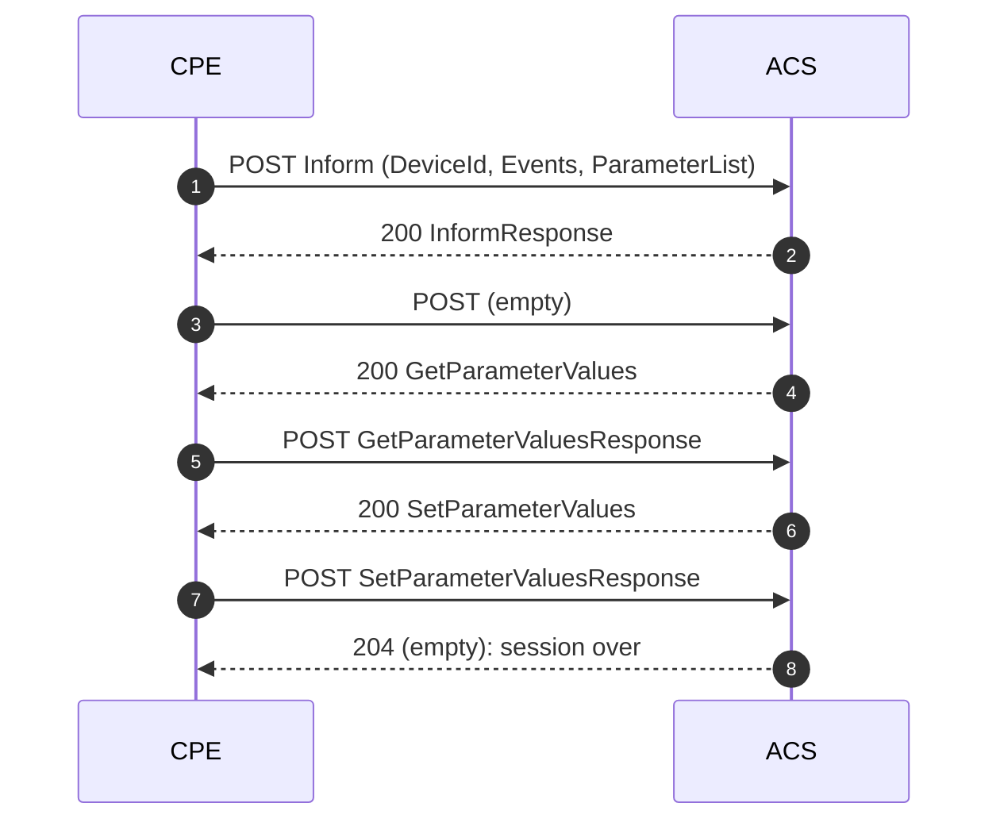

# TR-069 primer

A short introduction to TR-069 (CWMP) for readers who are new to it, and how each part shows up in AcsTool. It covers what you need in order to read the feed and the detail pane; for the full protocol, see the Broadband Forum's TR-069 specification.

## The two roles

- **CPE** (Customer Premises Equipment): the router, ONT, set-top box or other device at the customer site.
- **ACS** (Auto-Configuration Server): the management server, e.g. GenieACS, Axiros, Friendly, or a vendor ACS.

**The CPE always opens the connection.** It sends HTTP POSTs to the ACS URL it has been given, and the ACS sends its commands back in the HTTP *responses*. That's why a proxy in the middle sees the whole conversation, and why a simulator only needs to be an HTTP client.

| In AcsTool | Plays |
|---|---|
| Proxy tab | Sits between a real CPE and a real ACS |
| Simulator tab | Plays the CPE in front of a real ACS (directly, or through the proxy) |

## Messages

Every message is a SOAP 1.1 envelope (XML) in an HTTP body. The CWMP namespace says which protocol version is used: `urn:dslforum-org:cwmp-1-0` up to `cwmp-1-4`. A `cwmp:ID` header pairs each request with its response.

An **empty HTTP POST** (no body) from the CPE means "I have nothing more to send, what do you want?". An **empty HTTP response** (`204`, or `200` with no body) from the ACS means "nothing more, goodbye".

## A session



1. **Inform.** The CPE says who it is (`DeviceId`: manufacturer, OUI, product class, serial), why it's calling (`Event` codes) and some key values (`ParameterList`).
2. **InformResponse.** The ACS acknowledges. `MaxEnvelopes` is always 1 in practice.
3. **Empty POST.** The CPE has no requests of its own (it could send e.g. `TransferComplete` here).
4–7. **ACS RPCs.** The ACS sends one command per HTTP response; the CPE answers each one in its next POST.
8. **Empty response.** The ACS is done; the CPE closes the session.

The ACS keeps track of which session a POST belongs to by cookie or by TCP connection. HTTP authentication (Basic or Digest) happens on the first POST.

### How AcsTool shows this

In the feed, a session is one row; in the detail pane's **Messages** tab, it's the list of exchanges above:

| # | Request | Response |
|---|---|---|
| 1 | `Inform 00D09E-SIM098001 [1 BOOT] 8 params` | `200 InformResponse` |
| 2 | `(empty)` | `200 GPV ×2` |
| 3 | `GPVResponse ×2` | `200 SPV ×1` |
| 4 | `SPVResponse status=0` | `204` |

The row's **Outcome** says how it ended (see [Outcomes](proxy-mode.md#session-outcomes)); **Msgs** counts the exchanges.

## Event codes

Events tell the ACS why the CPE is calling. Several can be sent together.

| Code | Meaning | In the simulator |
|---|---|---|
| `0 BOOTSTRAP` | First contact with this ACS (fresh install, factory reset, new ACS URL) | ✓ |
| `1 BOOT` | Device (re)booted | ✓ (default) |
| `2 PERIODIC` | Regular periodic Inform | ✓ (manual tick only; no timer yet) |
| `3 SCHEDULED` | Requested earlier by `ScheduleInform` | — |
| `4 VALUE CHANGE` | A parameter with notification on has changed | ✓ (manual tick only) |
| `6 CONNECTION REQUEST` | The ACS asked the CPE to call in | ✓ (sent when no event is ticked) |
| `7 TRANSFER COMPLETE`, `M Download`, `M Reboot`, … | Follow-ups to earlier commands | — (not yet) |

`M …` events carry a **CommandKey**, an ID the ACS gave in the original command.

## Parameters and data models

The CPE's configuration is a tree of named parameters. Object names end with `.`; leaf parameters have a type and a value:

```text
InternetGatewayDevice.DeviceInfo.SoftwareVersion = "1.0.0"     (xsd:string, read-only)
InternetGatewayDevice.ManagementServer.PeriodicInformInterval = 300   (xsd:unsignedInt, writable)
```

Two data models are common:

| Model | Root | Used by |
|---|---|---|
| **TR-098** | `InternetGatewayDevice.` | Older gateways |
| **TR-181** (Device:2) | `Device.` | Newer devices of all kinds |

The simulator has a template for each (**+ From TR-098**, **+ From TR-181**). Some parameters are **mandatory in every Inform** for the chosen root; the simulator always sends them (see [the table in simulator-mode.md](simulator-mode.md#parameterlist)).

Types are XML Schema types: `xsd:string`, `xsd:int`, `xsd:unsignedInt`, `xsd:boolean` (`0`/`1`/`true`/`false`), `xsd:dateTime`, `xsd:base64`, and so on.

## Common RPCs

Sent by the ACS to the CPE:

| RPC | What it does | AcsTool simulator |
|---|---|---|
| `GetRPCMethods` | Lists the RPCs the CPE supports | ✓ |
| `GetParameterNames` | Lists names under a path (and whether writable) | ✓ |
| `GetParameterValues` | Reads values | ✓ |
| `SetParameterValues` | Writes values; `ParameterKey` is stored in `ManagementServer.ParameterKey` | ✓ |
| `GetParameterAttributes` / `SetParameterAttributes` | Read/set notification and access lists | — (Fault 9000) |
| `AddObject` / `DeleteObject` | Create/remove an instance of a multi-instance object | — (Fault 9000) |
| `Reboot`, `FactoryReset` | Restart / reset the device | — (Fault 9000) |
| `Download`, `Upload` | Firmware or config transfer | — (Fault 9000) |
| `ScheduleInform` | Ask for an Inform later | — (Fault 9000) |

The proxy forwards **every** RPC unchanged, including ones it doesn't recognize; the feed and Summary tab just name them.

## Faults

An error is a SOAP Fault with a CWMP fault code:

| Code | Meaning |
|---|---|
| `8000`–`8899` | ACS fault codes (e.g. `8005` retry request), sent by the ACS |
| `9000` | Method not supported |
| `9001` | Request denied |
| `9002` | Internal error |
| `9003` | Invalid arguments |
| `9005` | Invalid parameter name |
| `9006` | Invalid parameter type |
| `9007` | Invalid parameter value |
| `9008` | Attempt to set a non-writable parameter |

A `SetParameterValues` fault lists one `SetParameterValuesFault` entry per bad parameter. AcsTool shows the code and string in the Summary tab and in the Messages list (e.g. `Fault 9005 Invalid parameter name`).

## Connection requests

To make a CPE call in now, the ACS sends an HTTP GET to the CPE's `ManagementServer.ConnectionRequestURL`, and the CPE then starts a session with event `6 CONNECTION REQUEST`. AcsTool doesn't receive connection requests yet; use **Send Inform now** in the simulator instead (with no event ticked it sends `6 CONNECTION REQUEST`).

## Ports and URLs

- `7547` is the IANA port for CWMP and the usual CPE connection-request port; many lab ACSs also listen on it. AcsTool's proxy uses 7547 by default.
- `7557` is GenieACS's CWMP port, which is why the default upstream is `http://localhost:7557`.
- The ACS URL often has a path (`/acs`, `/tr069`, `/cwmp`), which the proxy passes through by default.
