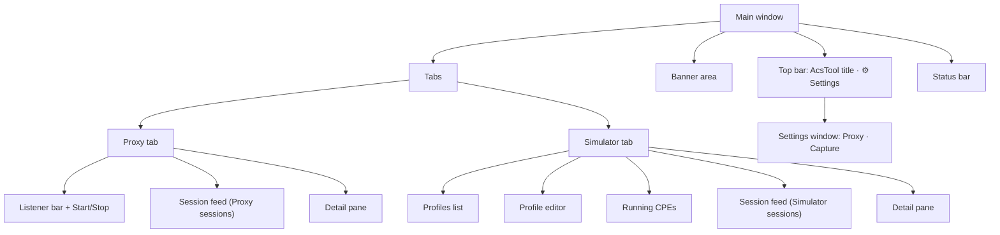

# UI tour

Every window, tab and control in AcsTool, with what it does and its default. Everything here comes from the XAML views in `src/AcsTool.App/Views/` and their view models in `src/AcsTool.Presentation/`.



## Main window

Title: **AcsTool — TR-069 Proxy & Inform Simulator**. Default size 1280 × 820, minimum 640 × 480, centered on screen. The app is per-monitor DPI aware.

### Top bar
- **AcsTool** label on the left.
- **⚙ Settings** button on the right opens the [Settings window](#settings-window). It is modal and always reloads the current values when it opens.

There is no menu bar and no Export button in this version.

### Banner area
Colored strips under the top bar. Each has a **dismiss** button. Colors: light blue = info, yellow = warning, red = error, green = success. A banner with the same purpose replaces the previous one instead of stacking.

| Banner text (start) | Kind | When |
|---|---|---|
| *Windows Firewall may prompt; allow Private networks so modems can reach the proxy.* | Info | Every app start |
| *settings.json was corrupt and was backed up to settings.json.bad-…; defaults loaded.* | Warning | `settings.json` could not be parsed |
| *Port N is already in use…*, *Access denied binding…*, *Address … is not available on this PC…*, *Could not listen on…* | Error | Proxy Start failed to bind |
| *Proxy failed to start: …* | Error | Any other Start failure, for example a missing custom CA file |
| *Upstream base URL has a path; Digest auth may fail (uri mismatch)* | Warning | Proxy started with an upstream URL that has a path and Path mode `PassThrough` |
| *TLS validation disabled for the upstream ACS* | Warning | Proxy started with an `https://` upstream and TLS mode `IgnoreErrors` |
| *Profile 'X' has N validation error(s)* | Error | Simulator **Save** with invalid fields |
| *Cannot start 'X': …* / *Profile is invalid: …* | Error | Simulator **Start** or **Send Inform now** refused |
| *The password of 'X' could not be decrypted for this Windows user; re-enter it before starting.* | Warning | Profiles loaded with a DPAPI password from another user or PC |
| *Unexpected error: …* | Error | An unhandled UI error (the app keeps running; details in the log) |

### Status bar
One line, updated live:

```
Proxy: Running · active 2 · sessions 148 · capture 3.4 MB / 256 MB · dropped 0
```

| Part | Meaning |
|---|---|
| `Proxy: <state>` | `Stopped`, `Starting`, `Running`, `Stopping` or `Faulted` |
| `active` | Sessions (proxy **and** simulator) still in progress |
| `sessions` | Sessions held in memory (both sources) |
| `capture X MB / Y MB` | Estimated memory used by captured messages vs. the capture budget ([Capture settings](settings-reference.md#capture-section)) |
| `dropped` | Change notifications dropped because the UI could not keep up. Non-zero is harmless: the feed re-syncs itself. |

### Keyboard shortcuts

| Key | Action |
|---|---|
| **F5** | Start or stop the proxy (works on both tabs) |
| **Ctrl+L** | Clear the **Proxy** feed (works on both tabs, but always clears the Proxy feed) |

### Closing the window
Closing disables the window, stops the proxy (open sessions end as **Canceled**), stops all simulated CPEs, saves `settings.json`, flushes the log and exits. This normally takes a few seconds.

---

## Proxy tab

```
┌ Listen [0.0.0.0 ▾] Port [7547] → Upstream [http://localhost:7557      ] TLS [Strict ▾] Cookies [PassThrough ▾] ┐
│ [▶ Start]  Stopped                                                                                         │
├──────────────────────── Session feed ─────────────────────┬────────────── Detail pane ──────────────────────┤
```

Minimum size 760 × 420; scrollbars appear only when the window is smaller.

### Listener bar
All fields are editable only while the proxy is **Stopped** or **Faulted** (tooltip: *Changes apply on the next Start*). Invalid values get a red border and the **▶ Start** button is disabled.

| Control | Default | What it does | Validation |
|---|---|---|---|
| **Listen** (editable drop-down) | `0.0.0.0` | Local address the listener binds to. The list offers `0.0.0.0` (all interfaces), `127.0.0.1` (this PC only) and every IPv4 address of your active, non-loopback network adapters. You can also type an address, e.g. an IPv6 one, or `localhost`. | Must be an IP address or `localhost` |
| **Port** | `7547` | TCP port of the listener. | 1–65535 |
| **→ Upstream** | `http://localhost:7557` | Base URL of your ACS. Every CPE request is forwarded here. | Absolute `http://` or `https://` URL with a host and **no** `user:password@` |
| **TLS** | `Strict` | Certificate validation for an `https://` upstream: `Strict`, `IgnoreErrors`, `PinnedThumbprint`, `CustomCa`. See [proxy-mode.md](proxy-mode.md#https-upstream-and-tls-modes). | |
| **Cookies** | `PassThrough` | `PassThrough` relays cookies between CPE and ACS (with `Set-Cookie` rewriting); `ManagedPerCpe` keeps a cookie jar per session inside the proxy. | |

Clicking Start copies these five values into the current settings. They are written to `settings.json` the next time settings are saved (Settings window **Save**, or app close). After **Stop**, and after a failed Start, the fields reload from the saved settings, so changes made in the Settings window while the proxy ran take effect now.

### Start/Stop row

| Control | What it does |
|---|---|
| **▶ Start** / **⏹ Stop** (F5) | Starts or stops the listener. Stop waits up to 5 s for in-flight requests, then aborts them; open sessions end as **Canceled**. |
| State text | `Stopped`, `Starting`, `● Running on <URLs>`, `Stopping`, or `✖ Failed to start` (details in a red banner). |
| URL buttons `⧉ http://…:7547` | One per address the proxy can be reached at. With `0.0.0.0` you get one per local IPv4 address. Click to copy the URL to the clipboard, ready to paste into a CPE's ACS URL. The copied URL has no path; add one if your ACS needs it. |

### Session feed and detail pane
The left half is the [session feed](#session-feed-shared), showing **Proxy** sessions only. The right half is the [detail pane](#detail-pane-shared) for the selected session. Drag the vertical splitter to resize them (each side keeps at least 300 px).

---

## Simulator tab

Three rows: the profile area (top), a splitter, and the lower pane with **Running CPEs**, the feed and the detail pane. Minimum size 900 × 560. Drag the horizontal splitter to give the editor or the lower pane more room; the editor scrolls on its own when it is short.

### Profiles list (top left)

| Control | What it does |
|---|---|
| **Profiles** list | All saved profiles, sorted by name when loaded (new profiles are added at the end). A leading **●** marks unsaved changes. Selecting a profile opens it in the editor. Unsaved edits stay in memory while you switch profiles, until the app closes. |
| **+ From TR-098** | New profile from the TR-098 (`InternetGatewayDevice.`) template, named *New TR-098 profile*, serial `SIM098001` (or the next free number). Not saved until you click **Save**. |
| **+ From TR-181** | Same with the TR-181 (`Device.`) template, serial `SIM181001`, product class `Device2`. |

The editor is hidden when no profile is selected. The data model root (TR-098 or TR-181) is fixed by the template you start from.

### Profile editor: command bar

| Control | What it does |
|---|---|
| **Profile** | Profile name. Required. |
| **Save** | Validates and writes the profile to `%APPDATA%\AcsTool\profiles\<id>.json`. Errors are listed in red under the bar. |
| **Delete** | Stops the profile's CPE if it runs, deletes the file and removes the profile. **No confirmation.** |
| **▶ Start CPE** | Validates the current editor values (saved or not) and starts a simulated CPE for this profile. It sends nothing yet. If the profile already runs, nothing happens. |
| **⏹ Stop** | Stops this profile's CPE. A session in progress ends as **Canceled**. |
| **✉ Send Inform now** | Starts the CPE if needed, then queues an Inform with the events ticked in the **Events** box. |
| **■ Stop all** | Stops every running CPE. |

Validation errors appear in red under the bar as `Field: message`, for example `DeviceId.OUI: OUI must be 6 upper-case hex digits (e.g. 00D09E)`.

> A running CPE keeps the profile values it was started with. After editing DeviceId, ACS, credentials, timeout or parameters, click **⏹ Stop** and start again. The **Events** box is the exception: **Send Inform now** always uses the boxes ticked right now.

### Profile editor: Device box

| Field | Template default | Inform field | Rule |
|---|---|---|---|
| **Manufacturer** | `AcsTool` | `DeviceId/Manufacturer` | Required unless ProductClass is set |
| **OUI** | `00D09E` | `DeviceId/OUI` | Exactly 6 hex digits; typed in upper case, max 6 characters |
| **ProductClass** | `IGD` (TR-098), `Device2` (TR-181) | `DeviceId/ProductClass` | |
| **Serial** | `SIM098001`… / `SIM181001`… | `DeviceId/SerialNumber` | Required; must be unique among running CPEs with the same OUI |

### Profile editor: ACS box

| Field | Default | What it does | Rule |
|---|---|---|---|
| **URL** | `http://127.0.0.1:7547/acs` (the local proxy) | Where the CPE posts its Informs | Absolute `http://` or `https://` URL |
| **User** | empty | Username for HTTP Basic or Digest auth | |
| **Password** | empty | Password, shown as dots. Stored DPAPI-encrypted for your Windows user (tooltip *Stored with DPAPI (current Windows user)*). If it can't be decrypted, a red note says *Stored password could not be decrypted for this Windows user; re-enter it.* | |
| **cwmp** | `V1_0` | CWMP version: `V1_0` … `V1_4`. Sets the `urn:dslforum-org:cwmp-1-x` namespace of every message. | |
| **Timeout (s)** | `30` | Per-request timeout. The TCP connect timeout is the smaller of this and 10 s. | 1–600 |

### Profile editor: Events box
A check box for every standard event code (`0 BOOTSTRAP` … `14 HEARTBEAT`) and every method event (`M Reboot`, `M ScheduleInform`, `M Download`, `M ScheduleDownload`, `M Upload`, `M ChangeDUState`). `M …` events get a small **CommandKey** text box. Templates tick `1 BOOT`.

| Control | What it does |
|---|---|
| Event check boxes | Ticked events are the profile's default events and are sent by **Send Inform now**. |
| CommandKey box (M events only) | CommandKey sent with that event. |
| **Custom** + **+** | Adds your own event code (e.g. `X ACME BOOT`), ticked. Duplicates are ignored. |

If no event is ticked, the Inform carries `6 CONNECTION REQUEST`.

### Profile editor: Parameters box

| Control | What it does |
|---|---|
| **+ Add** | Adds a row `<root>X_New.ParameterN`, type `xsd:string`, empty value. Rename it in the grid. |
| **Reset to defaults** | Replaces the list with the template parameters (using the current DeviceId). |
| Grid | Editable. Columns below. Rows can't be deleted from the grid in this version; use **Reset to defaults**, or edit the profile JSON. |

| Column | Meaning |
|---|---|
| **Name** | Full parameter path; must start with the profile root (`InternetGatewayDevice.` or `Device.`), must not end with `.` or contain `..`, and must be unique. |
| **Type** | `xsd:string`, `xsd:int`, `xsd:unsignedInt`, `xsd:long`, `xsd:unsignedLong`, `xsd:boolean`, `xsd:dateTime`, `xsd:base64`, `xsd:hexBinary`. The value must match the type. |
| **Value** | Current value, returned by GetParameterValues and sent in the Inform when included. |
| **W** | Writable: whether SetParameterValues may change it (otherwise fault 9008). |
| **Inf** | Include in every Inform's ParameterList. Locked on for the mandatory Inform parameters. |
| **N** | Notification attribute, 0–2. Stored and validated, but not used by the simulator in this version. |
| **🔒** | `True` for mandatory Inform parameters of the data model; their **Inf** flag cannot be cleared. |

### Running CPEs
Header: `Running CPEs  N running · N in session · N error`. The grid (max 140 px tall) has one row per simulated CPE:

| Column | Meaning |
|---|---|
| **Device** | Device key `OUI-Serial`, e.g. `00D09E-SIM098001` |
| **State** | `Idle` (waiting), `InSession`, `Error` (last session failed), `Stopped`. A row is removed from the list when its CPE is stopped, so `Stopped` is rarely seen. |
| **Retry** | Failed sessions in a row. Sent as the Inform `RetryCount`; reset to 0 after a completed session. |
| **Last outcome** | Outcome badge of the last session, e.g. `✔ Completed` |
| **Sessions** | Sessions run since the CPE started |
| **Last error** | Short error of the last failed session, e.g. `UpstreamError: CONNECT ConnectionRefused` |
| **Inform** button | Sends an Inform with the default events the CPE was **started** with (not the current check boxes). |

### Session feed and detail pane
Under Running CPEs: the [session feed](#session-feed-shared) with **Simulator** sessions only, and the [detail pane](#detail-pane-shared).

---

## Session feed (shared)

Used on both tabs; each tab has its own feed and only shows its own source.

### Toolbar

| Control | Default | What it does |
|---|---|---|
| **Filter** | empty | Case-insensitive text match on device key, client endpoint, types of the messages the CPE sent in the session (e.g. `Inform`, `Empty`, `GetParameterValuesResponse`, `Fault`) and error text. Applies 250 ms after you stop typing. |
| **Outcome** | `All` | `All`, `ErrorsOnly` (anything except Completed and In progress), `InProgress`, `Completed` |
| **⏸ Pause** (toggle) | off | Freezes the list. Updates are collected and applied when you un-pause; sessions evicted meanwhile do not reappear. Capture continues in the background. |
| **⟲ Clear** | | Deletes this tab's sessions from memory. The other tab's sessions are kept. |
| **Auto-scroll** | on | Scrolls to each new session. |
| *N sessions* | | Number of sessions in this feed (before filtering). |

New sessions appear at the top. The feed keeps at most **Feed max items** sessions (default 2000), dropping the oldest.

### Columns

| Column | Meaning |
|---|---|
| **Time** | Session start, local time `HH:mm:ss.fff` |
| **Device** | Device key `OUI-Serial` from the Inform. For requests that could not be tied to an Inform: `Unknown session from <ip>`, `Non-CWMP request` or `Request body too large`. |
| **Client** | CPE address `ip:port` (Proxy) or `sim:<device key>` (Simulator) |
| **Events** | Event codes, numeric ones shortened: `0,1` = `0 BOOTSTRAP`, `1 BOOT`; `M Reboot` stays as is |
| **Ex** | Number of HTTP exchanges (request/response pairs) |
| **Outcome** | Badge, see the table below |
| **Duration** | Total session time in ms (empty while in progress) |

When a session has an error, a red line under the row shows it: the last classified error, e.g. `CONNECT ConnectionRefused: Connection refused`, or, for an error outcome without one, the session's last note. Row backgrounds: green for Completed, pale blue for In progress, red for Upstream error and Auth failed, amber for ACS fault, CPE fault, HTTP error and Protocol error, white otherwise.

| Badge | Outcome |
|---|---|
| `⧗ In progress` | InProgress |
| `✔ Completed` | Completed |
| `✖ Upstream error` | UpstreamError |
| `🔒 Auth failed` | AuthFailed |
| `⚠ ACS fault` | AcsFault |
| `⚠ CPE fault` | CpeFault |
| `⚠ HTTP error` | HttpError |
| `⚠ Protocol error` | ProtocolError |
| `⌛ Abandoned` | Abandoned |
| `↷ Superseded` | Superseded |
| `⊘ Canceled` | Canceled |

What each outcome means for the proxy and the simulator: [proxy-mode.md](proxy-mode.md#session-outcomes) and [simulator-mode.md](simulator-mode.md#session-outcomes).

## Detail pane (shared)

Shows *Select a session* until you click a feed row.

### Header
- **Session** `<device key>   <client endpoint>`
- **Started** `yyyy-MM-dd HH:mm:ss.fff` · **Duration** `N ms` or `in progress` · outcome badge
- **Events:** full event codes with CommandKeys, e.g. `1 BOOT; M Reboot (rb1)` · CWMP version (`cwmp-1-0`, or `unknown`) · `→` target URL
- TLS line, only for HTTPS upstream sessions in the Proxy tab: `<certificate subject> · issuer <issuer> · <policy errors>` (e.g. `None`, `RemoteCertificateChainErrors`)
- Error line in red: the last classified error
- Session notes as bullets, e.g. `• ambiguous correlation by IP`, `• CPE disconnected before response relayed` (proxy) or `• ACS fault 8005 Retry request` (simulator). Notes recorded on single exchanges (auth challenges, cookie rewrites, 3xx Location) are not shown yet; see [roadmap](roadmap.md#planned-fixes-for-known-issues).

### Exchanges grid

| Column | Meaning |
|---|---|
| **#** | Exchange number in the session |
| **Request** | One-line summary, e.g. `Inform 00D09E-SIM098001 [1 BOOT] 8 params`, `GPVResponse ×3`, or `(empty)` |
| **Response** | Status and summary, e.g. `200 InformResponse`, `204`, `401`; or the error class (`CONNECT ConnectionRefused`, `TIMEOUT AwaitingResponse`); `…` while pending |
| **ms** | Total time of the exchange |

Selecting an exchange fills the three tabs below. The splitter between the grid and the tabs is draggable.

### Summary tab
Two name/value lists, **Request** and **Response**, with the parsed fields of each message: `Method`, `cwmp:ID`, `HoldRequests`, `Version`, then message-specific fields, for example for an Inform: `DeviceId` (`Manufacturer / OUI / ProductClass / Serial`), `Events`, `RetryCount`, `MaxEnvelopes`, `CurrentTime` and one line per parameter (`name` → `value (type)`). Lists longer than 200 items end with `… and K more — see the Raw view`. A classified error is shown in red below.

### Headers tab
- **Reveal Authorization** check box (off): while off, `Authorization` and `Proxy-Authorization` values are masked, e.g. `Basic <redacted user=cpe1>` or `Digest username="cpe1" <redacted>`. Tick it to see the real value.
- **Request headers** and **Response headers** grids (Name, Value). For proxy sessions these are the headers the CPE sent and the headers the ACS returned, before the proxy's rewriting.

### Raw tab
- **Pretty**: formats the XML (indentation). The setting is per exchange: each exchange starts unformatted. Formatting runs in the background; invalid XML or text over 2 million characters is shown unchanged.
- **Copy request** / **Copy response**: copy the raw body to the clipboard.
- Two read-only monospace boxes: request body (top) and response body (bottom), with a splitter. Only bodies are shown; headers are on the Headers tab.
- A yellow strip like `Captured 1 MiB of 3.2 MiB` appears when a body was larger than **Max captured body** and was truncated in memory (the full body was still forwarded).

---

## Settings window

Opened with **⚙ Settings**. Size 640 × 560, resizable. Pages on the left: **Proxy** and **Capture**. Footer text: *Proxy changes apply on the next Start.*

| Button | What it does |
|---|---|
| **Restore defaults** | Fills both pages with default values (not saved until **Save**). Also resets settings that have no field here, such as `tls` and `maxRequestBodyBytes`; see the warning in [settings-reference.md](settings-reference.md#restore-defaults). |
| **Cancel** (Esc) | Discards edits. |
| **Save** (Enter) | Validates, writes `settings.json` and applies the values. A field with a validation error (red border) blocks saving. |

### Proxy page

| Field | Default | Range / choices |
|---|---|---|
| Bind address | `0.0.0.0` | required |
| Port | `7547` | 1–65535 |
| Upstream ACS URL | `http://localhost:7557` | absolute http(s) URL, no user:password |
| Path mode | `PassThrough` | `PassThrough`, `Fixed` |
| Fixed upstream path | empty | used when Path mode is `Fixed` |
| Host header | `Upstream` | `Upstream`, `Preserve` |
| Cookie mode | `PassThrough` | `PassThrough`, `ManagedPerCpe` |
| Strip Set-Cookie Domain | on | |
| Strip Set-Cookie Secure when the CPE leg is HTTP | on | |
| Add X-Forwarded-For | off | |
| Upstream failure | `StatusCode` | `StatusCode`, `Abort` |
| Connect timeout (s) | `10` | 1–300 |
| Request timeout (s) | `30` | 1–3600 |
| Session idle timeout (s) | `30` | 1–3600 |
| Use the system proxy for upstream | off | |
| Start the proxy on launch | off | |

### Capture page

| Field | Default | Range |
|---|---|---|
| Max sessions | `5000` | 10–1,000,000 |
| Max captured body (KiB) | `1024` | 1–102,400 |
| Capture budget (MiB) | `256` | 16–16,384 |
| Feed max items | `2000` | 100–100,000 |

Every field is explained in [settings-reference.md](settings-reference.md).
